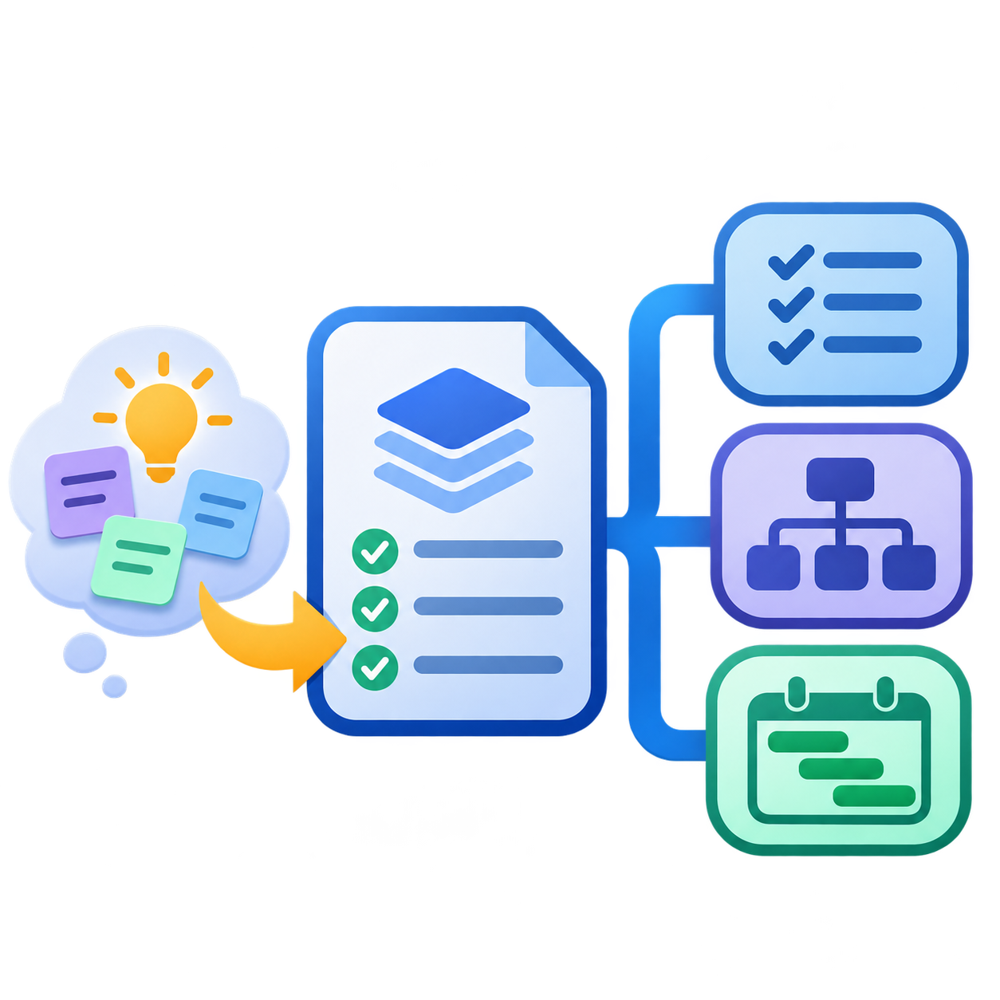

# SDD Bootstrap Skill

**SDD Bootstrap** is a provider-agnostic skill for turning informal software and IT solution ideas into **clear specifications, justified architecture decisions, and implementation-ready project plans**.

It is designed to support **collaborative discovery**, **ambiguity resolution**, **traceable decision-making**, and **structured handoffs** to human developers or AI coding agents.

> [!IMPORTANT]
> This skill produces a **project bootstrap**, not an implemented or deployed application.
> It helps participants clarify requirements, evaluate architecture, and prepare a repository and roadmap that other agents or developers can execute.

## What it does

SDD Bootstrap is meant to help when you need to:

- explore or clarify a software or IT solution idea;
- transform notes, sketches, documents, or existing context into structured specifications;
- identify ambiguities, assumptions, and high-impact open questions;
- evaluate architectural and technological options without prematurely locking decisions;
- define project conventions and collaboration boundaries;
- prepare a repository handoff and an actionable development roadmap.

Its guiding principles include:

- **human authority over consequential decisions**;
- **constructive disagreement and collaborative reasoning**;
- **clear distinction between facts, proposals, and approved decisions**;
- **provider neutrality** across models, tools, and platforms;
- **traceability** between requirements, decisions, tasks, and verification.

## Concept at a glance

The skill takes **informal ideas** and helps transform them into an **implementation-ready bootstrap**.



## Repository layout

This repository is a **distribution repository**. The installable skill lives in the `sdd-bootstrap/` directory.

```text
sdd-bootstrap-skill/
├── README.md
├── LICENSE
├── assets/
│   └── sdd-bootstrap-overview.png
└── sdd-bootstrap/
    ├── SKILL.md
    ├── agents/
    │   └── openai.yaml
    ├── assets/
    │   ├── icon-small.svg
    │   ├── icon-large.svg
    │   └── icon-large.png
    └── references/
        ├── PROJECT_CONVENTIONS.md
        └── [13 supporting research reports].md
```

- The **repository name** is `sdd-bootstrap-skill` for clarity on GitHub.
- The **skill name** is `sdd-bootstrap`, which is the installable identifier used by agents and skill managers.

## Installation

### Recommended: install with Skills CLI

If your target environment supports the Agent Skills ecosystem, the simplest option is to install directly from GitHub:

```bash
npx skills add s1vh/sdd-bootstrap-skill --skill sdd-bootstrap
```

This is the recommended route because it lets the skill manager place the skill in the correct location for the selected agent.

### Manual installation

If you prefer to install manually, clone this repository first, then copy the **`sdd-bootstrap/` directory** into the appropriate skills folder for your agent. Run the commands below from the directory containing the cloned repository unless otherwise indicated.

```bash
git clone https://github.com/s1vh/sdd-bootstrap-skill.git
```

#### Codex / OpenCode (project-local)

```bash
mkdir -p .agents/skills
cp -R sdd-bootstrap-skill/sdd-bootstrap .agents/skills/
```

Expected result:

```text
.agents/skills/sdd-bootstrap/
```

#### Codex / OpenCode (user-global)

```bash
git clone https://github.com/s1vh/sdd-bootstrap-skill.git /tmp/sdd-bootstrap-skill
mkdir -p ~/.agents/skills
cp -R /tmp/sdd-bootstrap-skill/sdd-bootstrap ~/.agents/skills/
```

#### Claude Code (project-local)

```bash
mkdir -p .claude/skills
cp -R sdd-bootstrap-skill/sdd-bootstrap .claude/skills/
```

Expected result:

```text
.claude/skills/sdd-bootstrap/
```

> [!NOTE]
> Different tools may vary in how they discover or invoke skills. The installation paths above reflect common conventions for local project skills, but the exact invocation experience depends on the host environment.

## Usage

Once installed, ask the agent to use **`sdd-bootstrap`** for the current task.

Depending on the tool, the invocation may look different. Typical patterns include:

- `$sdd-bootstrap`
- `@sdd-bootstrap`
- `/sdd-bootstrap`
- or simply an explicit natural-language instruction such as:

```text
Use the sdd-bootstrap skill to turn this project idea into an implementation-ready bootstrap. Start with collaborative discovery, identify consequential ambiguities, and avoid locking architecture decisions prematurely.
```

A good first prompt usually includes:

- the project idea or current problem;
- any existing notes, requirements, or links;
- known constraints or preferences;
- whether you want exploration, a partial bootstrap, or a full bootstrap.

## Reference library

The skill includes a local reference library under `sdd-bootstrap/references/`:

- `PROJECT_CONVENTIONS.md` — the accepted methodology baseline;
- thirteen supporting research reports covering elicitation, requirements, architecture, quality, verification, deployment, MCP discovery, and related topics.

These references are meant to **support** the skill's reasoning.

- `PROJECT_CONVENTIONS.md` is the normative baseline for generated project conventions.
- The other reports are supporting research, not automatically approved project decisions.

## Compatibility and portability

This repository is intentionally structured to keep the skill portable across different agent ecosystems.

- It does **not** depend on ChatGPT Projects or a specific conversation history.
- It does **not** require MCP integrations to be useful.
- It is meant to remain usable from public GitHub distribution plus local installation.

A public GitHub repository is therefore a practical distribution channel, but **reading the README alone does not activate the skill**. The skill still needs to be installed or explicitly loaded by the target environment.

## Development status

This is an **early public version** of the skill.

It is intended to be:

1. tested on projects of different nature;
2. improved based on real bootstrap sessions;
3. refined over time for portability, reference loading, and workflow ergonomics.

Feedback, issue reports, and proposed improvements are welcome.

## License

This repository is distributed under the **MIT License**. See [`LICENSE`](./LICENSE).
