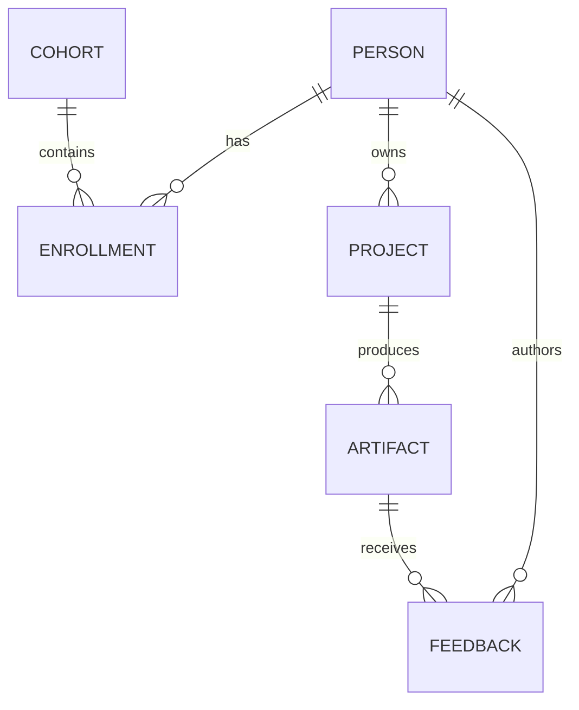
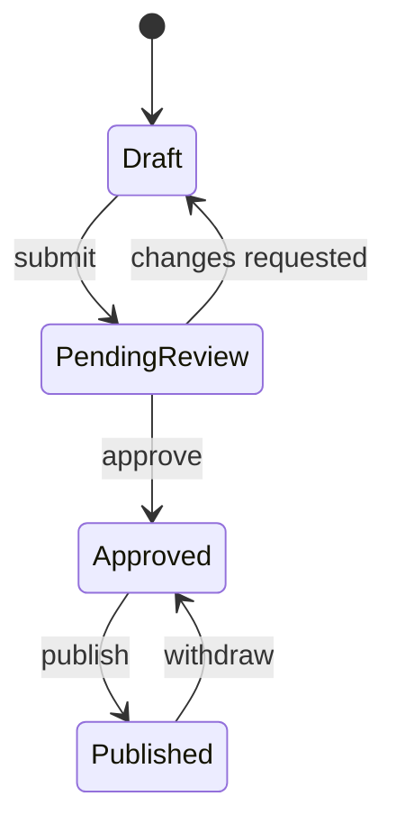
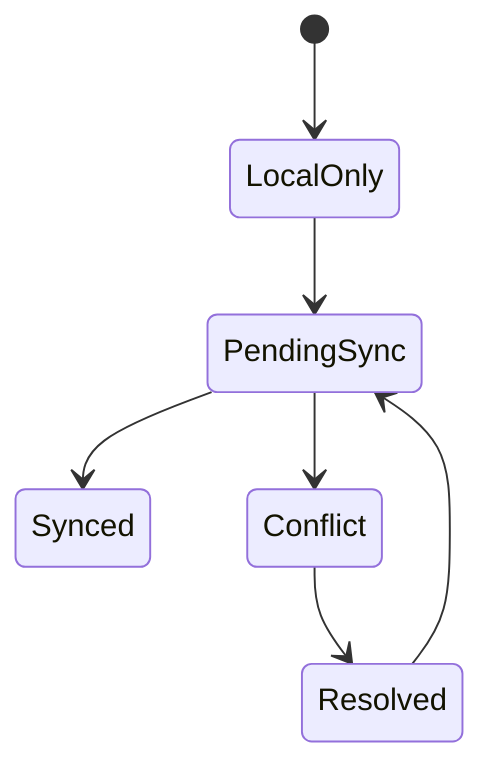

# Research 07 — Domain Modeling, Data Architecture & API Contracts

> **Editorial review — 11 November 2026.** Revised from the original Deep Research report, preserving its research scope and examples. Previously missing inline references were checked and repaired where possible; unsupported empirical assertions were qualified or corrected. Bibliographic links are standalone URLs, not inaccessible session IDs. This is a reference document, not execution evidence. See `CORRECTIONS.md` and `VERIFICATION_REPORT.md` in the accompanying archive.


## Executive synthesis

An SDD bootstrap process should model **meaning before mechanism**. The earliest durable artifacts should therefore capture shared language, actors, responsibilities, invariants, state transitions, ownership, data sensitivity, external dependencies, and observable interface semantics—not tables, endpoints, queues, or framework classes unless those implementation choices are already justified. This reflects a core Domain-Driven Design insight: large systems often need multiple internally consistent models rather than one universal model, and explicit boundaries become especially valuable where the same word carries different meanings in different parts of an organization. ([Fowler Bounded Context](https://martinfowler.com/bliki/BoundedContext.html))

The recommended bootstrap hierarchy is:

> **evidence → vocabulary → domain rules → boundaries → information needs → interface semantics → candidate representations → implementation choices**

This ordering is deliberately asymmetric. A stakeholder statement such as “mentors approve a portfolio” can justify investigating what *approve*, *mentor*, *portfolio*, and *ownership* mean. It does **not** yet justify inventing a `portfolio_approval` SQL table, a `POST /approvals` endpoint, Kafka, GraphQL, or a microservice. Those are downstream design options.

A useful distinction for the Skill is between four modeling layers:

| Layer | Primary question | Typical artifacts | Bootstrap status |
|---|---|---|---|
| Conceptual/domain | What exists, means, changes, and must remain true? | glossary, domain map, invariants, workflows, states | often warranted |
| Logical information | What information must be represented and related? | logical entities, attributes, ownership, cardinality, lifecycle | conditional |
| Interface/contract | What may one boundary promise another? | operations, commands, events, files, errors, compatibility rules | conditional |
| Physical implementation | How will this be stored, transported, indexed, partitioned, or deployed? | tables, indexes, brokers, protocol bindings, vendor schemas | generally defer unless decision-critical |

That separation prevents a conceptual domain model from silently becoming a database schema. It also permits static sites, CLI tools, embedded systems, games, and offline applications to pass through the same discovery process without being forced into CRUD/API/database assumptions.

The central design principle is therefore **proportional modeling**. A portfolio website with static content may need a content taxonomy and no database. A regulated integration service may need precise provenance, retention, authorization invariants, webhook semantics, idempotency and compatibility policy. A highly interactive domain may justify bounded contexts or state machines; a straightforward CRUD domain may not. Martin Fowler explicitly warns that CQRS, for example, can add substantial complexity and is inappropriate for many systems that fit a simpler CRUD model. ([Fowler CQRS](https://martinfowler.com/bliki/CQRS.html))

A bootstrap should also distinguish **semantic contracts** from **transport contracts**. “A learner may publish only artifacts they own and that are eligible for public visibility” is a semantic rule. An OpenAPI path describing `PATCH /artifacts/{id}` is a transport/interface description. Conformance to OpenAPI does not prove the semantic authorization rule has been implemented. Likewise, schema validation proves only properties expressible in that schema language; OpenAPI itself cautions that its schemas do not catch every specification violation. ([OpenAPI 3.2.1](https://spec.openapis.org/oas/v3.2.1.html))

As of **11 November 2026**, important contract specifications include OpenAPI 3.2.1, published 10 September 2026; JSON Schema 2020-12 as the current published JSON Schema specification; AsyncAPI 3.1.0; GraphQL’s latest released edition of September 2025; Apache Avro 1.12.0; CloudEvents 1.0.2; and OpenRPC 1.4.x. OpenAPI 3.2.0 appeared in September 2025, so references that still describe 3.1 as “latest” are now stale. ([OpenAPI 3.2.1](https://spec.openapis.org/oas/v3.2.1.html); [JSON Schema 2020-12](https://json-schema.org/draft/2020-12/); [AsyncAPI 3.1.0](https://www.asyncapi.com/docs/reference/specification/v3.1.0))

**Confidence:** high for the principles above; moderate for any universal claim about which modeling technique yields better project outcomes, because empirical comparisons among DDD, Event Storming, ER modeling, BPMN, API-first practices and lightweight alternatives remain highly context-dependent.

## Domain discovery, shared language, and proportional modeling

### Modeling the problem without prematurely fixing the solution

The **problem domain** describes the real or imagined world the software is intended to support: people, concepts, rules, activities, decisions, constraints and outcomes. The **solution domain** contains mechanisms introduced by the proposed system: databases, applications, services, queues, APIs, adapters, caches and deployment units. Bootstrap discovery should permit links between them but should not collapse them.

Consider:

```text
Domain fact:
A portfolio artifact has an author and may have a visibility decision.

Potential logical representation:
Artifact
- artifact_id
- author_id
- visibility

One possible physical representation:
artifacts(id UUID PRIMARY KEY, author_id UUID, visibility TEXT)

One possible interface:
PATCH /artifacts/{artifactId}/visibility
```

Only the first statement is intrinsically about the domain. Each successive representation makes additional decisions.

DDD terminology is useful when it clarifies complexity, but it should not be a compulsory ontology. A **bounded context** is particularly valuable when vocabulary changes meaning across organizational or system boundaries; Fowler’s description emphasizes that large domains become difficult to unify and that distinct contexts can intentionally maintain different models of common concepts. ([Fowler Bounded Context](https://martinfowler.com/bliki/BoundedContext.html))

A bootstrap vocabulary may therefore use the following terms without requiring tactical DDD implementation:

| Concept | Bootstrap interpretation |
|---|---|
| Entity | something whose identity matters over time |
| Value | something primarily distinguished by its properties |
| Invariant | condition that must remain true whenever the relevant operation completes |
| Policy | rule that may vary by context, jurisdiction, configuration or time |
| Aggregate / consistency boundary | candidate set of state requiring coordinated invariant enforcement |
| Domain event | meaningful fact that the domain considers to have happened |
| Bounded context | boundary inside which terminology/model semantics are internally coherent |
| Projection | representation derived from another authoritative representation |
| Source of truth | authoritative source for a specific fact—not necessarily for every fact about an object |

The last distinction is important. “User service is the source of truth for users” is usually too broad. It is better to say, for example, “Identity Provider A is authoritative for login identifier; Portfolio context is authoritative for public display biography.” Authority can be attribute-specific.

### Collaborative discovery

For uncertain domains, the bootstrap should allow multiple elicitation forms: interviews, examples, diagrams, event timelines, screenshots, voice transcripts, process maps and imported specifications. Every extracted statement should carry epistemic metadata such as:

```yaml
id: RULE-014
statement: "A mentor can review artifacts only for assigned learners."
status: proposed       # observed | proposed | approved | disputed | unknown
source:
  type: interview
  reference: "session-2026-11-10#18m32s"
authority:
  owner: "program operations"
confidence: medium
open_questions:
  - "Can substitute mentors review during absences?"
```

The distinction among **evidence**, **interpretation**, **assumption**, **decision**, and **open question** is more important than any specific modeling notation. It prevents an AI-generated diagram from acquiring authority simply because it looks polished.

A lightweight 30-minute discovery session can use five moves:

1. Ask for a concrete successful scenario and one failure scenario.
2. Identify nouns whose identity matters, verbs that change state, and terms whose meaning is disputed.
3. Ask “what must never happen?” to expose invariants.
4. Mark who owns each decision or piece of information.
5. Record unresolved terms and high-impact assumptions rather than forcing closure.

For deeper workshops, Event Storming, Domain Storytelling, journey mapping, state modeling, decision tables and context mapping can be combined. The method should follow the ambiguity: process ambiguity suggests workflow/event techniques; terminology ambiguity suggests glossary/context mapping; lifecycle ambiguity suggests state machines; data ownership ambiguity suggests CRUD/ownership matrices.

### Choosing modeling techniques by problem shape

| Technique | Particularly useful for | Main strength | Main failure mode |
|---|---|---|---|
| Glossary / ubiquitous language | almost every nontrivial project | exposes semantic disagreement cheaply | becomes dictionary without decisions |
| Event timeline / Event Storming | workflows and temporal domains | reveals commands, actors, events, exceptions | every event becomes a broker message |
| Domain Storytelling | stakeholder collaboration | accessible narrative model | may under-specify invariants |
| ERD | structured information relationships | cardinality/data structure clarity | physical-schema bias too early |
| State machine | lifecycle-heavy entities | explicit legal transitions | state explosion |
| Decision table | policy/rule combinations | exposes missing cases | poor for long temporal workflows |
| BPMN/activity model | operational processes | role/process clarity | diagram bureaucracy |
| Context map | large or integration-heavy domains | semantic and ownership boundaries | premature service decomposition |
| Capability map | organizational/product scope | separates capabilities from implementations | weak behavioral precision |
| Ontology / knowledge graph | genuinely semantic, relationship-rich domains | expressive vocabulary and inference | very high modeling overhead |
| C4 context | system/external boundaries | communication and architecture orientation | not a domain model |

Text-based diagrams are attractive for portable bootstrap repositories because they can be versioned and diffed. Mermaid supports ER, class, sequence and other diagram forms from textual definitions, while Structurizr DSL provides model-as-code specifically around C4 architectural models. ([Mermaid official](https://mermaid.js.org/); [Structurizr DSL](https://docs.structurizr.com/dsl))

The Skill should never infer that “bounded context” means “microservice.” Context boundaries are semantic boundaries; deployment topology is a separate architecture decision.

### Invariants, policies, and acceptance examples

An **invariant** should be written as a statement whose violation makes the domain state invalid, for example:

```text
INV-ART-01
An artifact cannot be publicly visible unless its owner has permission
to publish it and all required publication approvals are satisfied.
```

A policy is usually changeable without redefining the basic meaning of the domain:

```text
POL-ART-02
Current program policy requires mentor review before first public publication.
```

A user preference is weaker still:

```text
PREF-ART-03
A learner prefers portfolio items to default to private.
```

This hierarchy prevents temporary business policy from becoming a permanent database constraint or API assumption.

State transition models are especially good at uncovering hidden behavior:

| From | Action | To | Required condition |
|---|---|---|---|
| Draft | submit | PendingReview | owner is eligible |
| PendingReview | approve | Approved | reviewer authorized |
| PendingReview | request changes | Draft | reviewer authorized |
| Approved | publish | Published | visibility policy satisfied |
| Published | withdraw | Approved | owner or authorized admin |

Bootstrap should record concurrency questions explicitly: what if approval and withdrawal occur simultaneously? What establishes uniqueness? What makes retries safe? Which operation must be atomic? These questions influence later architecture without forcing an early implementation.

Money, time and identity deserve special treatment. The model should specify currency, rounding authority, timestamps versus local civil times, timezone semantics, stable identifiers, mutable display names, localization boundaries and whether historical rules must be reproducible. These are domain semantics before they are database types.

## Data architecture, ownership, lifecycle, and privacy

### Choose storage from information behavior, not fashion

A technology-neutral bootstrap should first capture **access patterns, integrity requirements, lifecycle, volume uncertainty and ownership**. Only then should it compare storage families.

| Model | Strong fit | Typical tradeoff |
|---|---|---|
| Relational | structured transactional data, integrity, joins, mature querying | schema evolution and object impedance require discipline |
| Document | aggregate-shaped documents, variable structures | duplication and cross-document consistency |
| Key-value | direct-key access, caching, simple state | limited relational querying |
| Graph | relationship traversal is first-class | operational/tooling complexity if relationships are incidental |
| Time-series | timestamped measurements | poor general-purpose transactional model |
| Search index | retrieval/ranking/full-text | usually a projection, not authoritative transactional source |
| Object/blob storage | large files/media/artifacts | metadata and transactional semantics live elsewhere |
| Event store | event history is itself authoritative | significant semantic and operational burden |

Event sourcing is much more than “keeping an audit log”: Fowler’s canonical description defines application changes as persisted events from which state may be reconstructed. That can support temporal reconstruction and replay, but it imposes strong modeling and evolution consequences. ([Fowler Event Sourcing](https://martinfowler.com/eaaDev/EventSourcing.html))

Likewise CQRS should not be selected simply because read models differ from write models. Fowler explicitly notes that many systems remain better served by a conventional CRUD approach and that CQRS introduces considerable complexity. ([Fowler CQRS](https://martinfowler.com/bliki/CQRS.html))

For many SDD bootstrap targets, a **single relational database**, static files, or even no persistent application data at all is the rational default until requirements demonstrate otherwise.

### Logical models before physical schemas

A logical model might say:

```yaml
entity: PortfolioArtifact
identity: artifact_id
attributes:
  owner_id:
    meaning: "identity of the learner or creator responsible for the artifact"
  title:
    required: true
  visibility:
    values: [private, cohort, public]
  created_at:
    semantics: "instant when artifact record was created"
relationships:
  - target: Feedback
    cardinality: zero-to-many
invariants:
  - INV-ART-01
authority:
  context: Portfolio
physical_mapping: deferred
```

The model intentionally avoids SQL types, indexes and vendor-specific constraints.

Normalization and denormalization should be treated as tradeoffs rather than ideology. Normalize when avoiding contradictory updates and expressing relationships clearly matters; denormalize when a proven access pattern justifies duplication and there is a documented synchronization authority.

### Consistency and integration

Strong consistency is appropriate when a business invariant must be checked against current authoritative state within one atomic operation. Eventual consistency is appropriate where temporary divergence is acceptable and reconciliation behavior is defined. The bootstrap must document the *business consequence of stale state*, not merely label the architecture “eventually consistent.”

Patterns such as outbox/inbox, change-data capture, sagas and compensating actions are escalation tools for distributed workflows, not default bootstrap machinery. Their introduction should be triggered by evidence that one logical business workflow spans independently committed systems and that failure/retry semantics matter.

A useful integration worksheet is:

```yaml
interaction: INT-07
producer: Portfolio
consumer: Notifications
fact: ArtifactPublished
delivery_requirement: at_least_once_candidate
duplicate_effect: "must not send duplicate public announcement"
ordering_requirement: "unknown"
failure_strategy: "retry + dead-letter candidate; not yet approved"
source_of_truth: Portfolio
decision_status: proposed
```

### Privacy and lifecycle by design

Data modeling must include why data exists, who can access it, how long it is needed, and what happens at deletion—not just its shape. Under GDPR Article 5, principles include purpose limitation, data minimization, accuracy, storage limitation, integrity/confidentiality and accountability. Lawfulness depends on an applicable legal basis, which must not be invented by a bootstrap agent. ([EU GDPR official](https://eur-lex.europa.eu/eli/reg/2016/679/oj))

For projects involving children, the bootstrap should escalate privacy/legal review rather than guess consent rules. The EDPB emphasizes additional protection for children and age-appropriate transparency; consent age can also vary across EU member-state law within the limits allowed by GDPR. ([EDPB children and privacy](https://www.edpb.europa.eu/sme-data-protection-guide/faq-frequently-asked-questions/answer/are-there-specific-safeguards-data_en); [EU GDPR official](https://eur-lex.europa.eu/eli/reg/2016/679/oj))

The bootstrap therefore asks:

```markdown
| Data class | Purpose | Subject | Authority | Access | Retention | Deletion | Legal review |
|---|---|---|---|---|---|---|---|
| Email | authentication/contact | learner | IdP? | learner/admin | UNKNOWN | UNKNOWN | REQUIRED |
| Portfolio image | publication | learner | Portfolio | configurable | UNKNOWN | user removal? | MAYBE |
| Mentor feedback | learning/review | learner | Feedback | learner/mentor | UNKNOWN | UNKNOWN | REQUIRED if minors |
```

“UNKNOWN” is preferable to fabricated certainty.

Retention and right-to-erasure analysis must consider backups, derived projections, search indexes, analytics exports, audit evidence and external processors. The bootstrap can flag these conflicts but cannot declare legal compliance.

The NIST Privacy Framework is useful as a technology- and jurisdiction-agnostic risk-management complement; NIST explicitly presents it as voluntary, outcome-based, flexible and not itself law. ([NIST Privacy Framework](https://www.nist.gov/privacy-framework))

Authorization should be modeled as a domain concern, not merely an API gateway setting. OWASP’s API Security Top 10 highlights object-level, property-level and function-level authorization failures, reinforcing the need to ask “who may act on this specific object/property/action?” at contract and domain-design time. ([OWASP API Top 10 2023](https://owasp.org/API-Security/editions/2023/en/0x00-header/))

## Interface contracts, compatibility, and evolution

### Not every boundary is an API

A bootstrap interface inventory should include internal module calls, HTTP APIs, RPC, GraphQL, events/messages, webhooks, CLI contracts, files, import/export formats, third-party APIs and—where actually useful—MCP tool contracts.

| Interface | Good fit | Main coupling |
|---|---|---|
| Internal module | same deployable/codebase | source/runtime |
| HTTP resource API | broad interoperability | URI/resource/schema semantics |
| RPC/gRPC | typed service operations | method/schema/runtime ecosystem |
| GraphQL | client-selected graph queries | shared schema/query semantics |
| Async message/event | temporal decoupling | message semantics and delivery assumptions |
| Webhook | external event notification | receiver availability/retry/idempotency |
| File/CSV | batch/interchange/manual workflows | file version/encoding/semantics |
| CLI | local automation/operator workflows | command/exit/output contract |
| MCP tool | agent-mediated capability | tool schema, trust and permissions |

HTTP semantics matter independently of framework conventions. RFC 9110 defines idempotence in terms of the intended server effect of repeated identical requests; PUT, DELETE and safe methods are defined as idempotent, while retrying non-idempotent methods automatically requires additional knowledge that retry semantics are safe. ([RFC 9110 HTTP semantics](https://www.rfc-editor.org/rfc/rfc9110.html))

Therefore a POST-based payment or creation operation may still need an explicit application idempotency mechanism even though HTTP does not make POST intrinsically idempotent.

### Contract-first formats

As of 11 November 2026:

| Format/specification | Current reference | Suitable for |
|---|---|---|
| OpenAPI | 3.2.1 | HTTP APIs |
| JSON Schema | 2020-12 | JSON instance/schema validation |
| AsyncAPI | 3.1.0 | message-driven APIs |
| GraphQL | September 2025 release | GraphQL type/system contract |
| Protocol Buffers | current editions/proto guides | strongly typed messages/RPC ecosystems |
| Avro | 1.12.0 | data serialization/evolving records |
| CloudEvents | 1.0.2 | common event envelope |
| OpenRPC | 1.4.x | JSON-RPC APIs |

These version claims are taken from the respective specification sites, not secondary tutorials. ([OpenAPI 3.2.1](https://spec.openapis.org/oas/v3.2.1.html); [JSON Schema 2020-12](https://json-schema.org/draft/2020-12/); [AsyncAPI 3.1.0](https://www.asyncapi.com/docs/reference/specification/v3.1.0))

A minimal OpenAPI 3.2 example can express structural contract intent:

*Version note:* The illustrative document below declares `openapi: 3.2.0`; the reference specification cited in this study is patch release 3.2.1. These belong to the same 3.2 line. YAML parsing alone does not demonstrate OpenAPI conformance, and no runtime API or semantic authorization check is implied.

```yaml
openapi: 3.2.0
info:
  title: Portfolio Contract
  version: 0.1.0
paths:
  /artifacts/{artifactId}:
    get:
      operationId: getArtifact
      parameters:
        - name: artifactId
          in: path
          required: true
          schema:
            type: string
      responses:
        "200":
          description: Artifact visible to the caller
          content:
            application/json:
              schema:
                $ref: "#/components/schemas/Artifact"
        "404":
          description: Artifact unavailable or not visible
components:
  schemas:
    Artifact:
      type: object
      required: [id, title, visibility]
      properties:
        id: { type: string }
        title: { type: string }
        visibility:
          type: string
          enum: [private, cohort, public]
```

OpenAPI is language-agnostic and intended to let humans and tooling understand HTTP service capabilities without source-code inspection. But structural validity does not establish that authorization, business invariants, latency, retries or implementation behavior are correct. ([OpenAPI 3.2.1](https://spec.openapis.org/oas/v3.2.1.html))

A standalone JSON Schema can document data structure using the same `id`/`title`/`visibility` property names as the illustrative HTTP contract above. These examples are drafts; syntax checks do not establish interface compatibility or runtime semantics:

```json
{
  "$schema": "https://json-schema.org/draft/2020-12/schema",
  "$id": "urn:sdd:portfolio-artifact:0.1",
  "type": "object",
  "required": ["id", "title", "visibility"],
  "properties": {
    "id": { "type": "string", "minLength": 1 },
    "title": { "type": "string", "minLength": 1 },
    "visibility": {
      "enum": ["private", "cohort", "public"]
    }
  },
  "additionalProperties": false
}
```

JSON Schema’s current published specification remains draft 2020-12. ([JSON Schema 2020-12](https://json-schema.org/draft/2020-12/))

For asynchronous interactions:

*Version note:* The following example intentionally declares `asyncapi: 3.0.0`, while the discussed released specification is 3.1.0. The AsyncAPI maintainers describe 3.1.0 as a non-breaking minor release; the example has been syntax-parsed but has **not** been independently validated by a version-compatible AsyncAPI schema/tool or deployed against a broker.

```yaml
asyncapi: 3.0.0
info:
  title: Portfolio Events
  version: 0.1.0
channels:
  artifactPublished:
    address: portfolio.artifact.published
    messages:
      ArtifactPublished:
        payload:
          type: object
          required: [artifactId, occurredAt]
          properties:
            artifactId: { type: string }
            occurredAt: { type: string, format: date-time }
```

AsyncAPI is protocol-agnostic and describes message-driven APIs across transports such as AMQP, MQTT, WebSockets, Kafka and HTTP. ([AsyncAPI 3.1.0](https://www.asyncapi.com/docs/reference/specification/v3.1.0))

CloudEvents can provide a standardized event envelope when interoperability benefits justify it; the project’s current released core specification is 1.0.2. ([CloudEvents 1.0.2](https://github.com/cloudevents/spec))

Protocol Buffers deserve a specific caution: field numbers are part of the compatibility contract. Tooling such as Buf can compare Protobuf revisions and identify source/wire-breaking changes; its documentation distinguishes file, package, JSON-wire and binary-wire compatibility levels. ([Buf breaking changes](https://buf.build/docs/breaking/))

### Semantics before schema

Schema compatibility and semantic compatibility are different.

Adding an optional field may be syntactically backward-compatible yet semantically breaking if consumers infer behavior from absence. Changing an enum meaning without changing its literal value may pass structural validation and still break business logic. A contract therefore needs four layers:

```text
1. Shape
2. Meaning
3. Interaction behavior
4. Operational expectations
```

For example:

```yaml
operation: approveArtifact
semantic_preconditions:
  - reviewer is authorized for learner
  - artifact state is PendingReview
postconditions:
  - state becomes Approved
retry_semantics:
  duplicate_request: no additional approval effect
errors:
  unauthorized: no information disclosure about private artifact
compatibility:
  existing Approved artifacts retain meaning
```

### Evolution

Published interfaces should assume change. Fowler’s “parallel change” pattern describes **expand → migrate → contract** as a safer way to evolve interfaces that have multiple consumers. ([Fowler Parallel Change](https://martinfowler.com/bliki/ParallelChange.html))

A data/API migration plan can therefore be:

```text
EXPAND
- add new optional representation
- maintain old representation
- publish compatibility note

MIGRATE
- update producers
- inventory consumers
- backfill where needed
- observe actual usage

CONTRACT
- remove deprecated representation only after approved exit criteria
```

Database evolution similarly involves schema, existing data and data-access behavior; evolutionary-database guidance emphasizes version-controlled migrations and small changes rather than ad hoc production mutation. ([Sadalage & Fowler — Evolutionary Database Design](https://martinfowler.com/articles/evodb.html))

Consumer-driven contracts may help providers understand the subset of behavior consumers actually depend on, but they complement rather than replace provider specifications and semantic governance. ([Fowler Consumer-Driven Contracts](https://martinfowler.com/articles/consumerDrivenContracts.html))

At bootstrap, none of this should be claimed as executed. A legitimate bootstrap artifact says:

```yaml
migration_strategy: proposed_expand_migrate_contract
consumer_inventory: incomplete
backfill_plan: not_designed
compatibility_tests: not_executed
production_data: unavailable
```

## Worked examples

### Solo static personal portfolio

**Assumptions, not facts:** one owner; primarily static public content; no authentication; contact may be handled by an external form provider.

The proportionate model is a content taxonomy, not a DDD aggregate hierarchy.

```text
Portfolio
 ├─ Profile
 ├─ Project*
 │   ├─ title
 │   ├─ summary
 │   ├─ links*
 │   └─ media*
 └─ ContactRoute?
```

Minimal glossary:

| Term | Meaning |
|---|---|
| Project | portfolio item describing work |
| Media asset | image/video/file referenced by a project |
| External link | destination not hosted by portfolio |
| Draft | content not included in production build |

Possible invariants:

```text
INV-PF-01 Every published project has a title.
INV-PF-02 Every locally referenced asset resolves to an existing file.
INV-PF-03 Draft content is excluded from public build output.
```

A JSON Schema for content files may be justified; a database, public API, event bus and bounded-context architecture are not.

```json
{
  "$schema": "https://json-schema.org/draft/2020-12/schema",
  "type": "object",
  "required": ["slug", "title", "summary"],
  "properties": {
    "slug": { "type": "string", "pattern": "^[a-z0-9-]+$" },
    "title": { "type": "string", "minLength": 1 },
    "summary": { "type": "string", "minLength": 1 },
    "draft": { "type": "boolean", "default": false }
  }
}
```

**ADR candidate:** keep portfolio content as version-controlled files unless editing workflow, multi-user collaboration or runtime querying creates evidence for persistent application storage.

**Bootstrap artifacts:** `GLOSSARY.md`, optional `CONTENT_SCHEMA.json`, asset policy, external-service inventory.

**Implementation-time work:** choose static-site technology, validate actual build, configure contact provider, test broken links and deployment behavior.

**Likely failure mode:** an agent sees the words “portfolio application” and invents authentication, PostgreSQL and REST endpoints.

### Hackadō evolving toward a multi-user portfolio platform

No following detail should be treated as a confirmed product requirement. It is a discovery model to expose decisions.

Candidate vocabulary:

```text
Learner      person participating in a cohort
Mentor       person authorized to support/review assigned learners
Organizer    person administering program operations
Cohort       program participation grouping
Project      learner work effort
Artifact     portfolio-visible representation of work
Feedback     review/comment associated with an artifact or project
Approval     domain decision permitting a specified transition
Visibility   audience allowed to view an artifact
```

Candidate invariants:

```text
H-INV-01 Feedback authorship cannot be reassigned after publication.
H-INV-02 A learner cannot alter feedback attributed to another actor.
H-INV-03 Public visibility requires the currently approved publication rules.
H-INV-04 Authorization is evaluated against tenant/cohort/assignment scope.
```

Three possible boundary models:

| Option | Boundaries | Advantage | Risk |
|---|---|---|---|
| A | single Portfolio domain | simplest early implementation | rules may become tangled |
| B | Identity / Learning / Portfolio | separates role/enrolment from publishing | more integration semantics |
| C | Identity / Program / Portfolio / Review | explicit ownership and feedback model | may over-segment immature product |

**Recommended bootstrap outcome:** do not choose B or C solely because they look more “DDD.” Record a decision gate: split only if language, ownership, lifecycle or independent evolution demonstrates an actual boundary.

Candidate logical model:



This diagram is conceptual/logical and does not imply database tables.

Example state model:



Critical unresolved questions:

- Is Hackadō multi-tenant by organization, cohort, school, or not at all?
- Can one learner belong to multiple cohorts?
- Can artifacts exist independently of projects?
- Is mentor feedback private, cohort-visible or publishable?
- Are approvals pedagogical, publication-related, or both?
- Are participants minors in any pilot jurisdiction?
- Who owns exported portfolio content after a cohort ends?
- Which data must be retained or deleted, and under whose authority?

If minors are involved, children’s-data protections and jurisdiction-specific legal review become explicit gates; the bootstrap must not choose a lawful basis or consent mechanism itself. ([EDPB children and privacy](https://www.edpb.europa.eu/sme-data-protection-guide/faq-frequently-asked-questions/answer/are-there-specific-safeguards-data_en); [EU GDPR official](https://eur-lex.europa.eu/eli/reg/2016/679/oj))

Representative interface only after a boundary is warranted:

```yaml
operation: PublishArtifact
caller: learner
input:
  artifactId: ART-123
semantic_preconditions:
  - caller owns artifact
  - current publication policy satisfied
  - caller authorized in relevant program scope
result:
  state: Published
unknowns:
  - whether mentor approval is universally required
  - whether publication is reversible without review
```

**Change request:** “Mentors may delegate review temporarily.”

Propagation:

```text
CR-012
 ↓
Glossary: introduce ReviewDelegation
 ↓
Domain rule: authorized reviewer can be direct mentor OR active delegate
 ↓
Data model: candidate delegation(subject, delegate, scope, starts_at, ends_at)
 ↓
API semantics: reviewer authorization response must reflect active delegation
 ↓
ADR: where delegation authority is owned
 ↓
Backlog: authorization rule + administration workflow
 ↓
Acceptance examples: before/during/after delegation window
 ↓
Agent handoff: unresolved timezone and revocation semantics
```

This is the traceability pattern the Skill should generate.

### Privacy-sensitive API-first integration service

Assume the service maps records between a client and a third-party provider.

Domain concepts:

```text
Connection
Subject
ExternalRecord
Mapping
ConsentEvidence?   # only if the chosen lawful basis actually requires it
DeliveryAttempt
WebhookReceipt
ProcessingPurpose
```

Do **not** assume consent is necessarily the lawful basis; under GDPR there are multiple possible bases, and the appropriate one depends on purpose/context. ([EU GDPR official](https://eur-lex.europa.eu/eli/reg/2016/679/oj))

Candidate invariant:

```text
INT-INV-01
The system must never expose data from Connection A through an authorization
context belonging exclusively to Connection B.
```

This directly addresses the type of object-level authorization problem highlighted by OWASP API Security. ([OWASP API Top 10 2023](https://owasp.org/API-Security/editions/2023/en/0x00-header/))

Webhook contract:

```yaml
event: record.updated
delivery:
  duplicates: possible
  ordering: not guaranteed
consumer_requirement:
  deduplicate_by: event_id
  retry_safe: required
security:
  signature_verification: required_candidate
data:
  minimize_payload: yes
open_questions:
  - provider retry window
  - provider signature algorithm
  - retention of raw payloads
```

Candidate architecture alternatives:

| Option | Description | Use when |
|---|---|---|
| Direct synchronous mapping | transform during API request | provider reliable, latency acceptable |
| Queue-backed processing | persist work then process | retries/backpressure matter |
| Outbox + worker | coordinate local state and outgoing work | local transaction plus external delivery creates atomicity gap |

The bootstrap does not install a queue because “integration services use queues.” It records delivery semantics and lets architecture evidence decide.

### Offline-first mobile / embedded / creative system

Suppose a creative mobile tool lets users edit projects offline and later sync.

Core question: **who is authoritative while disconnected?**

Candidate model:

```text
Project
Revision
Device
SyncCursor
Conflict
Asset
TelemetryPreference
```

State transitions:



Key questions include whether edits commute, whether last-write-wins is acceptable, whether users need explicit conflict resolution, whether identity survives device replacement, whether assets are mergeable, whether telemetry is optional, and whether deleted records can reappear after offline reconciliation.

A contract may be a sync file or protocol rather than REST:

```json
{
  "projectId": "P-42",
  "baseRevision": 17,
  "changes": [
    {
      "changeId": "C-203",
      "operation": "rename",
      "value": "Night Study"
    }
  ]
}
```

A bootstrap must not choose CRDTs merely because the system is offline-first. If edits are coarse-grained or only one device may edit at a time, simpler conflict policies may be preferable.

## Human–agent collaboration, tooling, safety, and traceability

### Authority and provenance

Agent-generated models should be proposals until reviewed. A safe artifact header is:

```yaml
artifact: DOMAIN_MODEL.md
status: proposed
generated_by: "research/bootstrap agent"
evidence:
  - SRC-004
  - SRC-009
human_owner: "product/domain lead"
last_reviewed: null
unresolved:
  - Q-021
```

Imported API documents, schemas and repository files must be treated as **untrusted input**, not executable instructions. Prompt injection embedded in documentation, malicious schema references, poisoned code-generation templates and generated clients all create risks. The bootstrap should parse or summarize external artifacts in an isolated, read-only manner where possible and require human approval before installing generators, connecting accounts, sending data, or granting secrets.

NIST SSDF recommends integrating secure-development practices into the software lifecycle rather than treating security as a final activity; this supports keeping provenance, dependency/tool choices and secure handoff requirements in the bootstrap rather than deferring all security reasoning to implementation. ([NIST SSDF 1.1](https://csrc.nist.gov/pubs/sp/800/218/final))

### Traceability model

A lightweight graph is preferable to duplicating the same rule across five documents:

```text
SRC-12  evidence
  ↓ supports
TERM-07 "Artifact"
  ↓ used-by
RULE-21 publication eligibility
  ↓ constrains
CTX-02 Portfolio
  ↓ represented-by
DATA-09 Artifact.visibility
  ↓ exposed-by
API-14 PublishArtifact
  ↓ accepted-by
AC-31 unauthorized learner cannot publish
  ↓ implemented-by
TASK-88
  ↓ verified-by
TEST-??   [future; not executed at bootstrap]
```

The document set should identify one authority for each type of statement:

| Concern | Suggested authority |
|---|---|
| term meaning | `GLOSSARY.md` |
| domain rules | `DOMAIN_MODEL.md` |
| architectural decision | ADR |
| logical data definition | `DATA_MODEL.md` |
| interface wire contract | OpenAPI/AsyncAPI/schema/etc. |
| product acceptance | feature spec / acceptance criteria |
| work status | backlog |
| agent-specific handoff | `.agents/handoffs/...` |

Other documents should link rather than copy.

### Tooling landscape

Text-first, portable tools are especially compatible with repository bootstrap because their artifacts can be reviewed and version-controlled. Mermaid is designed around text definitions embedded in documentation, and Structurizr DSL supports C4 model-as-code. ([Mermaid official](https://mermaid.js.org/))

For API/schema governance, tools such as Spectral can lint OpenAPI, AsyncAPI and generic JSON/YAML according to predefined or custom rules; structural linting is valuable, but it should not be confused with semantic or runtime verification. ([AsyncAPI specification (contextual source)](https://www.asyncapi.com/docs/reference/specification/v3.1.0))

For Protobuf, Buf’s breaking-change checks illustrate a more specialized compatibility-analysis approach across source and wire compatibility levels. ([Buf breaking changes](https://buf.build/docs/breaking/))

MCP should be considered only when an agent-accessible external capability has a genuine advantage over a CLI, library, SDK or conventional API. The official MCP Registry exists for discovering published MCP servers, and the currently released protocol generation is 2026-07-28. That specification generation changed significant protocol behavior, so MCP integrations are themselves version-sensitive dependencies rather than timeless plumbing. ([MCP specification (contextual source)](https://modelcontextprotocol.io/))

An SDD bootstrap capability-selection record should be tool-neutral:

```yaml
need: "validate API contract"
options:
  - type: cli
  - type: library
  - type: hosted_api
  - type: mcp
decision: deferred
criteria:
  - offline capability
  - license
  - maintenance
  - supported spec version
  - data exposure
  - secret requirements
  - reproducibility
  - CI compatibility
human_approval_required: true
```

### Decision gate

A modeling decision should advance from **question → proposal → approved decision** only when all four are present:

```text
1. Problem/evidence
2. Alternatives
3. Consequences
4. Responsible human approval
```

High-impact unknowns remain visible rather than being silently resolved by the agent.

## Reusable bootstrap artifacts, readiness gates, and evaluation

### Minimal conditional artifact set

A v0.1 bootstrap should **not** create every file automatically. The adaptive minimum is:

```text
Always or nearly always
- glossary section or GLOSSARY.md
- domain rules/invariants section
- uncertainty/decision ledger
- traceability IDs for consequential decisions

When data is nontrivial
- DATA_MODEL.md
- DATA_LIFECYCLE.md

When external/internal published interfaces exist
- API_CONTRACTS.md or machine-readable contract

When boundaries are genuinely complex
- context map
- ADR(s)
```

A copy-ready `DOMAIN_MODEL.md`:

```markdown
# Domain Model

Status: proposed | reviewed | approved

## Scope
What part of the problem domain this model covers.

## Evidence
- SRC-...

## Glossary
| ID | Term | Meaning | Context | Status |
|---|---|---|---|---|

## Actors and capabilities
| Actor | Capability | Constraints |
|---|---|---|

## Core concepts
| ID | Concept | Identity | Lifecycle | Authority |
|---|---|---|---|---|

## Invariants
| ID | Statement | Scope | Evidence | Status |
|---|---|---|---|---|

## States
...

## Boundaries
...

## Open questions
...
```

Copy-ready data dictionary:

```markdown
| ID | Concept | Field | Meaning | Required? | Sensitive? | Authority | Retention | Notes |
|---|---|---|---|---|---|---|---|---|
```

Copy-ready interface inventory:

```markdown
| ID | Producer | Consumer | Purpose | Style | Stability | Auth | Data class | Contract | Status |
|---|---|---|---|---|---|---|---|---|---|
```

Copy-ready ownership matrix:

```markdown
| Capability/Data | Owner | Readers | Writers | Approver | External processor | Unknowns |
|---|---|---|---|---|---|---|
```

Copy-ready compatibility policy:

```yaml
contract: API-PORTFOLIO
stability: draft
breaking_change_definition:
  structural: documented
  semantic: documented
consumer_inventory_required_before_breaking_change: true
deprecation_window: unresolved
migration_pattern: expand_migrate_contract_candidate
automated_compatibility_check: future
human_approval: required
```

Copy-ready decision ledger:

```yaml
- id: DEC-014
  question: "Does Portfolio own publication approval?"
  status: unresolved
  alternatives:
    - Portfolio
    - Program
    - separate Review context
  evidence: [SRC-08, SRC-11]
  impact:
    - authorization
    - data ownership
    - API boundary
  reversibility: medium
  required_approver: product_domain_owner
```

### Bootstrap readiness

The following may honestly be approved during bootstrap:

- shared terminology reviewed by relevant humans;
- explicit domain assumptions and invariants;
- provisional ownership boundaries;
- logical data model where needed;
- data classification/lifecycle questions;
- interface inventory;
- draft semantic and machine-readable contracts;
- external integration risks;
- architecture alternatives and ADRs;
- backlog and acceptance criteria;
- unresolved questions and implementation-agent handoff.

The following should remain marked **proposed**, **draft** or **unvalidated** unless independently established:

- external API behavior not actually exercised;
- rate limits or provider guarantees not confirmed from authoritative documentation;
- physical schema performance;
- production authorization behavior;
- migrations;
- backup restoration;
- code generation;
- runtime compatibility;
- contract-test results;
- actual retention enforcement;
- privacy/security compliance.

A bootstrap **must not claim** that APIs are operational, migrations succeeded, tests passed, schemas are production-safe, third-party accounts are configured, or deployment works unless those actions genuinely occurred.

### Adaptive escalation triggers

Escalate modeling when any of the following appears:

```text
Different stakeholders use the same term differently
→ glossary/context discovery

Complex lifecycle or invalid transitions matter
→ state model

Cross-object invariant or transaction boundary matters
→ consistency/aggregate analysis

Multiple sources claim authority for the same fact
→ ownership/source-of-truth analysis

Sensitive/regulated/minor-related data appears
→ data lifecycle + privacy review

Multiple independent consumers depend on an interface
→ explicit compatibility policy

External provider/webhook/retry behavior matters
→ integration contract + failure model

Offline/concurrent writes occur
→ conflict/authority model

High-cost irreversible storage/interface decision appears
→ ADR + spike/evidence gate
```

Conversely:

```text
Static content + one author + no runtime mutation
→ avoid database/domain-service ceremony

Single executable + internal module boundary
→ avoid public API specification unless interface stability matters

Small CRUD domain with simple ownership
→ avoid CQRS/event sourcing/context proliferation
```

### Consistency lint checklist

An automated or agent-assisted linter can detect:

```text
[ ] every referenced TERM-* exists
[ ] every RULE-* has status and evidence
[ ] every API operation links to a capability/rule
[ ] every sensitive field has lifecycle classification
[ ] every external interface has ownership and verification status
[ ] no approved ADR references a superseded contract without migration note
[ ] no backlog item claims implementation of an unresolved semantic rule
[ ] no document duplicates an authoritative rule with divergent wording
[ ] deprecated fields/events have consumer-impact notes
[ ] “tested”, “verified”, “compliant”, “secure”, “production-ready” claims have evidence
```

### Pilot and falsification program

The research hypotheses should be tested rather than assumed true.

| Hypothesis | Measure | Falsification signal |
|---|---|---|
| glossary improves agent interpretation | disagreement rate between independent implementation agents | no improvement over raw requirements |
| invariants expose defects earlier | edge cases found before coding | increased documentation with no defect gain |
| conditional modeling reduces bloat | artifact count/review time across simple vs complex projects | simple projects still acquire heavy artifacts |
| explicit ownership reduces authorization gaps | number of ownership ambiguities during review | gaps remain unchanged |
| contract-first reduces breaking changes | incompatible changes caught before implementation | changes still discovered mainly at runtime |
| traceability improves change handling | time/accuracy of impact analysis | links become stale or costly |
| text-first artifacts improve portability | provider/tool migration exercise | hidden tool dependence prevents reuse |

Failure injection should include ambiguous terms, contradictory stakeholder rules, missing actor, external-spec change, renamed field, duplicated webhook, privacy deletion request, offline concurrent edit, malicious instruction embedded in imported API documentation, and a request to add a database to a project that demonstrably does not need one.

The bootstrap passes not when it produces more documentation, but when consequential ambiguity becomes visible **before** implementation agents turn it into accidental architecture.

### Annotated primary references and freshness protocol

The strongest standards baseline for future Skill maintenance is:

- **OpenAPI Initiative — OpenAPI 3.2.1.** Authoritative current HTTP API description specification; patch release dated 10 September 2026. ([OpenAPI 3.2.1](https://spec.openapis.org/oas/v3.2.1.html))
- **JSON Schema — Draft 2020-12.** Current published JSON Schema specification as identified by the project. ([JSON Schema 2020-12](https://json-schema.org/draft/2020-12/))
- **AsyncAPI — 3.1.0.** Current retrieved specification for protocol-neutral message-driven API description. ([AsyncAPI 3.1.0](https://www.asyncapi.com/docs/reference/specification/v3.1.0))
- **GraphQL — September 2025 edition.** Current released edition; newer working drafts should not be treated as released standards without explicit labeling. ([GraphQL Sep 2025](https://spec.graphql.org/September2025/))
- **Apache Avro — 1.12.0 specification.** Authoritative serialization/schema specification. ([Avro 1.12.0](https://avro.apache.org/docs/1.12.0/specification/))
- **CloudEvents — 1.0.2.** Current released core/event-format baseline retrieved from the project repository. ([CloudEvents 1.0.2](https://github.com/cloudevents/spec))
- **IETF RFC 9110.** Internet Standard defining HTTP semantics, including idempotence. ([RFC 9110 HTTP semantics](https://www.rfc-editor.org/rfc/rfc9110.html))
- **OWASP API Security Top 10 2023.** Practical security taxonomy emphasizing object/property/function authorization and business-flow abuse. ([OWASP API Top 10 2023](https://owasp.org/API-Security/editions/2023/en/0x00-header/))
- **GDPR / EUR-Lex and EDPB.** Primary/regulatory sources for EU privacy principles, lawful bases and children’s-data considerations; jurisdiction-specific interpretation still requires qualified review. ([EU GDPR official](https://eur-lex.europa.eu/eli/reg/2016/679/oj); [EDPB children and privacy](https://www.edpb.europa.eu/sme-data-protection-guide/faq-frequently-asked-questions/answer/are-there-specific-safeguards-data_en))
- **NIST Privacy Framework 1.0.** Voluntary, technology-neutral privacy-risk framework rather than a law or certification. ([NIST Privacy Framework](https://www.nist.gov/privacy-framework))
- **NIST SSDF 1.1.** Lifecycle-oriented secure software-development practice baseline. ([NIST SSDF 1.1](https://csrc.nist.gov/pubs/sp/800/218/final))
- **Fowler on Bounded Context, CQRS, Event Sourcing, Parallel Change and Consumer-Driven Contracts.** Influential pattern references; useful engineering guidance rather than empirical proof that the patterns improve every system. ([Fowler Bounded Context](https://martinfowler.com/bliki/BoundedContext.html); [Fowler CQRS](https://martinfowler.com/bliki/CQRS.html); [Fowler Event Sourcing](https://martinfowler.com/eaaDev/EventSourcing.html))

A future research-update process should re-check volatile claims at least at each Skill release: specification versions, tooling compatibility, licensing, project maintenance, security advisories, MCP protocol/registry behavior, privacy guidance and external-platform contracts. Normative specifications should be distinguished from working drafts, proposals and vendor documentation. MCP is a particularly clear example of why this matters: the released 2026-07-28 protocol introduced substantial behavioral changes, while additional SEPs remain proposals or drafts rather than settled requirements. ([MCP specification (contextual source)](https://modelcontextprotocol.io/))

## Implications for SDD Bootstrap Skill v0.1

The minimum adaptive protocol should be **small, explicit and escalation-driven**:

```text
DISCOVER
Capture evidence, examples, actors, terminology and uncertainty.

CLARIFY LANGUAGE
Create/extend glossary only where terms matter or conflict.

IDENTIFY RULES
Extract invariants, policies, permissions and state transitions.

LOCATE AUTHORITY
Identify who/what owns decisions and data.

MODEL PROPORTIONATELY
Use the smallest representation that resolves the current uncertainty.

INVENTORY BOUNDARIES
Record internal/external interfaces only where boundaries actually exist.

DRAFT CONTRACTS CONDITIONALLY
Create machine-readable schemas only where they improve implementation,
review, interoperability or compatibility.

REVIEW CONSEQUENCES
Check privacy, authorization, lifecycle, compatibility and failure semantics.

GATE CONSEQUENT DECISIONS
Require human approval for high-impact/irreversible assumptions.

TRACE
Link evidence → term/rule → model → contract → backlog → acceptance criteria.

HAND OFF
Mark every artifact approved, proposed, unresolved or unvalidated.
```

The Skill should create **no mandatory DDD layer**, no default database, no default API, and no default distributed architecture. Its first question is not “what stack should we use?” but “what meanings and promises would become expensive to misunderstand?”

Conditional escalation rules should be encoded directly into the Skill. Simple static projects should terminate modeling early. Domains with disputed language, sensitive information, complex authorization, long-lived published interfaces, concurrency, offline operation or several independently evolving ownership boundaries should receive deeper modeling.

Evidence gates should distinguish at least:

```yaml
statuses:
  - observed
  - proposed
  - approved
  - disputed
  - unknown
  - externally_documented
  - unverified
```

Human approval is required before converting unresolved high-impact assumptions into architectural constraints. External API access, legal basis, retention policy, tenant boundaries, authorization semantics, irreversible public-contract choices and tool installations deserve explicit gates.

The portable v0.1 template set should therefore be conditional rather than ceremonial:

```text
GLOSSARY.md          when terminology matters
DOMAIN_MODEL.md      when behavior/rules are nontrivial
DATA_MODEL.md        when persistent information is nontrivial
DATA_LIFECYCLE.md    when sensitive/lifecycle concerns exist
API_CONTRACTS.md     when published interfaces exist
machine-readable API/schema files when justified
docs/decisions/*.md  for consequential choices
uncertainty ledger   always available, possibly embedded elsewhere
```

No empty placeholder file should be created merely because a framework says it “belongs” in the repository.

The most important pilot hypothesis is that **reviewed semantic models reduce divergence between independent implementation agents more effectively than adding implementation detail early**. A second is that explicit data authority and authorization invariants reveal security/privacy gaps before code exists. A third is that adaptive omission—deliberately refusing heavy modeling for simple projects—improves trust and reviewability.

The principal unresolved research questions are empirical: how much modeling is enough before returns diminish; which artifact forms are most consistently interpreted across coding agents; how stable traceability links remain under rapid specification change; whether schema-first workflows actually reduce downstream defects across small projects; and how much domain modeling nontechnical stakeholders will reliably review. Those should be measured in pilots rather than converted into doctrine.

The resulting rule for SDD Bootstrap v0.1 is concise:

> **Model enough of the domain, data and contracts to prevent consequential misunderstandings; preserve uncertainty where evidence is insufficient; and defer every implementation commitment that has not yet earned the right to become architecture.**

## Source provenance and limitations

**Final editorial pass (11 November 2026).** Legacy Deep Research result identifiers have been removed because they cannot be resolved from a standalone Markdown export. Where possible, affected assertions now cite independently located, relevant primary publications or official specifications. If a specific empirical claim could not be supported, it was rewritten or qualified rather than assigning a different study as though it were the missing original. Broad design guidance may be an editorial synthesis rather than a direct quotation from a standard.

This review includes source checks for the assertions repaired here, consistency fixes, static formatting inspection and parsing of extractable YAML/JSON examples. It is **not** a claim that all historical citations have been exhaustively rechecked, that all linked pages will remain reachable, or that any described software, CI, API, migration, security control or deployment was implemented and tested. Publication and product versions are an as-of snapshot and should be refreshed before decisions that depend on them.

For the change log and exact validation scope, consult the adjacent `CORRECTIONS.md` and `VERIFICATION_REPORT.md` in this research bundle.
