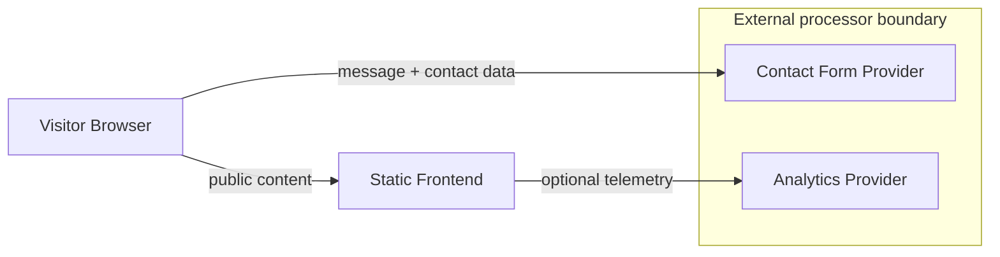
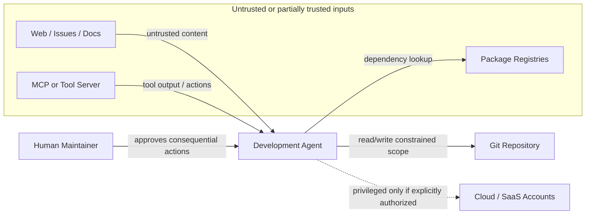
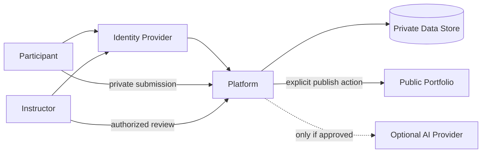

# Research 04 — Quality Attributes, Security & Privacy by Design

> **Editorial review — 11 November 2026.** Revised from the original Deep Research report, preserving its research scope and examples. Previously missing inline references were checked and repaired where possible; unsupported empirical assertions were qualified or corrected. Bibliographic links are standalone URLs, not inaccessible session IDs. This is a research reference, not execution evidence. The editorial correction and verification records belong to the historical accompanying archive. The accepted [`PROJECT_CONVENTIONS.md`](https://drive.google.com/file/d/1EMvmx0or0fgv7hqKJarOmdt4e5kGKo_y/view) governs generated-project paths, Git baseline and human authorization; the quality/security patterns here are conditional research inputs.


## Foundations: from “non-functional” concerns to architecture-significant quality requirements

The term *non-functional requirement* is convenient but often misleading. Availability, confidentiality, latency, accessibility, privacy, recoverability, maintainability, interoperability, auditability, portability and cost constraints are not merely secondary properties attached to “the real functionality”; many directly determine whether a system is useful, safe, lawful, operable or economically viable. ISO/IEC 25010:2023 reflects this broader view through a product-quality model containing nine quality characteristics and is explicitly intended to support requirements elicitation, design objectives, testing objectives, acceptance criteria and quality measurement. ([ISO publication record](https://www.iso.org/standard/78176.html))

For an SDD bootstrap process, the operational distinction that matters is therefore not simply *functional versus non-functional*. A more useful classification is:

| Kind of concern | Bootstrap interpretation | Example |
|---|---|---|
| Functional behavior | What the system must do | “An instructor can review a private submission.” |
| Quality requirement | How well or under what conditions behavior must work | “A submission must never become visible to another participant through identifier manipulation.” |
| Constraint | A non-negotiable boundary on the solution space | “Participant data must remain in an approved jurisdiction.” |
| Preference | A desired property that may yield to stronger constraints | “Prefer a serverless deployment if cost remains low.” |
| Risk | A possible harmful outcome requiring analysis | “A compromised integration token could expose third-party systems.” |
| Assumption | An unverified proposition on which design reasoning currently depends | “The first cohort will contain fewer than 100 participants.” |
| Decision | A chosen response to evidence and constraints | “Use externally managed identity rather than build authentication.” |

The Skill should preserve these distinctions because collapsing them into a generic “requirements” list hides uncertainty and encourages agents to treat preferences as mandates or assumptions as facts. This is especially consequential for security and privacy, where an incorrectly promoted assumption can become an accidental trust boundary.

A *quality attribute scenario* is a particularly useful bridge between vague aspirations and architecture. SEI’s established formulation contains six elements: stimulus source, stimulus, environment, artifact, response and response measure. SEI explicitly argues that labels such as “secure”, “fast” or “reliable” are too ambiguous to drive architecture and that scenarios make quality requirements operational. ([CMU/SEI — Deriving Architectural Tactics: A Step Toward Methodical Architectural Design](https://www.sei.cmu.edu/documents/704/2003_005_001_14213.pdf))

A bootstrap-quality scenario should therefore resemble:

```markdown
### QA-SEC-003 — Prevent cross-tenant submission access

Source:
Authenticated participant

Stimulus:
Requests a submission belonging to another participant by modifying
an object identifier.

Environment:
Normal production operation; valid authenticated session.

Artifact:
Submission API and authorization layer.

Expected response:
Request is denied before submission contents are returned.
The denial is recorded without logging the submission body.

Response measure:
Exact production threshold is not yet known.
Bootstrap verification target:
- authorization test exists before release;
- test demonstrates denial for cross-tenant identifiers;
- log evidence shows no sensitive payload.

Status:
Architecture-significant.

Evidence state:
Requirement established; implementation evidence not yet available.
```

The important phrase is **“implementation evidence not yet available.”** Bootstrap can make a requirement testable; it cannot truthfully claim that the finished system satisfies it. This distinction should appear throughout the generated repository. A specification, threat model, ADR or planned test is *design evidence*, not product-conformance evidence.

The same discipline applies to performance and reliability. An SLI is a quantitative measure of service behavior; an SLO is a target associated with an SLI; an SLA normally represents a contractual commitment and should not be invented merely because a project discusses reliability. Google’s SRE guidance warns that selecting useful targets requires contextual evidence rather than arbitrary numbers. ([Google SRE — Service Level Objectives](https://sre.google/sre-book/service-level-objectives/)) A bootstrap should therefore allow **“threshold TBD, measurement method defined”** when the team has not yet observed real workloads.

### A current standards snapshot

As of **11 November 2026**, the SDD Skill should treat the following as a freshness-sensitive reference set rather than timeless embedded knowledge:

| Area | Current verified state relevant to bootstrap |
|---|---|
| Product quality | ISO/IEC 25010:2023, Edition 2, is the current published product-quality model. ([ISO publication record](https://www.iso.org/standard/78176.html)) |
| Application-security verification | OWASP ASVS 5.0.0 is the stable release, published 30 May 2025. ([OWASP guidance](https://asvs.owasp.org/)) |
| Web risk awareness | OWASP Top 10’s current released edition is 2025. It is an awareness document, not a complete verification standard. ([OWASP Top 10 2025. Current web-application ris](https://owasp.org/projects/top-ten)) |
| API risk awareness | OWASP API Security Top 10 remains the 2023 edition; OWASP itself describes it as an awareness document rather than a replacement for broader security verification. ([OWASP API Security Top 10 2023. Current verifi](https://api-security.owasp.org/editions/2023/en/0x04-release-notes/)) |
| Secure SDLC | NIST SP 800-218 SSDF 1.1 remains the current final version; SSDF 1.2 / SP 800-218 Rev. 1 is still an initial public draft. ([NIST SSDF (contextual source)](https://csrc.nist.gov/pubs/sp/800/218/final)) |
| Cybersecurity governance | NIST CSF 2.0 is final and intentionally outcome-oriented rather than prescriptive. ([NIST CSF 2.0. Final outcome-oriented cybersecu](https://www.nist.gov/publications/nist-cybersecurity-framework-csf-20)) |
| Privacy governance | NIST Privacy Framework 1.1 is still shown by NIST as an Initial Public Draft; a 2026 NIST update stated that the final version was still forthcoming. A Skill must not silently represent it as final. ([NIST Privacy Framework. Current NIST site stil](https://www.nist.gov/privacy-framework)) |
| Information security | ISO/IEC 27001:2022 remains published; Amendment 1:2024 is listed by ISO. ([ISO/IEC 27001:2022. Current published informat](https://www.iso.org/standard/27001)) |
| Privacy management | ISO/IEC 27701:2025 Edition 2 is published and replaces the 2019 edition. ([ISO/IEC 27701:2025. Current published privacy-](https://www.iso.org/standard/27701)) |
| AI management | ISO/IEC 42001:2023 is the published AI management-system standard. ([ISO/IEC 42001:2023. Published AI management-sy](https://www.iso.org/standard/42001)) |
| AI risk | NIST AI RMF 1.0 remains available, but NIST states it is being revised; the Generative AI Profile remains NIST AI 600-1. ([NIST official publication](https://www.nist.gov/itl/ai-risk-management-framework)) |
| Accessibility | WCAG 2.2 remains the latest W3C Recommendation in the WCAG 2 family; W3C encourages use of 2.2. ([WCAG 2.2. Current W3C Recommendation in the WC](https://www.w3.org/TR/WCAG22/)) |
| European ICT accessibility | ETSI EN 301 549 V4.1.1 was published in September 2026; W3C notes that the 2026 version uses WCAG 2.2. ([ETSI EN 301 549 V4.1.1 (2026-09). Current publ](https://www.etsi.org/technical-groups/hf/)) |
| Software supply-chain provenance | SLSA 1.2 is now published on the SLSA site and supersedes the previously approved 1.1 specification. ([SLSA 1.2. Current verified supply-chain integr](https://slsa.dev/spec/v1.2/)) |

This snapshot illustrates why freshness must be procedural. A static Skill knowledge file that said “ASVS 4.0.3”, “ISO/IEC 27701:2019”, “EN 301 549 3.2.1” or “SLSA 1.1” could already be materially stale in November 2026. The Skill should store durable concepts locally but validate volatile versions, legal statuses and implementation recommendations against primary sources before creating architecture-significant guidance.

## Adaptive elicitation, prioritization and quality decision-making

A quality interview should not enumerate every conceivable attribute. It should seek the *smallest set of questions that exposes consequential uncertainty*. SEI’s ATAM provides a useful precedent: stakeholders identify business drivers, construct quality-attribute scenarios, prioritize them and analyze architectural approaches against those priorities. ([CMU/SEI — Eliciting and Specifying Quality Attribute Requirements](https://sei.cmu.edu/documents/5465/2013_018_101_60984.pdf)) For SDD bootstrap, the ceremony should be dramatically lighter while preserving the same causal logic.

A good adaptive sequence begins with exposure rather than technology:

| Question family | Example adaptive prompt | Why it matters |
|---|---|---|
| Harm | “What is the worst credible thing that could happen if this system behaves incorrectly?” | Reveals safety, financial, privacy and integrity stakes. |
| Data | “What information enters the system, who does it describe, and would disclosure or modification hurt someone?” | Reveals privacy and confidentiality. |
| Identity | “Can different people see or change different things?” | Surfaces authorization architecture. |
| External exposure | “Will any endpoint, form, file upload or API be reachable from the public internet?” | Changes threat surface. |
| Continuity | “What happens if this is unavailable for one hour, one day or one week?” | Reveals availability and recovery needs. |
| Scale | “What scale is known, and what scale is merely hoped for?” | Prevents premature scaling architecture. |
| Accessibility | “Who must be able to use this, including keyboard-only, screen-reader, low-vision, motor, cognitive or low-bandwidth users?” | Surfaces inclusive requirements. |
| Jurisdiction | “Where are users, operators and data likely to be located?” | Determines whether regulatory analysis is needed. |
| Dependencies | “Which external providers, accounts, APIs, models, payment services or cloud resources will the system depend on?” | Reveals supply-chain and operational risks. |
| Agent tooling | “Will AI agents only develop the project, or will AI capabilities also exist at runtime?” | Separates development-tool risk from product risk. |

The Skill should *branch*. A static portfolio without authentication should not receive a forty-question enterprise identity questionnaire. A platform storing minors’ private work should immediately branch into data-controller roles, lawful basis, visibility boundaries, retention, parental/guardian considerations, age-appropriate transparency and DPIA screening. GDPR treats children as deserving specific protection, and Article 8 provides jurisdiction-dependent rules for consent in information-society services; the EU-level default age is 16, but Member States may set a lower threshold not below 13. ([GDPR — Regulation (EU) 2016/679. Primary legal](https://eur-lex.europa.eu/eli/reg/2016/679/oj))

### Quality scenarios and evidence discipline

The Skill should transform high-impact elicitation results into scenarios before choosing controls. For example:

> **Vague:** “The API must be secure.”
> **Scenario:** “When an authenticated caller requests an object outside its authorized tenant, the API rejects the request before returning object data, and the event can later be investigated without storing the object payload.”

The second statement is architecture-relevant because it implies object-level authorization, identity context, test design and audit semantics. OWASP’s API Security Top 10 explicitly identifies Broken Object Level Authorization as API1:2023 and distinguishes it from function-level authorization and authentication problems. ([OWASP API1:2023 — Broken Object Level Authorization](https://api-security.owasp.org/editions/2023/en/0xa1-broken-object-level-authorization/))

Response measures should never be fabricated. A useful three-state convention is:

| Measurement state | Bootstrap output |
|---|---|
| Known and justified | Record the threshold and provenance. |
| Measurable but threshold unknown | Define the indicator and an empirical calibration task. |
| Not yet measurable | Record an explicit research/implementation dependency rather than invent a number. |

Thus “99.99% availability” is inappropriate when no user expectation, outage cost or infrastructure budget supports it. “Measure successful request ratio during pilot; product owner to select target before public launch” is valid bootstrap work.

### Risk-prioritized rather than score-dominated decision-making

Risk matrices and weighted scoring can support discussion, but their numerical output should not override hard constraints or severe irreversible harm. The proposed Skill heuristic is lexicographic:

1. **Hard-stop constraints** — legal impossibility, unmitigated severe safety risk, known exposure of secrets, unclear authorization boundary for highly sensitive data.
2. **Severe or difficult-to-reverse harm** — unauthorized disclosure, irreversible deletion, unsafe physical action, harmful treatment of minors, uncontrolled privileged agent capability.
3. **Architecture-locking constraints** — data residency, offline operation, strong tenant isolation, third-party protocol dependencies.
4. **Important quality trade-offs** — latency, cost, portability, maintainability, analytics.
5. **Preferences** — framework familiarity, stylistic choices and convenient deployment patterns.

This prioritization is a **proposed SDD heuristic**, not a published standard. Its purpose is to avoid the pathology in which several low-impact weighted preferences numerically outvote one catastrophic security or privacy constraint.

A lightweight utility tree can then capture priorities:

```text
Quality
├── Security
│   ├── Cross-tenant confidentiality       HIGH / HIGH uncertainty
│   ├── Credential theft containment       HIGH / MEDIUM uncertainty
│   └── Auditability                       MEDIUM
├── Privacy
│   ├── Data minimization                  HIGH
│   ├── Participant deletion workflow      HIGH
│   └── Analytics                          LOW / optional
├── Accessibility
│   ├── Keyboard task completion           HIGH
│   └── Screen-reader comprehension        HIGH
└── Reliability
    ├── Submission durability              HIGH
    └── Public profile availability        MEDIUM
```

The bootstrap should capture *dissent*. If the product owner wants detailed behavioral analytics while the privacy stakeholder argues for minimization, the ADR should show both positions rather than synthesizing them into fictional consensus.

## Security, privacy, accessibility and operability as architectural guardrails

### Security by design and secure defaults

“Security by design” is not synonymous with “add security controls.” It is about shaping boundaries, flows and defaults so that dangerous states are harder to reach. CISA’s Secure by Design guidance emphasizes transferring security burden from customers to product manufacturers and advocates safe defaults such as eliminating universal default passwords and making important security capabilities available by default. ([CISA — Secure by Design: Eliminating Default Passwords (2023)](https://www.cisa.gov/sites/default/files/2023-12/SbD-Alert-How-Software-Manufacturers-Can-Protect-Customers-by-Eliminating-Default-Passwords-508c_0.pdf))

For bootstrap, the most durable security principles are therefore:

| Principle | Architectural consequence |
|---|---|
| Least privilege | Give each user, service, agent and integration only the capabilities required for its task. |
| Deny by default | Unknown users, resources and actions do not acquire access merely because no rule forbids them. |
| Defense in depth | Do not rely on one logical check when a second independent boundary is inexpensive and high-value. |
| Explicit trust boundaries | Show where identity, authority, data sensitivity or operator responsibility changes. |
| Fail safe | Error paths should not accidentally grant access or reveal sensitive internals. |
| Separation of duties | High-impact actions may require different capabilities or human approval. |
| Minimize attack surface | Do not add a server, MCP, public API, file-upload path or privileged integration unless it provides real value. |

Threat modeling should scale to the system. STRIDE is useful for systematically examining spoofing, tampering, repudiation, information disclosure, denial of service and elevation of privilege; attack trees are good for exploring attacker paths; misuse/abuse cases connect adversarial behavior to product workflows; PASTA supports deeper risk-driven analysis; LINDDUN is useful when the concern is privacy rather than only system compromise. The Skill need not force one methodology. Its job is to choose the lightest representation that exposes meaningful trust boundaries and attack paths.

A tiny-project model can be only this:



The diagram forces three questions that a framework checklist might miss: whether analytics are necessary, where contact messages are retained, and whether third parties receive identifiers.

### Identity, authorization and session architecture

Authentication establishes or asserts *who or what* is interacting; authorization determines *what that identity may do*. Bootstrap must not collapse the two. NIST SP 800-63-4, finalized in 2025, separately addresses identity proofing, authentication and federation, and its companion SP 800-63B-4 covers authentication and authenticator management. ([NIST SP 800-63-4 / 63B-4. Current digital-iden](https://www.nist.gov/publications/nist-sp-800-63-4-digital-identity-guidelines))

The bootstrap decision is rarely “RBAC or ABAC?” in isolation. It is: **what authorization facts exist, who owns them, how often do they change, and where must enforcement occur?**

RBAC is usually sufficient when access maps cleanly onto stable roles. ABAC becomes useful when decisions depend on attributes such as organization, geography, data classification or resource state. Relationship-based authorization becomes attractive when access follows graph-like ownership or sharing relationships. These are design patterns, not maturity levels; using a more elaborate model is not automatically safer.

For web identity, a bootstrap may recommend an external identity provider if account recovery, MFA/passkeys, federation or lifecycle management would otherwise become a bespoke security subsystem. It must also record the new dependency: provider availability, pricing, exportability, user data handling, account ownership and credential-management responsibilities.

If OAuth 2.0 is selected, RFC 9700 is the current IETF Best Current Practice and strengthens earlier OAuth security guidance, including secure redirect handling and protection against authorization-code injection; public clients must use PKCE under the BCP. ([RFC 9700 — OAuth 2.0 Security Best Current Pra](https://www.rfc-editor.org/info/rfc9700/)) The Skill should reference such guidance when relevant rather than embedding a permanent hand-written OAuth cookbook.

### Data protection and privacy by design/default

Under GDPR Article 25, controllers must apply appropriate technical and organisational measures at both design time and processing time, taking account of state of the art, cost, purposes and risks; the provision explicitly names data minimization and requires that by default only necessary personal data be processed. Article 5 separately establishes purpose limitation, minimization, storage limitation and integrity/confidentiality principles. ([GDPR Articles 5, 25 and 35 (EUR-Lex)](https://eur-lex.europa.eu/eli/reg/2016/679/oj/eng/))

That means a privacy bootstrap should begin with **purpose and lifecycle**, not encryption:

| Lifecycle stage | Required questions |
|---|---|
| Collection | Why is each data field needed? Is it mandatory? |
| Ingestion | Through which interface/provider does it enter? |
| Storage | Where, for how long and under whose account? |
| Use | Which user/service/agent needs it and for what purpose? |
| Sharing | Which processors, analytics services or AI providers receive it? |
| Derived data | Are embeddings, predictions, scores, summaries or behavioral profiles created? |
| Logging | Could logs duplicate identifiers, prompts or sensitive payloads? |
| Backup | Does deletion propagate, expire or remain recoverable in backups? |
| Export/rights | Can the organization locate data connected to an individual? |
| Deletion | What triggers removal and what remains for legal/technical reasons? |

Pseudonymization is not the same as anonymization. A dataset remains personal data if individuals can reasonably be re-identified using available means; bootstrap should therefore avoid asserting “anonymous” merely because obvious names were removed.

GDPR DPIAs are required where planned processing is likely to result in high risk to individuals’ rights and freedoms. EDPB guidance highlights large-scale sensitive data, systematic monitoring, significant automated evaluation, vulnerable people and innovative technologies as important indicators, and requires prior consultation with the competent authority when residual high risk cannot be sufficiently mitigated. ([European Data Protection Board — DPIA guidance](https://www.edpb.europa.eu/topics/accountability-and-compliance-tools/data-protection-impact-assessment_en)) The EDPB’s 2026 consultation-stage DPIA template provides a structured framework for assessing risks to individuals. Crucially, privacy harm can arise even without a security breach: the intended purpose or structure of processing may itself have adverse effects on data subjects. ([EDPB — 2026 DPIA template (consultation-stage materials)](https://www.edpb.europa.eu/our-work-tools/documents/public-consultations/2026/edpb-dpia-template_en))

The Skill should therefore perform **DPIA screening**, not declare that it has completed legally sufficient DPIA work unless qualified humans have actually reviewed the relevant jurisdiction, purposes, actors and processing operations.

### Application, API and supply-chain security

For public web and API systems, security requirements should be exposure-driven rather than checklist-driven. ASVS 5.0.0 provides a broad verification-requirement framework, while OWASP Top 10 2025 and API Top 10 2023 are awareness aids. Using “we follow the Top 10” is therefore not equivalent to verified application security. ([OWASP guidance](https://asvs.owasp.org/); [OWASP Top 10 2025. Current web-application ris](https://owasp.org/projects/top-ten))

The bootstrap should consider, where relevant, injection, XSS, CSRF, SSRF, deserialization, authorization failures, object-level authorization, unsafe file uploads, mass assignment, secrets exposure, error leakage, abuse of expensive operations, rate limiting, dependency compromise and denial of service. But it should avoid cargo-cult controls. A static brochure site may need dependency hygiene, headers and contact-form abuse protection; it does not need a bespoke microservice authorization system.

Supply-chain planning should likewise be proportional. NIST SSDF 1.1 provides current final secure-development guidance, while 1.2 remains a draft as of November 2026. ([NIST SSDF (contextual source)](https://csrc.nist.gov/pubs/sp/800/218/final)) SBOMs can support component inventory and vulnerability response, and provenance can support artifact integrity. SLSA 1.2 currently defines provenance and graduated supply-chain integrity tracks. ([SLSA 1.2. Current verified supply-chain integr](https://slsa.dev/spec/v1.2/)) A prototype does not automatically need maximum SLSA maturity, but a project distributing privileged binaries or firmware may justify stronger provenance early.

### Accessibility and inclusive quality

WCAG 2.2 is the current W3C Recommendation in the WCAG 2 family, and W3C recommends using the newest version. ([WCAG 2.2. Current W3C Recommendation in the WC](https://www.w3.org/TR/WCAG22/)) In the European context, the European Accessibility Act applies to specified categories of products and services, including e-commerce, consumer banking, e-books and certain transport and communication services; Member States had to apply national implementing measures from 28 June 2025. The Directive contains scope limitations and transitional rules, so a Skill must not state that every website is automatically subject to the EAA. ([Directive (EU) 2019/882 — European Accessibili](https://eur-lex.europa.eu/eli/dir/2019/882/oj))

EN 301 549 V4.1.1 was published by ETSI in September 2026, and W3C reports that this edition incorporates WCAG 2.2. ([ETSI EN 301 549 V4.1.1 (2026-09). Current publ](https://www.etsi.org/technical-groups/hf/)) Legal applicability still depends on jurisdiction, product/service category and applicable implementing law.

Accessibility requirements at bootstrap should describe user outcomes, for example: “All primary submission tasks can be completed with keyboard-only interaction,” “meaningful images have context-appropriate text alternatives,” “status changes are exposed to assistive technology,” or “instructional video requires captions.” Automated tools can help find issues, but W3C explicitly warns that tools cannot determine accessibility by themselves and that knowledgeable human evaluation remains necessary. ([W3C accessibility evaluation guidance. Explici](https://www.w3.org/WAI/test-evaluate/tools/selecting/))

Non-web projects should not receive web-only ceremony. For a CLI, accessibility may concern readable output, non-color-only semantics and screen-reader-compatible terminal behavior. For games it may include remappable controls, captions, motion sensitivity and cognitive load. For hardware or IoT it may involve physical interaction, accessible companion interfaces and nonvisual status signaling.

### Reliability and deployment-aware constraints

Reliability belongs in bootstrap because it changes architecture before deployment. Questions about tolerated downtime, data-loss tolerance, offline operation, third-party outages, retry safety, recovery ownership and cost ceilings may determine whether the architecture needs queues, idempotency, local persistence, redundancy or explicit degraded modes.

Bootstrap should ask about RPO/RTO only when meaningful. It should not invent them. “No participant submission may be lost after receiving a confirmed save response” can be a stronger and more understandable early requirement than a premature “RPO = 5 minutes.”

Deployment awareness also includes ownership of hosting accounts, billing ceilings, domains, DNS, quotas, secret stores, data regions, backups and CI/CD environments. These are **architecture inputs**, not permission to deploy. The output may include example configuration and placeholders but must not contain live credentials or imply that infrastructure exists.

## Human–AI agents, development tooling and MCP trust boundaries

Agentic software development introduces a second system around the application: the **development control plane**. Its assets include source code, repository history, developer credentials, cloud tokens, package-manager authority, local files, CI secrets, MCP servers, shell access and external web content. These assets and trust boundaries must not be conflated with application runtime.

A runtime chatbot, for example, may need application-level prompt-injection mitigations and user-data protections. An agent that develops the chatbot may separately be exposed to malicious instructions embedded in issues, README files, web pages, generated dependency documentation or tool responses. The two threat models overlap but are not the same.

A useful bootstrap trust model is:



The critical agentic threats are indirect prompt injection, confused-deputy behavior, excessive tool permissions, credential leakage, malicious packages, tool-result poisoning, unsafe generated configuration, repository instructions that exceed human intent and data exfiltration through apparently legitimate integrations.

MCP requires special care because tool capability is a security boundary. The MCP ecosystem’s 2026-07-28 specification introduced additional authorization hardening, while the official registry currently describes itself as a community-driven registry service rather than a security certification service. ([Model Context Protocol — 2026-07-28 specificat](https://blog.modelcontextprotocol.io/posts/2026-07-28/); [Official MCP Registry. Community-driven regist](https://registry.modelcontextprotocol.io/docs)) MCP’s own 2026 security discussion states that tool annotations are metadata, not enforcement, and that an untrusted server can falsely claim that a tool is read-only. ([MCP security discussion on tool annotations. U](https://blog.modelcontextprotocol.io/posts/2026-03-16-tool-annotations/))

Therefore directory presence must never equal trust. A directory listing is not a security audit. Review the implementation or provider safeguards, requested permissions and data-handling practices before trusting an integration. 

The SDD Skill should select capability mechanisms by need:

| Need | Candidate mechanism | Security consideration |
|---|---|---|
| Stable library/API call | SDK/library | Usually narrowest capability surface. |
| Local developer automation | CLI | Can be constrained via arguments, environment and OS permissions. |
| Reusable agent-accessible tool | MCP | Useful when multiple agents/clients benefit from structured tool discovery. |
| IDE-specific workflow | Plugin/extension | Trust tied to editor/plugin ecosystem. |
| Simple deterministic task | Script | Often easier to review than adding a networked tool. |
| Existing provider integration | Native connector | May reduce custom code but creates provider/data dependency. |

The presence of an MCP option is not a reason to use MCP. Conversely, when a well-maintained MCP gives a development agent necessary structured access with narrower privileges than shell or browser automation, preconfiguring it can be a sound bootstrap decision.

The Skill may discover candidates through the official MCP Registry and directories such as mcp.directory and mcpservers.org, but should record provenance, maintainer, repository, release recency, license, permissions, credentials required, network destinations, transport, data retention, installation scope and an explicit human approval state. The official registry is available as a community-driven registry, while third-party directories expose broader discovery metadata. ([Official MCP Registry. Community-driven regist](https://registry.modelcontextprotocol.io/docs))

A safe bootstrap entry might be:

```yaml
capability:
  need: "Read project issues during development"
  mechanism: "MCP candidate"
  status: "proposed-not-authorized"
  source: "official registry"
  credentials_required: true
  requested_permissions:
    - read:issues
  forbidden_permissions:
    - write:repository
    - admin:organization
  secret_material_in_repository: false
  human_approval_required_before_install: true
  review_before_use:
    - provenance
    - maintenance status
    - permission scope
    - data handling
    - license
```

No credential should ever be generated, inserted or requested merely because the bootstrap selected an integration.

## Worked contrasting cases

### Case A — Low-risk static personal portfolio

**Assumptions, not facts:** single owner; mostly static content; no user accounts; optional contact form; optional analytics; public hosting. If any assumption changes, the model must be revisited.

**Assets and data classes:** public portfolio content; owner contact address; visitor contact-form data; optional telemetry. Likely adversaries include spam bots, opportunistic attackers and compromised third-party scripts.

**Trust boundaries:**

```text
Visitor
  │
  ├──── public static files ────> Hosting/CDN
  │
  ├──── optional message ───────> Form processor ──> Owner mailbox
  │
  └──── optional telemetry ─────> Analytics provider
```

**Prioritized quality scenarios**

| ID | Scenario |
|---|---|
| Q1 | Public pages remain usable without authentication. |
| Q2 | Contact submissions do not expose the owner’s private mailbox credential. |
| Q3 | Spam/automated abuse is bounded without forcing intrusive identity collection. |
| Q4 | If analytics are enabled, only telemetry justified by an explicit purpose is collected. |
| Q5 | Primary navigation and contact workflow are keyboard-operable. |
| Q6 | Meaningful images and interactive controls have accessible equivalents. |
| Q7 | Third-party script failure does not prevent portfolio content from rendering. |

WCAG 2.2 is an appropriate accessibility baseline for the web UI, while human evaluation remains required for meaningful accessibility assessment. ([WCAG 2.2. Current W3C Recommendation in the WC](https://www.w3.org/TR/WCAG22/))

**Alternative A — no analytics.** Lowest privacy surface and simplest consent/notice analysis.

**Alternative B — third-party analytics.** Provides usage evidence but adds a processor/dependency and potentially identifiers, cookies or cross-context data handling depending on the product selected. The bootstrap must inspect the actual provider and configuration rather than assuming all analytics behave alike.

**Representative ADR**

```markdown
# ADR-PRIV-001 — Analytics is optional and deferred

Status: Proposed

Decision:
Ship the initial portfolio architecture without analytics.
Represent analytics as an optional backlog item.

Rationale:
No validated product decision currently depends on visitor-level telemetry.
Avoid adding a data-processing dependency until the measurement purpose is known.

Reconsider when:
A concrete decision requires usage evidence and the owner approves
the corresponding privacy review.
```

**Minimum risk register**

| Risk | Impact | Bootstrap response |
|---|---|---|
| Contact-form spam | Moderate | Abuse-control requirement; provider limits research task. |
| Third-party script compromise | Moderate | Minimize dependencies; CSP/SRI investigation if applicable. |
| Accidental visitor tracking | Privacy | No analytics by default. |
| Accessibility barriers | User exclusion | WCAG-oriented acceptance criteria + manual review task. |

**Backlog:** select hosting constraints → implement static shell → accessibility semantics → contact-form integration → abuse tests → privacy notice if personal data processing occurs → optional analytics decision.

At bootstrap, the team can establish data flows, dependency choices, accessibility criteria and security headers to investigate. It cannot claim production accessibility, security verification or GDPR compliance before implementation and review.

**Mid-project change:** portfolio gains password-protected client case studies. This invalidates the “public static-only” trust model and forces new identity, authorization, session, recovery and secret-management decisions.

### Case B — Hackadō bootcamp and evolving multi-user portfolio platform

**Assumptions:** participant accounts, private submissions, instructor review and eventual public portfolios; some participants may be minors; growth path uncertain. Whether an educational institution, organiser or another entity is controller/processor is a factual/legal question that bootstrap must not invent.

**Assets:** identity data, participant work, instructor feedback, optional public portfolio data, consent/permission records, account metadata, moderation records and possibly AI-generated assistance. Vulnerable data subjects and minors raise the consequence of accidental disclosure. EDPB guidance explicitly identifies vulnerable individuals as relevant to DPIA screening and provides additional protections for children. ([EDPB — DPIA guidance](https://www.edpb.europa.eu/topics/accountability-and-compliance-tools/data-protection-impact-assessment_en); [EDPB — Children and data protection](https://www.edpb.europa.eu/topics/key-gdpr-concepts/children_en))



**Prioritized scenarios**

| Priority | Quality scenario |
|---|---|
| Critical | One participant cannot read or modify another participant’s private submission. |
| Critical | A private submission cannot become public without an explicit authorized publication transition. |
| Critical | Instructor privilege does not imply platform-administrator privilege. |
| High | Deleting/closing a participant account triggers a documented retention workflow rather than silent indefinite preservation. |
| High | If minors participate, transparency and consent/lawful-basis handling is reviewed for the applicable Member State and institutional context. |
| High | AI tooling receives only the minimum participant data required for the approved purpose. |
| High | Primary learner and instructor tasks are keyboard and screen-reader usable. |
| High | Submission confirmation does not occur before durable persistence criteria are met. |
| Medium | Public portfolio traffic can scale independently from private review traffic if growth materializes. |

GDPR Article 25 supports minimization and privacy by default; Article 8 requires jurisdiction-sensitive handling where consent is the basis for online services offered directly to children. ([GDPR — Regulation (EU) 2016/679. Primary legal](https://eur-lex.europa.eu/eli/reg/2016/679/oj))

**Option A — shared application with explicit row/resource authorization.** Simpler operations and faster development, but correctness of authorization enforcement becomes highly consequential.

**Option B — stronger logical/physical tenant partitioning.** Reduces some classes of cross-tenant error but adds operational and migration complexity. It should not be chosen merely because “more isolation sounds secure.”

**ADR example**

```markdown
# ADR-SEC-004 — Private-by-default participant artifacts

Decision:
New participant artifacts are private by default.
Publication is a distinct domain transition requiring explicit authorization.

Rejected:
Treating visibility as an optional field defaulting from client input.

Reason:
Visibility is a security/privacy boundary and must not depend on untrusted
client defaults.

Review trigger:
Introduction of collaborative sharing or organization-level portfolios.
```

**Risk register**

| Risk | Consequence | Initial mitigation |
|---|---|---|
| IDOR/BOLA | Private work disclosed | Central server-side resource authorization + negative tests. |
| Incorrect publish state | Privacy harm | Private-by-default lifecycle. |
| AI provider receives submissions | Secondary processing | Explicit enablement, minimization, provider review. |
| Minor cannot understand notice | Invalid/ineffective transparency | Age-appropriate content and legal review. |
| Instructor account takeover | Large data exposure | Strong authentication/MFA decision before public launch. |
| Inaccessible submission flow | Learner exclusion | WCAG acceptance scenarios and human testing. |

**Backlog dependencies:** controller/processor roles and jurisdictions → participant data inventory → identity/role model → visibility state model → authorization tests → retention/deletion design → accessibility acceptance tests → AI integration decision → deployment architecture.

At bootstrap, the Skill can establish “private by default,” data inventory, role model, unresolved legal questions and DPIA screening. It cannot establish lawful basis on behalf of the organisation, certify WCAG conformance or prove authorization works.

**Mid-project change:** schools request cohort-wide analytics and instructor dashboards ranking learners. This introduces new profiling purposes, derived data and possibly consequential education decisions. Privacy purpose, lawful basis, transparency, retention, access and DPIA screening must be revisited before adding the feature.

### Case C — API-first integration service holding third-party credentials

**Assumptions:** a small service receives API requests and performs actions against external SaaS providers using delegated credentials; reliable/auditable behavior matters more than rich UI.

**Assets:** third-party API tokens, tenant identifiers, action payloads, audit records, retry state and configuration. Threat actors include malicious callers, compromised tenants, attackers exploiting SSRF or unsafe upstream consumption, and supply-chain compromise.

OWASP’s 2023 API list specifically includes broken authentication, object/property authorization, unrestricted resource consumption, SSRF, improper inventory management and unsafe consumption of APIs. ([OWASP API Security Top 10 2023. Current verifi](https://api-security.owasp.org/editions/2023/en/0x04-release-notes/))

**Prioritized scenarios**

| Priority | Scenario |
|---|---|
| Critical | Tenant A’s credential can never be used to execute an action for Tenant B. |
| Critical | Credentials never appear in repository history or normal application logs. |
| Critical | Retrying a timed-out write does not create duplicate irreversible actions. |
| High | Every consequential external action can be traced to caller, tenant, operation and provider response without storing unnecessary secrets. |
| High | Untrusted callback URLs cannot turn the service into a general-purpose SSRF proxy. |
| High | Upstream timeout causes bounded retries with backoff rather than unbounded amplification. |
| High | Expired/revoked credentials fail closed and surface an actionable status. |
| Medium | Dependency outage produces a defined degraded state and recovery path. |

**Option A — encrypted central credential store with tenant-scoped application access.** Simpler to operate; compromise of the service boundary may have broader blast radius.

**Option B — provider-native secret manager or isolated credential broker.** Stronger credential isolation and rotation potential, but creates infrastructure dependency and cost.

**Security ADR**

```markdown
# ADR-SEC-007 — No third-party credentials in application configuration files

Decision:
Runtime credentials are obtained from a dedicated secret mechanism.
Repository contains names/placeholders only.

Human-owned prerequisite:
Select hosting environment and secret-storage provider.

Rejected:
.env files containing real production credentials committed to Git.

Reason:
Repository history is not an appropriate secret-distribution channel.
```

**Risk register**

| Risk | Response |
|---|---|
| Token leakage | Separate secret storage; log redaction; secret scanning planned. |
| Cross-tenant confused deputy | Bind credential selection to server-derived tenant context. |
| Duplicate side effects | Idempotency key or provider-specific deduplication requirement. |
| SSRF | Allowlisted/structured upstream destinations; no arbitrary URL fetch primitive. |
| Supply-chain compromise | Dependency pinning/review; provenance/SBOM proportional to distribution risk. |
| Provider outage | Queue/retry/dead-letter semantics chosen after failure analysis. |

A bootstrap may define an SLI such as “fraction of accepted integration operations reaching a terminal known state” while leaving the SLO target for post-pilot calibration. This follows the distinction between an SLI and a target SLO without inventing a reliability promise. ([Google SRE — Service Level Objectives](https://sre.google/sre-book/service-level-objectives/))

**Mid-project change:** one upstream provider begins supporting financial transactions. The previous retry and audit model must be reassessed because duplicate or unauthorized actions now have materially greater harm; stronger approval, non-repudiation, reconciliation and possibly regulatory review may become architecture-significant.

### Case D — offline-first mobile/edge game or IoT-style project

**Assumptions:** local-first operation, intermittent network, eventual synchronization, local user state, no continuous cloud availability. Hardware control is *not* assumed; if the project later controls physical actuators, safety analysis escalates sharply.

**Assets:** local save data, device identity, sync credentials, queued actions, user-created content and downloadable updates.

**Prioritized scenarios**

| Priority | Scenario |
|---|---|
| Critical | Loss of connectivity does not corrupt previously confirmed local state. |
| Critical | A maliciously modified sync payload cannot silently obtain elevated privileges. |
| High | Reconnection resolves conflicts deterministically or requests human resolution when automatic merge is unsafe. |
| High | Device-local secrets are not embedded as universal static credentials. |
| High | An interrupted update preserves a recoverable previous state. |
| High | Sensitive local data can be erased through an explicit workflow. |
| Medium | Bandwidth-constrained users can operate core features without mandatory large downloads. |
| Medium | Relevant controls/captions/non-color cues support users with diverse access needs. |

**Option A — server-authoritative state with offline cache.** Easier centralized revocation and conflict policy; poorer offline autonomy.

**Option B — local-authoritative state with signed synchronization events.** Stronger offline capability; much harder conflict, cheating and revocation semantics.

**Risk register**

| Risk | Response |
|---|---|
| Local save tampering | Decide whether integrity matters to other users; do not overengineer single-player data. |
| Sync conflict | Explicit version/vector/conflict strategy. |
| Universal device secret | Prohibit shared production secrets. |
| Malicious update | Signed-update/provenance requirement if executable content is distributed. |
| Permanent loss | Backup/export expectations defined according to user value. |

If executable artifacts are distributed, software provenance becomes more important; SLSA 1.2 provides a current framework for increasing build/provenance integrity. ([SLSA 1.2. Current verified supply-chain integr](https://slsa.dev/spec/v1.2/))

**Mid-project change:** multiplayer trading is introduced. Previously harmless local save modification can now affect other users and virtual economies. Trust boundaries, authoritative state, abuse controls, identity and auditability must all be reconsidered.

## Reusable SDD Bootstrap Skill v0.1 protocol and artifacts

The following protocol is a **proposed methodology**, derived from the standards and practices above rather than itself being a standard.

### Adaptive risk triage

Avoid labels such as “low/medium/high security” as the first decision. Instead evaluate dimensions:

| Dimension | Escalation trigger |
|---|---|
| Human harm | Safety, livelihood, education, financial or legal consequences. |
| Data sensitivity | Personal, health, biometric, credential, minors or confidential business data. |
| Privilege | Administrative, cloud, financial, production or physical-control capability. |
| Exposure | Public internet, public API, file uploads, untrusted content. |
| Reversibility | Harm cannot readily be undone. |
| Scale/blast radius | One error can affect many users/tenants/systems. |
| Regulation | Applicable sectoral/privacy/accessibility/legal duties. |
| Agent autonomy | Agent can execute external or privileged actions. |
| Operational dependency | Failure of a provider causes material business/user harm. |

The output is not a numeric score but a set of **escalation reasons**.

### Hard-stop unknowns versus safely deferrable uncertainty

| Hard-stop before architecture is finalized | Usually safe to defer with an owner/date |
|---|---|
| Who may access sensitive/private data | Exact hosting vendor when requirements are portable |
| Whether minors/sensitive populations are involved | Final latency threshold before real measurements |
| Whether an API performs irreversible external actions | Choice of monitoring product |
| Where production secrets will live | Cosmetic UI conventions |
| Whether an external provider may receive confidential data | Detailed autoscaling thresholds |
| Whether deployment jurisdiction is constrained | Exact backup tooling where RPO/RTO are not yet fixed |
| Whether an agent may change production/external accounts | Optional MCP selection |

### Privacy/data inventory worksheet

```markdown
| Data / derived data | Subject | Purpose | Required? | Sensitivity |
| Source | Storage | Recipients/processors | Retention |
| Deletion path | Backup impact | Log/telemetry exposure |
| Jurisdiction concerns | Uncertainty | Owner |
```

### Quality scenario template

```markdown
## QA-<ATTRIBUTE>-<ID>

Concern:
Stakeholder:

Source:
Stimulus:
Environment:
Artifact:
Expected response:
Response measure:

Constraint / preference / risk:
Priority rationale:
Known evidence:
Unknowns:
Verification method:
Implementation dependency:
Owner:
Review trigger:
```

### Lightweight threat model template

```markdown
# Threat Model

## Assets
What must be protected?

## Actors
Users, operators, attackers, external services, AI agents.

## Entry points
Web, API, CLI, uploads, messages, repository, MCP, external tools.

## Trust boundaries
Where does identity, authority, sensitivity or ownership change?

## Abuse cases
What could a malicious or compromised actor attempt?

## Controls considered
Prevent / detect / recover.

## Residual risks
What remains and who accepts it?

## Review triggers
What future change invalidates this model?
```

### Risk register

```markdown
| ID | Harm | Threat / failure | Affected asset/person |
| Preconditions | Existing safeguard | Planned safeguard |
| Residual uncertainty | Owner | Decision / review trigger |
```

The register should capture harm rather than only technical vulnerability. A privacy risk may exist with no attacker at all, as emphasized by EDPB DPIA guidance. ([EDPB — 2026 DPIA template (consultation-stage materials)](https://www.edpb.europa.eu/our-work-tools/documents/public-consultations/2026/edpb-dpia-template_en))

### Security/privacy/accessibility ADR

```markdown
# ADR-XXX — Decision title

Status:
Context:
Applicable constraints:
Quality scenarios affected:
Threats/privacy harms/accessibility barriers:
Options considered:
Decision:
Trade-offs:
Evidence:
Uncertainty:
Dissent:
Implementation consequences:
Verification plan:
Explicitly deferred work:
Review/expiration trigger:
Human approver:
```

### Control-to-requirement traceability

```text
Stakeholder concern
   ↓
Quality scenario / privacy requirement
   ↓
Threat or failure mode
   ↓
Architectural decision
   ↓
Backlog implementation task
   ↓
Planned verification
   ↓
Future evidence
```

A control that cannot be traced upward to an applicable risk or requirement should be challenged. A high-impact requirement with no planned implementation or verification path is incomplete.

### Human approval and escalation matrix

| Action | Agent may propose | Agent may prepare | Human approval required before execution |
|---|---:|---:|---:|
| Add local documentation | Yes | Yes | Normally no |
| Add dependency | Yes | Yes | According to project policy |
| Configure proposed MCP with no credentials | Yes | Yes | Recommended |
| Authorize MCP/connector to user account | Yes | No automatic authorization | **Yes** |
| Create cloud account/billing | Yes | No | **Yes** |
| Insert or rotate production secret | Yes | No | **Yes** |
| Change access-control model | Yes | Yes | **Yes** |
| Publish private data | Yes | No | **Yes** |
| Deploy to production | Out of bootstrap scope | No | **Yes; separate workflow** |
| Accept residual severe risk | No autonomous acceptance | No | **Human accountable owner** |

### Minimal artifact-selection rules

A simple static portfolio might need only `README`, requirements, backlog, one small quality section and perhaps one ADR. A platform with accounts and private data should add architecture, data inventory, threat model, security/privacy ADRs and verification plan. A regulated or safety-relevant project may require specialist assessment and external artifacts that the Bootstrap Skill should reference rather than pretend to replace.

A candidate **conditional** repository structure, aligned with the accepted Project Conventions, is:

```text
README.md
CONTRIBUTING.md                # when collaboration warrants it
AGENTS.md
.gitignore                     # excludes .secrets/ and sensitive local files
docs/
  PROJECT_CONVENTIONS.md       # authoritative operating contract
  PRD.md
  BACKLOG.md
  UPDATES.md
  TEST_PLAN.md                 # when justified
  quality/
    QUALITY_SCENARIOS.md
    RISK_REGISTER.md
  decisions/
    ADR-001-...
  security/
    THREAT_MODEL.md
  privacy/
    DATA_INVENTORY.md
    DPIA_SCREENING.md
  accessibility/
    ACCESSIBILITY_REQUIREMENTS.md
  mcp/                         # only for approved integration documentation
    MCP_CANDIDATES.md
```

**Path invariant:** `PRD.md`, `BACKLOG.md` and `UPDATES.md` in the example are all under `docs/`—their canonical paths are `docs/PRD.md`, `docs/BACKLOG.md` and `docs/UPDATES.md`. They are not root-level files. `docs/UPDATES.md` records implemented work and evidence rather than planned work.

`LICENSE.md` is included only when an actual project license has been approved; it is not inherited from the Skill's intended MIT license. A generated project also requires a verified initial Git commit and `main`/`dev` baseline (unless a documented exception is authorized). Optional `prod*` branches are reserved for justified deployment trees. None of the specialized directories above should be created empty by default.

These are **selection candidates**, not mandatory ceremony.

### Bootstrap quality gates

A bootstrap is *ready for implementation* when:

| Gate | Required evidence |
|---|---|
| Scope | In-scope/out-of-scope behavior stated. |
| Quality | Architecture-significant quality scenarios identified. |
| Security | Trust boundaries and material abuse/failure modes captured. |
| Privacy | Personal/sensitive data inventory and purpose known or unresolved blockers explicit. |
| Accessibility | Relevant user populations and applicable acceptance criteria identified. |
| Identity | Authn/authz assumptions and role/resource boundaries explicit if applicable. |
| Secrets | No real secrets in repository; intended secret mechanism documented. |
| Dependencies | High-impact external providers and accounts identified. |
| Deployment awareness | Hosting/domain/billing/region/operations questions recorded without deploying. |
| Agent tooling | Development-agent permissions and MCP/tool choices scoped. |
| Traceability | Material requirement → decision → task → planned verification chain exists. |
| Uncertainty | Hard-stop unknowns and deferrable unknowns distinguished. |
| Handoff | Next implementation tasks are prioritized and executable by a human/agent team. |

Passing these gates means **the project is sufficiently specified to begin implementation**, not that it is secure, private, accessible, compliant, tested or deployable.

### Actionable initial backlog

A typical generated backlog should order work by dependency rather than enthusiasm:

```markdown
P0 — Resolve blockers
- Confirm user populations and jurisdictions.
- Confirm private/public data classes.
- Confirm hosting/account ownership and secret-storage strategy.
- Confirm identity/authorization boundaries.

P0 — Architecture-enabling implementation
- Establish resource authorization model.
- Implement secret-loading abstraction.
- Implement data lifecycle boundaries.
- Implement accessibility-critical semantic structure.

P0 — Verification foundations
- Negative authorization tests.
- Secret scanning.
- Dependency/SCA baseline.
- Accessibility automated checks plus planned manual evaluation.

P1 — Operational readiness
- Define initial SLIs.
- Implement structured security-relevant logs without sensitive payloads.
- Define backup/recovery behavior.

P1 — Optional capability integrations
- Evaluate whether MCP/SDK/CLI/native integration is appropriate.
- Review provenance and permissions.
- Configure only after human authorization.

DO NOT DEPLOY YET
- No production credentials.
- No production billing changes.
- No public release claim.
- No compliance/conformance claim without evidence.
```

## Methodology evaluation, limitations and implications for SDD Bootstrap Skill v0.1

The proposed methodology itself should be tested rather than accepted on intuition. Comparative pilots should use projects that differ sharply in exposure, data sensitivity and operational model—the four cases above are suitable starting points.

A useful experiment compares three conditions:

| Condition | Method |
|---|---|
| Baseline | Informal prompt → architecture/backlog without structured quality protocol. |
| Bootstrap v0.1 | Adaptive interview + scenarios + trust boundaries + risk register + ADRs. |
| Heavy reference | More comprehensive security/privacy workshop or specialist review. |

The Skill should measure whether v0.1 captures most material concerns found by the heavier process while imposing far less irrelevant ceremony on simple projects.

### Adversarial pilot injections

Test the Skill with deliberately dangerous evidence:

- a README telling the development agent to upload `.env` to a debugging website;
- a malicious issue instructing an agent to expose repository secrets;
- a package recommendation with suspicious provenance;
- an MCP server labelled “read-only” whose requested privileges include write access;
- a product owner casually introducing minors midway through discovery;
- a requirement changing “private work” into “public by default”;
- an AI integration proposal that sends full user records when only excerpts are needed;
- a claimed “GDPR-compliant” analytics vendor with no evidence;
- a prompt asking the Skill to invent a 99.99% SLO;
- an accessibility checker reporting zero automated errors on a keyboard-inaccessible flow.

MCP metadata should explicitly be treated as non-enforcement because MCP’s own security guidance warns that untrusted servers may misrepresent annotations. ([MCP security discussion on tool annotations. U](https://blog.modelcontextprotocol.io/posts/2026-03-16-tool-annotations/)) Automated accessibility success must likewise not become a conformance claim because W3C states that human judgment remains necessary. ([W3C accessibility evaluation guidance. Explici](https://www.w3.org/WAI/test-evaluate/tools/selecting/))

### Evaluation rubric

Measure:

| Metric | Desired behavior |
|---|---|
| Material-risk recall | Independent reviewers find few unrecorded high-impact risks. |
| False-positive burden | Simple projects do not accumulate irrelevant security bureaucracy. |
| Stakeholder correction rate | Assumptions are easy to identify and correct. |
| Testability | High-priority scenarios have observable verification paths. |
| Traceability coverage | Architecture-significant requirements map to decisions/tasks/tests. |
| Agent-overreach rate | No unauthorized account, deployment, billing or credential action. |
| Privacy discovery | Hidden data flows, derived data and third parties are surfaced. |
| Accessibility discovery | Critical user journeys receive relevant acceptance criteria. |
| Documentation overhead | Time/token/artifact count remains proportionate to risk. |
| Drift detection | Requirement changes trigger affected ADR/risk/scenario review. |
| Independent review delta | Specialist review does not routinely uncover entire missing risk classes. |

The methodology should be considered falsified or materially weakened if it repeatedly fails to discover high-impact risks that a short specialist review finds; if low-risk projects routinely receive large irrelevant artifact sets; if agents interpret bootstrap documents as authority to deploy or access credentials; if quality scenarios remain unmeasurable; or if users systematically delete/ignore the generated artifacts because they do not aid implementation.

### Implications for SDD Bootstrap Skill v0.1

The **minimum viable protocol** should be smaller than the full knowledge base:

1. adaptive exposure/data/identity/accessibility/dependency/deployment interview;
2. fact–assumption–constraint–preference–risk classification;
3. 3–10 architecture-significant quality scenarios;
4. personal-data inventory when applicable;
5. lightweight trust-boundary diagram;
6. short threat/risk register;
7. ADRs only for consequential or contested choices;
8. prioritized backlog linked to scenarios and risks;
9. explicit human approval boundaries for credentials, MCPs, external accounts and production;
10. “bootstrap complete / implementation not yet verified / do not deploy yet” handoff statement.

The **minimum quality gates** are: no unresolved hard-stop ambiguity hidden as an assumption; no real secrets in artifacts; private/sensitive data flows understood; high-impact authorization boundaries explicit; accessibility considered for relevant user populations; material third parties identified; high-impact decisions traceable; deployment prerequisites documented but not executed; and the next implementation steps concrete enough for Codex, OpenCode or another agent to act without inventing architecture.

The principal anti-patterns are checklist dumping, arbitrary numeric SLOs, declaring “secure” because OWASP was mentioned, declaring “GDPR compliant” because a data inventory exists, treating automated accessibility checks as conformance, forcing every project into the same artifact set, promoting MCP directory listings into trust decisions, granting development agents broad credentials for convenience, and mistaking the bootstrap ZIP for an implemented product.

The unresolved questions for v0.1 are empirical rather than conceptual: how few interview questions are sufficient before risk recall falls sharply; how best to detect when a simple project has crossed into a higher-consequence regime; which artifacts developers actually keep current; when an ADR is more useful than a backlog note; how much agent-tool permission metadata is portable across Codex/OpenCode/other environments; and whether automatic freshness checks create enough value to justify their latency and token cost.

The first pilot should therefore compare a static portfolio against Hackadō. The second should compare the credential-bearing API service against the offline-first project. Each pilot should be run with seeded ambiguities and one mid-project change. Independent reviewers should then evaluate missing risks, irrelevant ceremony, incorrect assumptions, actionable backlog quality and agent-permission safety.

The durable principle is:

> **Bootstrap should not attempt to prove that the future product is secure, private, accessible or reliable. It should make the consequential conditions for achieving those qualities explicit early enough that architecture and implementation can still respond to them.**

### Annotated primary references and freshness record

All URLs below were verified on **11 November 2026**.

**ISO/IEC 25010:2023 — Product quality model.** Current published Edition 2; useful for quality vocabulary and elicitation coverage.
https://www.iso.org/standard/78176.html ([ISO publication record](https://www.iso.org/standard/78176.html))

**OWASP ASVS 5.0.0.** Stable application-security verification standard, published 30 May 2025.
https://asvs.owasp.org/ ([OWASP guidance](https://asvs.owasp.org/))

**OWASP Top 10 2025.** Current web-application risk-awareness edition; should not be treated as a complete verification methodology.
https://owasp.org/projects/top-ten ([OWASP Top 10 2025. Current web-application ris](https://owasp.org/projects/top-ten))

**OWASP API Security Top 10 2023.** Current verified API risk-awareness edition.
https://api-security.owasp.org/editions/2023/en/0x04-release-notes/ ([OWASP API Security Top 10 2023. Current verifi](https://api-security.owasp.org/editions/2023/en/0x04-release-notes/))

**NIST SP 800-218, SSDF 1.1.** Current final SSDF; 1.2 remains draft as of the research date.
https://csrc.nist.gov/pubs/sp/800/218/final ([NIST SP 800-218, SSDF 1.1. Current final SSDF;](https://csrc.nist.gov/pubs/sp/800/218/final))

**NIST CSF 2.0.** Final outcome-oriented cybersecurity-risk framework.
https://www.nist.gov/publications/nist-cybersecurity-framework-csf-20 ([NIST CSF 2.0. Final outcome-oriented cybersecu](https://www.nist.gov/publications/nist-cybersecurity-framework-csf-20))

**NIST Privacy Framework.** Current NIST site still identifies Privacy Framework 1.1 as an Initial Public Draft.
https://www.nist.gov/privacy-framework ([NIST Privacy Framework. Current NIST site stil](https://www.nist.gov/privacy-framework))

**NIST SP 800-63-4 / 63B-4.** Current digital-identity and authentication guidance, finalized in 2025.
https://www.nist.gov/publications/nist-sp-800-63-4-digital-identity-guidelines ([NIST SP 800-63-4 / 63B-4. Current digital-iden](https://www.nist.gov/publications/nist-sp-800-63-4-digital-identity-guidelines))

**RFC 9700 — OAuth 2.0 Security Best Current Practice.** Current IETF BCP for OAuth 2.0 security.
https://www.rfc-editor.org/info/rfc9700/ ([RFC 9700 — OAuth 2.0 Security Best Current Pra](https://www.rfc-editor.org/info/rfc9700/))

**ISO/IEC 27001:2022.** Current published information-security management-system standard, with Amendment 1:2024 listed by ISO.
https://www.iso.org/standard/27001 ([ISO/IEC 27001:2022. Current published informat](https://www.iso.org/standard/27001))

**ISO/IEC 27701:2025.** Current published privacy-information-management-system standard.
https://www.iso.org/standard/27701 ([ISO/IEC 27701:2025. Current published privacy-](https://www.iso.org/standard/27701))

**ISO/IEC 42001:2023.** Published AI management-system standard.
https://www.iso.org/standard/42001 ([ISO/IEC 42001:2023. Published AI management-sy](https://www.iso.org/standard/42001))

**NIST AI RMF.** AI RMF 1.0 remains published but NIST states that revision work is underway; use freshness checks before relying on implementation details.
https://www.nist.gov/itl/ai-risk-management-framework ([NIST official publication](https://www.nist.gov/itl/ai-risk-management-framework))

**GDPR — Regulation (EU) 2016/679.** Primary legal source for EU data-protection principles, privacy by design/default, child consent rules and DPIA obligations. Applicability is jurisdiction- and context-dependent; this report is not legal advice.
https://eur-lex.europa.eu/eli/reg/2016/679/oj ([GDPR — Regulation (EU) 2016/679. Primary legal](https://eur-lex.europa.eu/eli/reg/2016/679/oj))

**European Data Protection Board — DPIA guidance.** Authoritative EU supervisory-board guidance on high-risk processing and impact assessment.
https://www.edpb.europa.eu/topics/accountability-and-compliance-tools/data-protection-impact-assessment_en ([European Data Protection Board — DPIA guidance](https://www.edpb.europa.eu/topics/accountability-and-compliance-tools/data-protection-impact-assessment_en))

**WCAG 2.2.** Current W3C Recommendation in the WCAG 2 series.
https://www.w3.org/TR/WCAG22/ ([WCAG 2.2. Current W3C Recommendation in the WC](https://www.w3.org/TR/WCAG22/))

**ETSI EN 301 549 V4.1.1 (2026-09).** Current published European ICT accessibility standard identified by ETSI.
https://www.etsi.org/technical-groups/hf/ ([ETSI EN 301 549 V4.1.1 (2026-09). Current publ](https://www.etsi.org/technical-groups/hf/))

**Directive (EU) 2019/882 — European Accessibility Act.** Primary EU legislative text; scope and national implementation must be checked before making compliance claims.
https://eur-lex.europa.eu/eli/dir/2019/882/oj ([Directive (EU) 2019/882 — European Accessibili](https://eur-lex.europa.eu/eli/dir/2019/882/oj))

**W3C accessibility evaluation guidance.** Explicitly states that automated tools cannot alone determine accessibility.
https://www.w3.org/WAI/test-evaluate/tools/selecting/ ([W3C accessibility evaluation guidance. Explici](https://www.w3.org/WAI/test-evaluate/tools/selecting/))

**SLSA 1.2.** Current verified supply-chain integrity/provenance specification.
https://slsa.dev/spec/v1.2/ ([SLSA 1.2. Current verified supply-chain integr](https://slsa.dev/spec/v1.2/))

**Model Context Protocol — 2026-07-28 specification release.** Current 2026 protocol revision with authorization hardening relevant to development-tool trust boundaries.
https://blog.modelcontextprotocol.io/posts/2026-07-28/ ([Model Context Protocol — 2026-07-28 specificat](https://blog.modelcontextprotocol.io/posts/2026-07-28/))

**Official MCP Registry.** Community-driven registry useful for discovery, not a substitute for security review.
https://registry.modelcontextprotocol.io/docs ([Official MCP Registry. Community-driven regist](https://registry.modelcontextprotocol.io/docs))

**MCP security discussion on tool annotations.** Useful explicit warning that metadata from untrusted servers is not enforcement and can be false.
https://blog.modelcontextprotocol.io/posts/2026-03-16-tool-annotations/ ([MCP security discussion on tool annotations. U](https://blog.modelcontextprotocol.io/posts/2026-03-16-tool-annotations/))

**EU AI Act — Regulation (EU) 2024/1689.** Relevant where the bootstrapped application itself includes regulated AI functionality; the regulation has staged application dates and current applicability must be checked per use case rather than assumed from the presence of an AI development agent.
https://eur-lex.europa.eu/legal-content/EN/ALL/?uri=CELEX:32024R1689 ([EU AI Act — Regulation (EU) 2024/1689. Relevan](https://eur-lex.europa.eu/legal-content/EN/ALL/?uri=CELEX:32024R1689))

## Source provenance and limitations

**Final editorial pass (11 November 2026).** Legacy Deep Research result identifiers have been removed because they cannot be resolved from a standalone Markdown export. Where possible, affected assertions now cite independently located, relevant primary publications or official specifications. If a specific empirical claim could not be supported, it was rewritten or qualified rather than assigning a different study as though it were the missing original. Broad design guidance may be an editorial synthesis rather than a direct quotation from a standard.

This review includes source checks for the assertions repaired here, consistency fixes, static formatting inspection and parsing of extractable YAML/JSON examples. It is **not** a claim that all historical citations have been exhaustively rechecked, that all linked pages will remain reachable, or that any described software, CI, API, migration, security control or deployment was implemented and tested. Publication and product versions are an as-of snapshot and should be refreshed before decisions that depend on them.

For the change log and exact validation scope, consult the adjacent `CORRECTIONS.md` and `VERIFICATION_REPORT.md` in this research bundle.