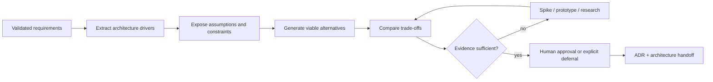
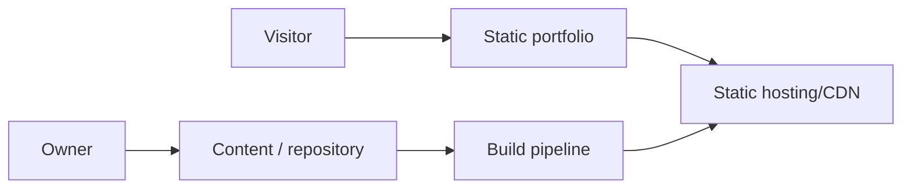
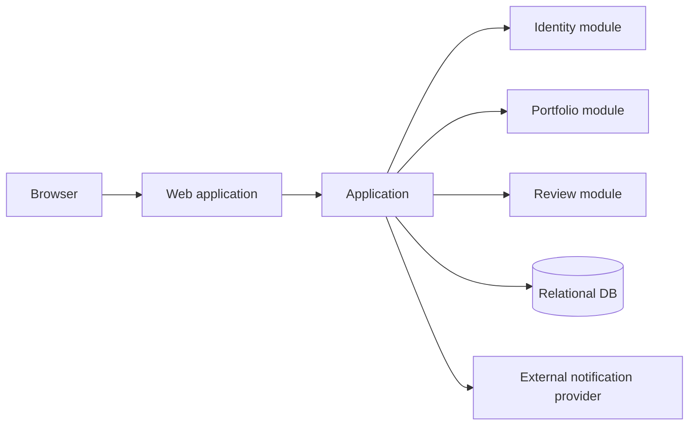
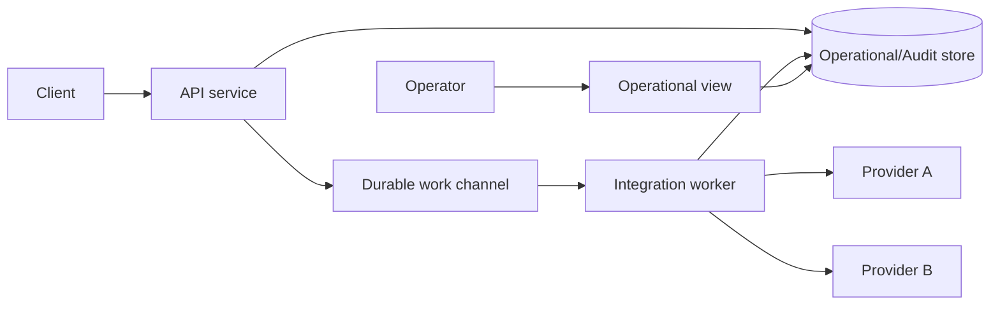
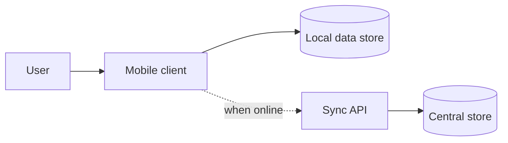

# Research 03 — Software Architecture & Technology Stack Decision-Making

> **Editorial review — 11 November 2026.** Revised from the original Deep Research report, preserving its research scope and examples. Previously missing inline references were checked and repaired where possible; unsupported empirical assertions were qualified or corrected. Bibliographic links are standalone URLs, not inaccessible session IDs. This is a research reference, not execution evidence. The editorial correction and verification records belong to the historical accompanying archive. For generated projects, the accepted [`PROJECT_CONVENTIONS.md`](https://drive.google.com/file/d/1EMvmx0or0fgv7hqKJarOmdt4e5kGKo_y/view) governs repository paths, Git branches, initial commit, handoff, human authority and release gates; the alternatives below remain research inputs.


## Foundations: Architecture as Consequential Decision-Making

Software architecture is best treated not as a diagram, folder structure, framework choice, or deployment topology, but as the set of consequential decisions that shape a system’s structure, behavior, evolvability, operational characteristics, and cost of change. ISO/IEC/IEEE 42010:2022 deliberately distinguishes an architecture from an **architecture description**: the standard governs how architecture is expressed through stakeholders, concerns, viewpoints, views, models, correspondences, and rationale, but does not prescribe a particular architecting process or notation. ([ISO/IEC/IEEE 42010:2022 — Software, systems an](https://www.iso.org/standard/74393.html))

That distinction is fundamental for an SDD bootstrap process. The bootstrap should not confuse “we created `ARCHITECTURE.md`” with “we have adequately reasoned about architecture.” Documentation is evidence of reasoning, not a substitute for it. Conversely, undocumented decisions can become accidental constraints because future contributors cannot distinguish deliberate architecture from historical accident. Architecture Decision Records address precisely this problem by capturing the context, choice, rationale, alternatives, consequences, and status of individual significant decisions. ([Martin Fowler — architecture patterns](https://martinfowler.com/bliki/ArchitectureDecisionRecord.html); [IEEE publication](https://ieeexplore.ieee.org/document/10155430/))

### A useful decision vocabulary

For bootstrap purposes, the following categories should remain semantically distinct:

| Concept | Meaning | Example |
|---|---|---|
| **Requirement** | Needed system behavior or externally observable property | “Users must be able to publish portfolio projects.” |
| **Quality-attribute scenario** | A contextualized expectation about qualities such as reliability, latency, modifiability or security | “During a regional network outage, already downloaded lessons remain usable.” |
| **Constraint** | A condition that materially narrows the solution space | “The initial budget permits only low-cost managed hosting.” |
| **Assumption** | A proposition treated temporarily as true but not yet validated | “Traffic will initially be low.” |
| **Architecture principle** | A reusable preference or guardrail | “Prefer replaceable external integrations at domain boundaries.” |
| **Architecture decision** | A chosen response to consequential forces | “Deploy as a modular monolith rather than independent services.” |
| **Implementation detail** | A lower-impact choice safely delegated to development | “Name this adapter class `StripePaymentGateway`.” |
| **Task** | Work required to implement or investigate a decision | “Create authentication provider spike.” |
| **Open issue** | A known uncertainty whose resolution is deliberately deferred | “Whether real-time collaboration is required remains unresolved.” |

This separation should be preserved in the Skill because requirements, assumptions and decisions have different authority and different change semantics. Treating an assumption as a decision—or a proposed stack as a requirement—is one of the easiest ways for an AI-assisted bootstrap to create accidental architecture.

### Architectural significance

An architecture decision is significant when getting it wrong would impose substantial consequences: expensive migration, widespread coupling, irreversible external commitments, security exposure, operational burden, data incompatibility, organizational dependency, or major impact on key quality attributes. The decision need not be technically exotic. Selecting the identity authority, persistence model, application topology, public API style, deployment substrate, offline synchronization strategy, or irreversible third-party data format may be architectural; choosing a formatting library usually is not.

The SEI’s Architecture Tradeoff Analysis Method was explicitly created to examine how architectural approaches affect multiple interacting qualities such as modifiability, performance, availability and security. The companion Quality Attribute Workshop is intended to identify and refine architecture-relevant quality scenarios even before a concrete architecture exists. ([Carnegie Mellon SEI — Architecture Tradeoff An](https://www.sei.cmu.edu/library/steps-in-an-architecture-tradeoff-analysis-method-quality-attribute-models-and-analysis/); [Carnegie Mellon SEI — Quality Attribute Worksh](https://sei.cmu.edu/library/quality-attribute-workshop-collection/))

A useful SDD heuristic is therefore:

> **Architectural significance ≈ consequence of error × cost of reversal × uncertainty × breadth of impact.**

This is a proposed heuristic, not a standard or validated mathematical model. Its purpose is triage rather than scoring.

A second important distinction is between **reversible** and **expensive-to-reverse** decisions. Reversibility is contextual. A database choice may be easy to change before production data exists and extremely costly after years of schema evolution; a frontend framework may matter little for a static brochure site but become deeply consequential in a large interactive application with hundreds of components. The Skill should therefore ask not “Is technology X architectural?” but “What would changing X later require in this project?”

### Deferral as a legitimate architectural outcome

“Do not decide yet” is a valid decision when three conditions hold: no current requirement forces the choice; alternatives can remain open without imposing hidden coupling; and the cost of obtaining additional evidence is lower than the likely cost of premature commitment. Evolutionary architecture literature advocates mechanisms such as fitness functions to keep desired architectural characteristics observable as systems change, rather than assuming architecture can be permanently fixed up front. ([Ford et al. — Building Evolutionary Architectures, fitness functions](https://evolutionaryarchitecture.com/precis.html))

Deferral becomes dangerous procrastination when downstream work requires an unresolved choice, when delaying the decision removes options, when security or compliance boundaries depend on it, or when multiple teams would otherwise make incompatible local decisions.

The bootstrap should consequently distinguish:

```text
COMMIT NOW
  └─ decision is forced by a hard constraint or high-impact dependency

INVESTIGATE NOW
  └─ consequential decision, insufficient evidence, cheap experiment possible

DEFER EXPLICITLY
  └─ no present dependency; options remain genuinely open

DELEGATE
  └─ low-impact implementation choice
```

### Evidence hierarchy

Architecture recommendations are vulnerable to cargo culting because technologies are often advocated through success stories whose organizational scale, workload, staffing, risk tolerance and operating model differ radically from the target project. Empirical studies comparing monoliths and microservices illustrate why context matters: controlled and case-study results show different performance, modularity and resource outcomes depending on workload, implementation and deployment environment, rather than establishing a universal winner. ([IEEE Access — Monolithic vs. Microservice Arch](https://ieeexplore.ieee.org/document/9717259/))

Research on software-architecture decision-making also finds that human, organizational and social factors are materially involved and remain incompletely studied; architectural decision quality cannot be reduced to technology properties alone. ([Zhou et al. — LLMs Generating Architecture Design Rationale (ACM TOSEM 2026)](https://doi.org/10.1145/3785010))

The knowledge base should label evidence explicitly:

| Evidence label | Interpretation |
|---|---|
| **Normative standard** | Defines requirements or formal terminology; strongest for what conformance means, not necessarily for project-specific choice. |
| **Empirical research** | Observed or experimental evidence; applicability depends on study design and context. |
| **Official project documentation** | Authoritative for capabilities, versions and supported behavior of that project. |
| **Vendor architecture guidance** | Useful implementation knowledge, but potentially aligned with the vendor’s platform and commercial incentives. |
| **Community practice** | Valuable experiential evidence but not proof of universal benefit. |
| **Proposed SDD heuristic** | A method to test during Skill pilots; must not be presented as established fact. |

This epistemic labeling should apply both to the Skill’s knowledge base and to sources gathered dynamically from the web.

## Architecture Discovery, Trade-offs and Solution Topologies

### A lightweight architecture-decision workflow

The heavyweight form of ATAM includes structured stakeholder activities, architecture presentations, scenario prioritization and analysis of sensitivity points, trade-offs and risks. QAW focuses earlier on eliciting and refining quality-attribute scenarios. CBAM extends architectural analysis toward economic benefit and cost. Those methods were developed for settings where architecture warranted deliberate evaluation; directly reproducing their full ceremony would be disproportionate for many small projects. ([Carnegie Mellon SEI — ATAM and CBAM integratio](https://insights.sei.cmu.edu/library/integrating-the-architecture-tradeoff-analysis-method-atam-with-the-cost-benefit-analysis-method-cbam/); [Carnegie Mellon SEI — Quality Attribute Worksh](https://sei.cmu.edu/library/quality-attribute-workshop-collection/))

For SDD Bootstrap v0.1, the underlying reasoning can be compressed into seven moves:



This is a proposed adaptation, not an official SEI method.

The critical requirement is that alternatives be generated **before** a preferred technology is normalized as inevitable. For a significant decision, the bootstrap should ordinarily expose two or three genuinely viable candidates unless a hard constraint eliminates the others. A “candidate” that obviously violates a mandatory requirement is not an alternative and should instead be recorded as rejected by constraint.

### Extracting architecture drivers

Architecture drivers normally come from a smaller subset of requirements rather than from every requirement equally. Likely drivers include:

- deployment and distribution model;
- number and type of actors;
- trust boundaries;
- data sensitivity and residency;
- integration requirements;
- offline behavior;
- expected concurrency and workload shape;
- availability and recovery expectations;
- auditability;
- regulatory constraints;
- anticipated change rate;
- organizational skills and operating capacity;
- budget and cost ceilings;
- portability requirements;
- release cadence;
- hardware limitations.

QAW’s scenario-based approach is useful because a vague claim such as “the system must be scalable” has little architectural value until stimulus, environment, affected artifact and expected response are clarified. ([Carnegie Mellon SEI — Quality Attribute Worksh](https://sei.cmu.edu/library/quality-attribute-workshop-collection/))

The Skill should resist fabricating numerical thresholds. If the stakeholder has not established a latency SLO, peak concurrency, data-retention period or recovery target, the correct artifact is an unresolved requirement or assumption—not an invented “industry standard.”

### Styles are dimensions, not mutually exclusive labels

A system can simultaneously use vertical slices inside a modular monolith, ports-and-adapters around selected domain modules, event-driven communication with an external subsystem, a server-rendered web frontend and a serverless scheduled function. Architecture styles answer different questions.

A useful decomposition is:

| Dimension | Example alternatives |
|---|---|
| Deployment topology | single deployable, modular monolith, independently deployed services |
| Internal dependency direction | layered, ports-and-adapters, clean architecture |
| Feature organization | horizontal technical layers, vertical slices |
| Interaction | synchronous request/response, asynchronous messaging, event-driven |
| State model | CRUD/state-oriented, event sourcing, append-only/audit-oriented |
| Scaling/execution | persistent process, functions/FaaS, edge execution |
| Product delivery | SSG, SSR, SPA, hybrid web, native mobile, cross-platform mobile |
| Extensibility | closed application, modules, plugins, external extension API |

Confusing those dimensions produces false arguments such as “hexagonal versus microservices,” even though one describes internal boundary design while the other primarily describes independently deployable service topology.

### Modular monolith versus microservices

A monolith can be modular, independently testable internally and horizontally replicated. Microservices add independent deployment and stronger process/network boundaries, but also distributed failure modes, versioned communication, network latency, operational coordination and data-ownership challenges. Fowler’s original microservices discussion explicitly notes both the benefits of stronger boundaries and the argument for starting with a modular monolith until independent services are justified. ([Fowler & Lewis — Microservices](https://martinfowler.com/articles/microservices.html))

Controlled evidence does not support “microservices are faster” or “monoliths are faster” as universal statements. One IEEE experiment found a monolith faster on a single machine and highlighted environment-dependent scaling economics, while later experiments and industry case studies have reported advantages for microservice variants under particular workloads and decompositions. ([IEEE Access — Monolithic vs. Microservice Arch](https://ieeexplore.ieee.org/document/9717259/))

For a small team, the bootstrap default should therefore **not** be “always use a monolith”; it should be:

> Start with the fewest independently deployable units that satisfy actual isolation, scaling, ownership and reliability requirements.

That heuristic permits a static site, single service, modular monolith, two-process system, serverless composition or microservices when justified.

### Layered, ports-and-adapters, clean architecture and vertical slices

These approaches should be treated as mechanisms for controlling source-code dependency and change propagation, not as mandatory directory templates. Their value depends on whether the system contains domain logic worth isolating, unstable external integrations, or multiple interfaces around the same core behavior.

A small CRUD application can suffer from a ceremonial interpretation of clean architecture that introduces interfaces and indirection without a meaningful boundary. Conversely, a system with volatile payment, identity or AI-provider integrations may benefit from explicit adapters even when the rest of the application remains simple.

The Skill should therefore ask:

```text
What is likely to change independently?
What must remain testable without infrastructure?
Which external dependencies are risky or replaceable?
Which domain rules deserve isolation?
```

The answer determines where abstraction is valuable.

### CQRS and event sourcing

CQRS can be justified when read and write models have materially different requirements or when domain operations benefit from explicit commands. Event sourcing can be justified when retaining a canonical history of state transitions creates important audit, reconstruction or temporal-analysis value. Neither should be inferred merely from “we need audit logs.”

Event sourcing creates architectural consequences around schema evolution, event compatibility, replay semantics, privacy deletion requirements, debugging and operational tooling. For a bootstrap process, those consequences make it an architecturally significant choice that should normally require an explicit ADR and evidence of a real requirement.

### Serverless and FaaS

Serverless execution can reduce infrastructure management for suitable event-driven or bursty workloads but changes cost models, observability, execution constraints, portability and failure handling. It should not be assumed to replace other execution models: operational suitability depends on workload, provider semantics, staffing and cost. This is a design trade-off, not a measured universal adoption trend. 

The bootstrap should therefore avoid treating serverless as “simpler” in the abstract. It is simpler only relative to a particular operational requirement and workload.

### Workflow orchestration

Long-running, retryable, multi-step business processes are different from ordinary request handlers. Explicit workflow/orchestration technology can be warranted where durable execution, compensation, retries, timeouts and human-in-the-loop stages are core requirements. If such needs are absent, adding a workflow platform during bootstrap is usually speculative complexity.

### Offline-first and edge architectures

Offline-first architecture is not equivalent to “cache a few web assets.” It raises questions of local authority, synchronization, conflict resolution, identity while disconnected, data encryption, eventual consistency and migration. On the web, Service Workers provide standardized mechanisms that can intercept fetch operations and support offline-enabled behavior, while the Web Application Manifest standard supplies install/startup metadata for web applications. ([W3C Service Workers. Current web-platform spec](https://www.w3.org/TR/service-workers/); [W3C Web Application Manifest. Primary specific](https://www.w3.org/TR/appmanifest/))

If offline modification of shared data is required, the synchronization model becomes architecturally significant and should not be deferred as a frontend implementation detail.

### Product-form decision

A useful bootstrap product-form matrix is:

| Form | Strong drivers | Reasons to reconsider |
|---|---|---|
| Static/SSG site | content-heavy, low interactivity, SEO, low operational burden | authenticated workflows, frequent personalized server data |
| SSR/hybrid web | SEO plus dynamic behavior; server-side authorization/data needs | application must operate substantially offline |
| SPA | rich long-lived client interactions | public content/SEO dominates; JavaScript execution burden unacceptable |
| PWA | web distribution plus installability/offline features | native platform APIs/distribution requirements exceed web capabilities |
| Native mobile | deep OS integration, specialized hardware, platform-specific UX | two-platform staffing and release burden |
| Cross-platform mobile | shared implementation valuable across platforms | critical features depend on divergent native behavior |
| Desktop | local files, desktop integrations, offline-heavy workflows | browser is sufficient |
| API/backend only | headless integration product | end-user interaction is actually required |
| CLI | developer/automation workflow, composability | nontechnical target audience |
| Embedded/edge | hardware locality, deterministic/local processing, connectivity constraints | cloud/web execution satisfies requirements |

UI architecture may remain undecided when the bootstrap knows the system boundaries and contracts but lacks evidence about the interaction channel. Prematurely picking a frontend framework because “every project needs one” is exactly the type of accidental commitment the Skill should prevent.

## Technology Stack Selection and Quality-Attribute Reasoning

### Selection starts with veto constraints

Weighted scoring should not be applied until hard constraints have eliminated impossible candidates.

Examples of veto criteria include:

```text
Required target platform unsupported
Mandatory license incompatible
Data residency impossible
Required offline mode unavailable
Team cannot legally or operationally adopt the service
Required authentication protocol unsupported
Deployment target cannot run the runtime
Essential accessibility requirement cannot be met
Required dependency is abandoned or unmaintained
```

Only then should remaining candidates be compared.

### Candidate stack matrix

A reusable matrix should combine qualitative evidence with deliberately limited scoring:

| Criterion | Type | Evidence | Candidate A | Candidate B | Candidate C |
|---|---|---|---|---|---|
| Mandatory platform support | veto | official docs | pass | pass | fail |
| Team competence | weighted | interview | strong | moderate | weak |
| Ecosystem maturity | weighted | releases + project evidence | strong | strong | — |
| Security posture | weighted/veto | advisories/OpenSSF | moderate | strong | — |
| Operational burden | weighted | deployment experiment | low | medium | — |
| Portability | weighted | architecture analysis | high | medium | — |
| Licensing | veto/weighted | SPDX/license text | pass | pass | — |
| Local development | weighted | spike | easy | moderate | — |
| Cost | uncertain | verified current pricing | ? | ? | — |
| Evidence confidence | metadata | source quality | high | high | — |

OpenSSF Scorecard provides automated indicators for aspects of an open-source project’s security posture, but OpenSSF itself cautions that automated validation cannot establish every relevant property and should not be treated as complete truth. The 2026 Open Source Project Security Baseline also emphasizes practices such as explicit dependency management and authenticated distribution channels. ([OpenSSF Scorecard](https://openssf.org/scorecard/); [OpenSSF OSPS Baseline v2026.08.28](https://baseline.openssf.org/versions/2026-08-28.html))

Software licensing should likewise be checked from actual license information rather than guessed from ecosystem reputation. SPDX provides an international standard and normalized identifiers for expressing software licenses and supply-chain information. ([SPDX specification](https://spdx.dev/use/specifications/))

### Why numeric ranking can mislead

A matrix with scores such as “React 8.7, Vue 8.4, Svelte 8.2” can manufacture precision unsupported by evidence. Numerical methods are useful when stakeholders understand the criteria, weights and uncertainty, but a decimal aggregate should not conceal hard constraints, missing data or a near-tie that is actually preference-sensitive.

Multi-criteria comparison can structure technology choices, but a qualitative matrix is often more appropriate when measurements, stakeholder weights or cost estimates are missing. The methodological lesson is not that one scoring formula is universally correct, but that criteria and preference structures need explicit treatment. 

For the Skill, a better approach is:

1. eliminate vetoed candidates;
2. mark unknown evidence explicitly;
3. assign only coarse ratings unless reliable quantitative measurements exist;
4. expose weights to stakeholders;
5. perform sensitivity analysis;
6. supplement the score with a trade-off narrative;
7. record dissent when participants disagree.

A useful sensitivity check is: **Would a plausible change in one weight reverse the recommendation?** If yes, the result is preference-sensitive and should be presented as such.

### Architecture spikes

When a decision is important and evidence is cheap to obtain experimentally, the bootstrap should propose a spike rather than pretending to know.

A spike might test:

```markdown
# Spike: Offline synchronization feasibility

## Question
Can candidate framework X preserve user edits across 24 hours offline
and reconcile with server state without losing data?

## Alternatives
- Framework X built-in persistence
- Local database + explicit sync layer

## Experiment
Implement one editable entity with create/update/delete while disconnected.

## Observe
- conflict semantics
- migration behavior
- platform support
- testability
- operational complexity

## Timebox
4 engineering hours

## Exit condition
Produce evidence sufficient for ADR-004; do not implement production solution.
```

This is preferable to an AI model asserting that a framework “handles offline seamlessly” without testing the project’s actual synchronization requirement.

### Stack freshness

Languages, frameworks, SDKs, cloud services, pricing, hosted quotas and protocol versions are volatile knowledge. They should never be copied blindly from a static knowledge chapter.

The bootstrap should distinguish:

```text
ENDURING KNOWLEDGE
architecture principles, trade-off reasoning, decision methods

SEMI-VOLATILE KNOWLEDGE
ecosystem maturity, common deployment forms, project health

VOLATILE KNOWLEDGE
supported versions, pricing, quotas, API capabilities, security advisories,
framework release status, hosted-service availability
```

For volatile decisions, the Skill should query current official sources at decision time, record an **as-of date**, and flag conflicts with its stored knowledge.

This matters in practice. For example, as of 11 November 2026 the latest published NIST SSDF baseline remains Version 1.1 as a final publication, while Version 1.2 exists as an Initial Public Draft from December 2025; an agent must not silently treat the draft as a final standard. ([NIST official publication](https://csrc.nist.gov/pubs/sp/800/218/r1/ipd))

### Quality-attribute trade-offs

Quality attributes should be converted into contextual scenarios before architectural consequences are drawn. SEI methods were developed precisely because architectural choices create interactions among qualities rather than optimizing them independently. ([Carnegie Mellon SEI — Architecture Tradeoff An](https://www.sei.cmu.edu/library/steps-in-an-architecture-tradeoff-analysis-method-quality-attribute-models-and-analysis/); [Carnegie Mellon SEI — Quality Attribute Worksh](https://sei.cmu.edu/library/quality-attribute-workshop-collection/))

Typical tensions include:

| Tension | Architectural implication |
|---|---|
| Low cost ↔ high availability | redundancy and managed resilience add cost |
| Simplicity ↔ independent deployment | service separation increases distributed-system burden |
| Portability ↔ managed-service leverage | abstraction reduces lock-in but may sacrifice provider-specific capabilities |
| Offline availability ↔ strong global consistency | disconnected writes require reconciliation semantics |
| Fast delivery ↔ generalized extensibility | speculative abstraction increases near-term complexity |
| Strong isolation ↔ low latency | process/network boundaries add communication overhead |
| Audit history ↔ privacy deletion | immutable history can conflict with deletion requirements |
| Minimal operations ↔ infrastructure control | managed platforms trade control for operational abstraction |
| Accessibility ↔ highly custom interaction | bespoke UI behavior increases accessibility responsibility |
| Observability ↔ data minimization | telemetry must avoid collecting unnecessary sensitive data |

These are tensions, not laws. The architecture should document which side matters more for the actual system and why.

### Modern ecosystem evidence as of 11 November 2026

Cloud-native technology is widespread but that fact should not be converted into a bootstrap default. CNCF’s 2026 surveys report substantial cloud-native and platform-engineering adoption, and its annual survey reports Kubernetes use across a large share of surveyed container users. Those populations are self-selected toward cloud-native practice, however, so their results describe ecosystem adoption rather than proving that Kubernetes, containers, microservices or platform engineering are appropriate for every project. ([CNCF State of Cloud Native Development Q3 2026](https://www.cncf.io/reports/the-state-of-cloud-native-development-q3-2026/))

The architectural lesson for a tiny bootstrap project is therefore almost the opposite of trend chasing: widespread sophisticated infrastructure makes those technologies **available**, not automatically **necessary**.

## Architecture Knowledge, Human–AI Collaboration and External Capabilities

### Smallest sufficient architecture description

ISO/IEC/IEEE 42010 requires architecture descriptions to address stakeholder concerns through suitable viewpoints and models, but it intentionally avoids prescribing a particular notation or document layout. ([ISO/IEC/IEEE 42010:2022 — Software, systems an](https://www.iso.org/standard/74393.html))

C4 provides four levels of static structural abstraction—system context, container, component and code—and its own guidance states that context and container diagrams are sufficient for many teams. ([C4 Model — official documentation. Primary doc](https://c4model.com/diagrams))

arc42 provides a broader architecture-documentation template covering topics such as constraints, context, solution strategy, building blocks, runtime, deployment, cross-cutting concepts, decisions, quality and risks, and is explicitly suitable for text/docs-as-code workflows. ([arc42 documentation template](https://docs.arc42.org/))

These approaches should be composed rather than treated as competing standards.

A minimal bootstrap architecture package can be:

```text
docs/ARCHITECTURE.md
  - goals and architectural drivers
  - system context
  - container/deployable-unit view
  - key constraints
  - chosen architecture style(s)
  - quality-attribute implications
  - deployment concept
  - unresolved architecture questions

docs/decisions/
  0001-*.md
  0002-*.md

docs/specs/
  implementation-ready feature or infrastructure specs

docs/BACKLOG.md
  spikes, unresolved decisions and prioritized implementation work
```

Component diagrams should only appear where internal structure is sufficiently important and stable to justify them. C4 itself emphasizes selective use of diagram levels. ([C4 Model — official documentation. Primary doc](https://c4model.com/diagrams))

### Text-as-code and drift

Architecture documentation stored alongside implementation is easier to review and version with changes. arc42 explicitly supports Markdown/AsciiDoc docs-as-code, while ADR practice commonly keeps records in source control and preserves superseded decisions rather than rewriting history. ([Martin Fowler — architecture patterns](https://martinfowler.com/bliki/ArchitectureDecisionRecord.html))

Diagram drift cannot be solved merely by choosing Mermaid or PlantUML. Textual formats improve diffability, but semantic drift still occurs if implementation changes without documentation review. The Skill should therefore attach change triggers to significant decisions:

```text
If authentication authority changes → review ADR-003 + threat boundaries.
If a new deployable service is introduced → update container/deployment view.
If persistent data ownership moves → review integration ADRs.
If offline writes are introduced → open synchronization ADR.
```

Fitness functions can eventually automate selected architectural invariants where those invariants are machine-checkable. ([Ford et al. — Building Evolutionary Architectures, fitness functions](https://evolutionaryarchitecture.com/precis.html))

### ADR template

```markdown
# ADR-NNN — <Decision title>

Status: Proposed | Accepted | Rejected | Superseded | Deferred
Date:
Decision owners:
Approved by:
Supersedes:
Superseded by:

## Context
What problem or architectural force requires a decision?

## Drivers
- Requirement / quality scenario
- Constraint
- Risk
- Organizational consideration

## Assumptions
- ...

## Options considered

### Option A
Benefits:
Costs:
Risks:
Evidence:

### Option B
Benefits:
Costs:
Risks:
Evidence:

## Decision
What is chosen, or why is the decision deferred?

## Rationale
Why does this option best fit the current context?

## Consequences
Positive:
Negative:
Operational:
Migration/exit implications:

## Confidence
High | Medium | Low

## Revisit when
Concrete trigger conditions.

## Sources
Verified URLs and access dates.
```

This extends common ADR practice with explicit assumptions, confidence and change triggers. Standard ADR practice emphasizes brevity, context, rationale, consequences, alternatives and superseding rather than rewriting old decisions. ([Martin Fowler — architecture patterns](https://martinfowler.com/bliki/ArchitectureDecisionRecord.html))

### AI-assisted architecture

Current research suggests that LLMs can contribute to architectural analysis but should not be treated as autonomous architecture authorities. A 2025 systematic literature review found growing application of LLMs to architecture tasks while identifying important underexplored areas such as conformance and cloud-native architecture. A 2026 study of ADR-violation detection found stronger performance for explicit, code-inferable decisions than for implicit or deployment/organizational decisions. Another 2026 study found that LLM-extracted architectural decisions could miss rationale and become overly implementation-focused. ([Schmid et al., Software Architecture Meets LLM](https://arxiv.org/abs/2505.16697); [Su et al., Evaluating Large Language Models fo](https://arxiv.org/abs/2602.07609))

A 2026 empirical study specifically evaluating LLM-generated design rationale further reinforces that generated rationale itself is a research subject rather than evidence that architectural judgment can safely be delegated wholesale. ([Zhou et al. — LLMs Generating Architecture Design Rationale (ACM TOSEM 2026)](https://doi.org/10.1145/3785010))

The Skill should therefore permit AI agents to:

- retrieve current documentation;
- enumerate alternatives;
- identify contradictions;
- draft decision matrices;
- inspect dependency and repository metadata;
- draft ADRs;
- design spikes;
- inspect architecture conformance;
- propose change triggers.

High-impact choices remain subject to explicit human approval.

An authority matrix can be:

| Action | AI agent | Human participant |
|---|---|---|
| Extract drivers | propose | verify |
| Identify missing evidence | yes | respond/approve |
| Generate alternatives | yes | expand/reject |
| Eliminate hard-constraint violations | propose with evidence | confirm |
| Recommend stack | yes, with uncertainty | decide |
| Accept high-impact ADR | no | yes |
| Run non-destructive spike | when authorized | authorize |
| Introduce paid dependency/account | no unilateral action | explicit approval |
| Store secrets | never in repo/bootstrap ZIP | user provisions securely |
| Supersede architecture decision | propose | approve |
| Deploy production system | outside bootstrap scope | later workflow |

### Independent review and multi-agent use

Parallel AI review can be useful because architecture reasoning is vulnerable to anchoring. One agent can propose, another can search for invalid assumptions, and a third can test documentation consistency. However, agreement among models does not transform weak evidence into fact. The 2026 ADR-conformance study used multiple models as validators but still found limitations where decisions depended on non-code organizational or deployment knowledge. ([Su et al., Evaluating Large Language Models fo](https://arxiv.org/abs/2602.07609))

The bootstrap should therefore distinguish:

```text
SOURCE CONSENSUS
multiple independent primary sources support the claim

MODEL CONSENSUS
multiple AI agents produced similar reasoning

HUMAN APPROVAL
responsible participant accepts the decision
```

They are not interchangeable.

### MCP, SDK, CLI and external tool selection

MCP is now a rapidly evolving open protocol ecosystem. The official MCP project published a new specification revision on 28 July 2026 with a stateless core, authorization hardening and a formal extensions framework, and operates an official server registry. ([MCP specification (contextual source)](https://modelcontextprotocol.io/))

That does **not** mean an MCP server belongs in every project. The correct decision sequence is:

```text
Needed capability
   ↓
Could the capability be provided by:
   ├─ built-in tool?
   ├─ ordinary library?
   ├─ SDK?
   ├─ CLI?
   ├─ HTTP/API integration?
   └─ MCP server?
```

The mechanism should be selected according to reproducibility, permission scope, maintenance, secret handling, local/remote execution, trust boundaries and portability.

Third-party MCP servers deserve particularly explicit review because tool descriptions and remote content can become prompt-injection or confused-deputy surfaces. OWASP’s MCP security guidance identifies prompt injection, tool poisoning, supply-chain concerns and SSRF among relevant risks and recommends controls around least privilege, validation and third-party server trust. ([MCP specification (contextual source)](https://modelcontextprotocol.io/))

The bootstrap may safely preconfigure an MCP that has been judged useful, but configuration should distinguish:

```text
development-time capability
≠ build dependency
≠ production runtime dependency
```

A repository might therefore contain:

```text
docs/mcp/
  README.md
  selected-server.md
  security-review.md

.example-agent-config/
  mcp.example.json
```

with environment-variable placeholders instead of credentials.

## Worked End-to-End Scenarios

### Scenario A: Personal portfolio with future extensibility

#### Starting requirements

Assume:

- public portfolio pages;
- strong discoverability and accessibility;
- project content updated infrequently;
- no user accounts at launch;
- low operating budget;
- possibility of adding a contact workflow and private editing later;
- no need for real-time personalization.

These are scenario assumptions for illustration, not evidence about a specific real project.

#### Architecture drivers

The dominant forces are low operational burden, public content delivery, accessibility, crawlability, maintainability, low lock-in and the possibility of adding limited dynamic behavior later.

#### Viable alternatives

| Alternative | Strengths | Costs/risks |
|---|---|---|
| Static/SSG site | extremely small runtime surface; cheap/simple hosting; strong fit for content | dynamic functionality requires later additions |
| SSR/hybrid application | dynamic behavior available immediately | unnecessary runtime/operations initially |
| SPA + API backend | rich client architecture | backend and client complexity not justified by current requirements |

#### Decision

The bootstrap should prefer a static or statically generated architecture **provided current content-management needs permit it**, while keeping contact and editing capabilities outside the initial runtime boundary.



#### Sample ADR

**Illustrative only:** this ADR records a plausible option, not a decision authorized by a real project owner. A later human approval would change its status and record the actual decision evidence.

```markdown
# ADR-001 — Start with a static deployable web artifact

Status: Proposed

## Context
The launch product contains public portfolio content and no authenticated
runtime workflow.

## Alternatives
1. Static/SSG artifact
2. SSR application
3. SPA plus API

## Decision
Use a static deployable architecture. Do not introduce an application
backend until a concrete dynamic requirement requires one.

## Rationale
It satisfies current functionality with the smallest operational surface
and preserves the option to add separate dynamic services later.

## Consequences
The initial architecture cannot provide authenticated editing or dynamic
per-user data without extension.

## Revisit when
Authenticated editing, personalized runtime content, transactional
workflows, or equivalent dynamic behavior becomes approved scope.
```

This follows the general principle of selecting the fewest deployable units required, rather than assuming a distributed topology. The C4 system-context/container abstraction remains sufficient here; a component-level diagram would add little value. ([C4 Model — official documentation. Primary doc](https://c4model.com/diagrams))

#### Safe bootstrap commitments

Commit to product form, deployable artifact type, source/content boundary, deployment preparation and initial specs.

Defer exact frontend framework if more than one candidate satisfies the build and accessibility requirements and no high-impact constraint distinguishes them.

### Scenario B: Hackadō bootcamp/portfolio platform

#### Starting requirements

Assume:

- multiple users;
- profiles and portfolio submissions;
- instructors/reviewers;
- privacy-sensitive account data;
- staged growth rather than hyperscale launch;
- browser-first experience;
- eventual moderation, notifications and analytics;
- small initial engineering team.

#### Architecture drivers

Identity, authorization, data ownership, privacy, changeability, team capacity and staged growth are more important than independent service deployment.

#### Alternatives

| Alternative | Strengths | Risks |
|---|---|---|
| Modular monolith + relational database | simple deployment; transactions; clear internal modules; easy local dev | requires discipline to preserve boundaries |
| Several microservices | deployment independence | unnecessary networking, versioning and operational overhead for initial team |
| Backend-as-a-service-heavy architecture | fast capability acquisition | service coupling, exit/migration and data-governance implications |

#### Proposed topology



Logical modules should not be mistaken for independent deployables.

#### ADR

```markdown
# ADR-002 — Use one application deployable with enforced domain modules

Status: Proposed

## Drivers
- small initial team
- relational multi-user data
- privacy-sensitive identity
- staged growth
- no demonstrated need for independent service scaling

## Decision
Begin as a modular monolith.

## Rejected alternative
Independent services are deferred because there is no current scaling,
team-ownership or isolation requirement strong enough to offset distributed
system complexity.

## Revisit when
A module requires independent scaling, release ownership, regulatory
isolation, materially different runtime characteristics, or separate
availability boundaries.
```

Microservice evidence is context dependent, and widely cited practitioner guidance explicitly acknowledges modular-monolith-first as a legitimate strategy. ([IEEE Access — Monolithic vs. Microservice Arch](https://ieeexplore.ieee.org/document/9717259/))

#### Stack note

The Skill should shortlist language/runtime/framework combinations based on team competence, deployment compatibility, security maintenance, testing ecosystem, accessibility support, license and provider portability; it should **not** hard-code a universal JavaScript, Python, Java or .NET preference.

Identity deserves its own decision because changing identity authority after accounts exist can become costly. Security requirements should be mapped later to the dedicated security chapter; NIST SSDF and OWASP ASVS provide current secure-development and verification references rather than a justification for any particular framework. ([NIST official publication](https://csrc.nist.gov/pubs/sp/800/218/final); [OWASP ASVS. Open application-security verifica](https://asvs.owasp.org/))

#### Requirement change

Suppose a new requirement appears:

> Enterprise customers require isolated regional deployments with separate operational ownership.

That materially changes the earlier topology. The correct response is not to rewrite ADR-002 as though the original decision was wrong. Instead:

```markdown
ADR-007 — Separate enterprise tenancy boundary
Status: Proposed
Proposed effect if approved: supersede relevant scope of ADR-002
```

The architecture might evolve toward:

```text
Public application
     |
shared domain modules
     |
deployment boundary
├── general SaaS deployment
└── isolated enterprise deployment(s)
```

Only services whose independent deployment is now justified should separate. ADR practice recommends preserving historical records and linking superseding decisions. ([Martin Fowler — architecture patterns](https://martinfowler.com/bliki/ArchitectureDecisionRecord.html))

### Scenario C: API-first service with audit and reliability constraints

#### Starting requirements

Assume:

- machine-to-machine API;
- integrations with several external providers;
- every consequential request must be auditable;
- downstream providers can fail or rate-limit;
- duplicate requests must not create duplicate side effects;
- human operators need traceability;
- the reliability requirement is more stringent than ordinary hobby software.

#### Architecture drivers

External unreliability, idempotency, auditability, failure isolation and operational visibility dominate.

#### Alternatives

**Alternative A — synchronous request chain**

```text
Client → API → Provider A → Provider B → response
```

Simple, but client reliability becomes coupled to downstream providers.

**Alternative B — accepted request + durable asynchronous processing**

```text
Client → API → durable work → worker → external providers
```

More moving parts, but retries and failure isolation become explicit.

**Alternative C — workflow engine**

Appropriate if interactions become long-running, compensating and stateful enough to justify durable orchestration.

#### ADR

```markdown
# ADR-003 — Decouple external side effects from synchronous request completion

Status: Proposed

## Drivers
- third-party outages must not lose accepted work
- requests require auditability
- retries must be controlled and idempotent

## Decision
Persist accepted commands before external execution and process external
side effects asynchronously.

## Deferred
No workflow engine is selected yet. A queue + worker is sufficient until
multi-step durable orchestration becomes an evidenced requirement.

## Consequences
Clients require operation-status semantics.
Retry and idempotency behavior become explicit parts of the contract.
```

This illustrates an important bootstrap behavior: architecture can commit to a reliability pattern without prematurely committing to a specific queue, cloud service or workflow vendor.

#### Context/container sketch



Detailed event schemas and API contracts belong in the later data/API research chapter.

#### Bootstrap commitment

Commit to idempotency as a required architectural property, durable acceptance, audit records and failure-aware processing.

Defer specific queue/runtime until current hosting candidates and verified cost/operational constraints are known.

### Scenario D: Offline-first mobile field application

#### Starting requirements

Assume:

- field workers may have no network for many hours;
- users must create and edit records while offline;
- data later synchronizes with a central system;
- device storage is constrained;
- conflicts between edits are possible;
- mobile distribution is required.

#### Drivers

Offline correctness, local persistence, synchronization, conflict semantics, device security and migration outweigh ordinary server-centric design simplicity.

#### Alternatives

| Alternative | Assessment |
|---|---|
| Web/PWA + service worker + browser storage | viable if required native/device capabilities and storage behavior are sufficient |
| Cross-platform mobile + local database | viable when broader device integration or stronger local persistence is required |
| Native applications | viable where platform-specific requirements justify separate implementation |

Service Workers standardize useful web offline mechanisms, but they do not eliminate application-level conflict or data-authority decisions. ([W3C Service Workers. Current web-platform spec](https://www.w3.org/TR/service-workers/))

#### Architecture



#### ADR

```markdown
# ADR-004 — Local state is authoritative during disconnected operation

Status: Proposed
Confidence: Medium

## Context
Users must create and edit records without connectivity.

## Decision
The client must persist domain changes locally and maintain a synchronization
queue. The concrete mobile technology remains undecided pending a device/API spike.

## Open issue
Conflict policy for concurrent updates requires stakeholder approval.

## Revisit when
Device capability requirements or conflict semantics eliminate one of the
candidate product forms.
```

#### Significant requirement change

Suppose stakeholders then require access to a proprietary hardware peripheral available only through a platform-specific native API and unsupported by the shortlisted cross-platform/web options.

That becomes a hard constraint. The product-form decision may shift to native or to a hybrid containing a native bridge. The correct trace is:

```text
new requirement
→ candidate compatibility re-check
→ previous assumption invalidated
→ ADR-004 partially superseded
→ new spike/ADR
```

No amount of weighted preference scoring should override a hard compatibility veto.

## Reusable SDD Bootstrap Architecture-Decision Protocol

### Adaptive interview prompts

The architecture interview should not ask every project every question. It should expand only where answers can affect a consequential decision.

Core prompts:

```text
Where will this run, and who must be able to use it?
Must any part keep working without network access?
What data would be costly, harmful or illegal to lose or expose?
Which external systems must it integrate with?
Are any platforms, languages, providers or licenses mandatory or forbidden?
Who will develop and operate it after bootstrap?
What accounts, paid services, domains or credentials will be required?
What failures are unacceptable?
Which parts are likely to change most?
Are there deployment, residency or distribution constraints?
What would be expensive to migrate later?
```

Follow-up questions are triggered by uncertainty and decision impact rather than by a fixed questionnaire.

### Architecture significance triage

```text
For each candidate decision:

1. Does a requirement or constraint force it?
2. Does it materially affect more than one subsystem?
3. Is reversal expensive after implementation or data accumulation?
4. Does it change a trust, persistence, deployment or integration boundary?
5. Does it create vendor/provider dependence?
6. Does it materially affect a critical quality attribute?
7. Is stakeholder disagreement unresolved?

0–1 YES → usually delegate/document lightly
2–3 YES → evaluate and record if needed
4+ YES → architecture decision; explicit review required
```

The thresholds are intentionally provisional and should be empirically tested during pilots rather than presented as validated science.

### Minimal path

For a low-risk project:

```text
PRD / validated requirements
      ↓
5–10 architecture drivers
      ↓
context diagram
      ↓
container/deployable view
      ↓
1–3 significant ADRs
      ↓
stack shortlist + current-source checks
      ↓
implementation specs + backlog
      ↓
bootstrap readiness review
```

No architecture document should be expanded merely to fill a template.

### Scaled path

For a higher-risk system:

```text
requirements
→ prioritized quality scenarios
→ trust/data/deployment boundaries
→ architecture alternatives
→ explicit trade-off analysis
→ risk workshop
→ spikes
→ ADR set
→ context/container/deployment views
→ stack evidence matrix
→ architecture review
→ conformance/fitness-function candidates
→ implementation handoff
```

This reflects the intent of QAW/ATAM-style scenario and trade-off reasoning while keeping the method proportionate. ([Carnegie Mellon SEI — Architecture Tradeoff An](https://www.sei.cmu.edu/library/steps-in-an-architecture-tradeoff-analysis-method-quality-attribute-models-and-analysis/); [Carnegie Mellon SEI — Quality Attribute Worksh](https://sei.cmu.edu/library/quality-attribute-workshop-collection/))

### Authority policy

Architecture decisions can have five statuses:

```text
PROPOSED
ACCEPTED
DEFERRED
REJECTED
SUPERSEDED
```

AI may create **PROPOSED** or recommend **DEFERRED**. It should not silently promote a high-impact choice to **ACCEPTED** when human approval is required.

The Skill should distinguish:

```text
User-stated constraint
Observed evidence
AI inference
AI recommendation
Human-approved decision
```

Each has different authority.

### Architecture documentation skeleton

```markdown
# Architecture

## Scope
What this architecture covers and explicitly excludes.

## Architectural Drivers
Requirements, quality scenarios and constraints.

## Assumptions and Unknowns
Validated separately from decisions.

## System Context
People, external systems and trust boundaries.

## Solution Topology
Deployable units, major stores and communication paths.

## Architecture Styles
Only styles actually used, with rationale.

## Technology Stack
Chosen technologies and deferred choices.

## Deployment Intent
Development/staging/production concept, hosting constraints,
accounts and secrets required. Bootstrap does not deploy.

## Significant Decisions
Links to ADRs.

## Quality Consequences
Known trade-offs and risks.

## Open Architecture Questions
Questions with owner/trigger.

## Change Triggers
Conditions that require architecture review.

## Evidence
Sources with date checked.
```

### Candidate stack worksheet

```markdown
# Stack Decision Worksheet

Decision:
Owner:
Decision deadline:
Reversibility: Easy / Moderate / Expensive
Confidence:

## Hard constraints
- ...

## Candidates
- A
- B
- C

## Criteria
| Criterion | Importance | A | B | C | Evidence |
|---|---:|---|---|---|---|

## Unknowns
- ...

## Spike required?
Yes / No

## Recommendation
...

## Human decision
Accepted / Deferred / Rejected

## Revisit when
...
```

### Bootstrap readiness gates

The architecture portion of bootstrap is ready when:

**Semantic gate.** Requirements, constraints, assumptions and decisions are distinguishable.

**Alternative gate.** Significant choices have either credible alternatives or a documented hard constraint that removes them.

**Evidence gate.** Volatile stack claims have been checked against current authoritative sources.

**Human-authority gate.** Consequential decisions have explicit ownership and approval status.

**Deployment gate.** Online systems identify intended deployment shape, required external accounts, environments and secret categories—even though the Skill does not deploy them.

**Security gate.** Major trust boundaries and sensitive-data locations are visible enough for the dedicated security analysis.

**Reversibility gate.** Expensive-to-reverse choices contain rationale and revisit triggers.

**Implementation gate.** The repository tells an implementation agent what is decided, what is prohibited, what remains open and which specs/backlog items come first.

**Expectation gate.** The human is explicitly told that the bootstrap output is development-ready planning and scaffolding, **not a finished executable, deployed service or APK**.

### Development handoff contract

A Codex/OpenCode/other-agent handoff should say, in effect:

```markdown
Implement only Accepted requirements and decisions.

Do not silently resolve Open Architecture Questions.

Do not replace a selected dependency/provider without recording the reason.

Treat Deferred decisions as intentionally unresolved.

Do not introduce new paid services, external accounts or secrets without approval.

When implementation evidence invalidates an architectural assumption:
1. stop the affected decision path,
2. report the contradiction,
3. propose an ADR update or superseding ADR,
4. continue only after the required approval.

Keep architecture docs and accepted ADRs consistent with implementation.
```

This makes architecture a live collaboration boundary rather than a one-time generated report.

## Pilot Evaluation, Freshness and Implications for SDD Bootstrap Skill v0.1

### Pilot hypotheses

The architecture methodology should be treated as something to test, not merely as plausible guidance.

Useful hypotheses include:

**H1.** Requiring explicit assumptions reduces silent architectural commitments.

**H2.** Alternative-first reasoning reduces unjustified stack choices compared with asking an agent directly for “the best stack.”

**H3.** A minimal context/container view plus ADRs gives better implementation handoff clarity per unit of documentation than a large generic architecture template for small projects.

**H4.** Current-source verification materially reduces obsolete framework/service recommendations.

**H5.** Explicit deferment reduces premature commitments without increasing implementation blocking.

**H6.** Independent AI review catches more assumption leakage and architecture contradictions than self-review alone.

Research on ADR adoption suggests that ADRs are still inconsistently used in open-source projects and often appear only in small numbers, while action research indicates they can address architecture knowledge-sharing problems when introduced deliberately. This supports testing whether a small ADR set provides enough value for SDD bootstrap rather than assuming extensive decision documentation is always beneficial. ([IEEE publication](https://ieeexplore.ieee.org/document/10155430/); [Chalmers University — Architecture Decision Re](https://research.chalmers.se/publication/542849))

### Ablation design

Across pilot projects, compare:

| Variant | Removed element | Question |
|---|---|---|
| A | no alternatives matrix | does anchoring increase? |
| B | no assumption register | do hidden assumptions become decisions? |
| C | no ADRs | does later rationale recovery degrade? |
| D | no current web verification | how many stack claims become stale or incorrect? |
| E | no explicit deferral state | are uncertain choices prematurely fixed? |
| F | no independent review | do contradictions survive bootstrap more often? |

### Metrics

Record:

- architecturally significant assumptions discovered after bootstrap;
- stakeholder corrections to architecture;
- number of unjustified technology commitments;
- number and cost class of reversed decisions;
- implementation blockers caused by unresolved architecture;
- architecture/spec traceability coverage;
- stale or incorrect technology claims;
- documentation volume;
- bootstrap time;
- model/tool token cost where measurable;
- number of ADRs actually consulted during implementation;
- developer/agent handoff comprehension;
- number of decisions later discovered to have no recorded rationale;
- architecture mismatch detected during first implementation increment.

A useful qualitative rubric asks implementers:

```text
Can I tell what is mandatory?
Can I tell what is merely recommended?
Can I tell what remains undecided?
Can I trace important choices to requirements?
Can I tell why a stack was selected?
Can I see which decisions require human approval to change?
Can I begin the first backlog item without inventing architecture?
```

### Adversarial and failure-injection tests

The Skill should be tested with cases such as:

- user requests microservices “because Netflix uses them” despite a tiny scope;
- AI proposes a framework version that has been superseded;
- hosted service pricing is unavailable or ambiguous;
- two stakeholders disagree about cloud-provider lock-in;
- requirement implies offline behavior late in the interview;
- a library is popular but its license conflicts with the project;
- an MCP server offers the needed capability but requests broad filesystem/network permissions;
- external documentation contains prompt-injection text;
- a deployment account requires paid billing information;
- an implementation agent discovers that an accepted assumption is false;
- a framework is technically capable but unknown to the maintaining team;
- two candidates are indistinguishable without a prototype.

The desired behavior is not “always choose correctly.” It is to **avoid presenting unsupported confidence as architectural certainty**.

### What would falsify the proposed heuristics?

The methodology should be changed if pilots show that:

- alternatives matrices do not materially improve decisions but significantly increase effort;
- ADRs are routinely ignored and their rationale is recoverable equally well through simpler artifacts;
- significance triage misses expensive decisions;
- explicit deferral routinely creates implementation paralysis;
- human approval gates generate ceremony without catching consequential mistakes;
- AI-generated architecture options create more anchoring than they prevent;
- context/container diagrams do not improve handoff comprehension;
- current-web validation costs substantially more than the errors it prevents for specific categories of knowledge.

Those outcomes should lead to method revision rather than post-hoc defense of the framework.

### Knowledge freshness protocol

Each architecture knowledge topic should carry a freshness class:

```yaml
topic: "technology-stack-selection"
stability: mixed
last_reviewed: 2026-11-11
revalidate:
  - framework versions
  - runtime support
  - hosting availability
  - pricing
  - protocol versions
  - security guidance
stable_core:
  - expose constraints
  - compare alternatives
  - record rationale
  - preserve human approval
```

When a web check contradicts the stored chapter:

```text
1. Preserve the stored text as historical knowledge.
2. Use the currently authoritative source for the live project decision.
3. Identify the affected knowledge section.
4. Report the discrepancy.
5. Propose a knowledge-base update.
6. Do not silently rewrite established guidance.
```

This is particularly important for fast-moving integration ecosystems. MCP, for example, had a new formal specification release on 28 July 2026 and continues to evolve authorization and extension mechanisms; a static Skill should therefore never assume its embedded MCP details remain current. ([MCP specification (contextual source)](https://modelcontextprotocol.io/))

### Implications for SDD Bootstrap Skill v0.1

The minimum viable architecture policy should be small:

```text
Understand drivers.
Separate constraints from assumptions.
Identify consequential decisions.
Generate credible alternatives.
Check hard constraints first.
Gather evidence proportional to risk.
Use spikes where evidence is cheap to obtain.
Allow explicit deferral.
Require human approval for high-impact choices.
Record accepted decisions and rationale.
Prepare deployment without performing it.
Hand unresolved questions to implementation explicitly.
Revalidate volatile technology knowledge from authoritative sources.
```

The Skill should explicitly reject several anti-patterns:

```text
"Every web app should use <framework>."
"Microservices are more scalable."
"Serverless is cheaper."
"Kubernetes is the modern default."
"This database is best."
"MCP is better than an SDK."
"A 9.1 score means this stack objectively wins."
"This is industry standard." [without a real standard]
"We can decide that later." [without analyzing option loss]
"The AI agents agree, therefore the claim is verified."
```

The core readiness principle is:

> **Bootstrap should commit only to architecture that is sufficiently justified to unblock safe development, while preserving every economically valuable option that does not yet need to be closed.**

That principle is compatible with ISO/IEC/IEEE 42010’s concern-oriented architecture descriptions, SEI scenario/trade-off methods, lightweight ADR practice and evolutionary architecture, while remaining intentionally smaller than any of those methods in full form. ([ISO/IEC/IEEE 42010:2022 — Software, systems an](https://www.iso.org/standard/74393.html); [Carnegie Mellon SEI — Architecture Tradeoff An](https://www.sei.cmu.edu/library/steps-in-an-architecture-tradeoff-analysis-method-quality-attribute-models-and-analysis/); [Carnegie Mellon SEI — Quality Attribute Worksh](https://sei.cmu.edu/library/quality-attribute-workshop-collection/))

### Annotated primary and authoritative references

**ISO/IEC/IEEE 42010:2022 — Software, systems and enterprise — Architecture description.** Normative international standard defining architecture-description concepts, stakeholders, concerns, viewpoints and rationale. Accessed 11 November 2026.
https://www.iso.org/standard/74393.html ([ISO/IEC/IEEE 42010:2022 — Software, systems an](https://www.iso.org/standard/74393.html))

**Carnegie Mellon SEI — Architecture Tradeoff Analysis Method collection and ATAM analysis material.** Primary source for systematic quality-attribute trade-off analysis.
https://www.sei.cmu.edu/library/steps-in-an-architecture-tradeoff-analysis-method-quality-attribute-models-and-analysis/ ([Carnegie Mellon SEI — Architecture Tradeoff An](https://www.sei.cmu.edu/library/steps-in-an-architecture-tradeoff-analysis-method-quality-attribute-models-and-analysis/))

**Carnegie Mellon SEI — Quality Attribute Workshop Collection.** Primary source for architecture-relevant scenario generation before architecture selection.
https://sei.cmu.edu/library/quality-attribute-workshop-collection/ ([Carnegie Mellon SEI — Quality Attribute Worksh](https://sei.cmu.edu/library/quality-attribute-workshop-collection/))

**Carnegie Mellon SEI — ATAM and CBAM integration.** Primary source for coupling architectural trade-offs to economic reasoning.
https://insights.sei.cmu.edu/library/integrating-the-architecture-tradeoff-analysis-method-atam-with-the-cost-benefit-analysis-method-cbam/ ([Carnegie Mellon SEI — ATAM and CBAM integratio](https://insights.sei.cmu.edu/library/integrating-the-architecture-tradeoff-analysis-method-atam-with-the-cost-benefit-analysis-method-cbam/))

**C4 Model — official documentation.** Primary documentation from the model’s creator; useful for context/container/component/code and deployment views.
https://c4model.com/diagrams ([C4 Model — official documentation. Primary doc](https://c4model.com/diagrams))

**arc42 — official documentation.** Primary source for pragmatic architecture-documentation structure and docs-as-code usage.
https://arc42.org/
https://docs.arc42.org/ 

**Martin Fowler — Architecture Decision Record.** Practitioner primary source documenting modern ADR usage, including short records, rationale and superseding rather than rewriting accepted decisions.
https://martinfowler.com/bliki/ArchitectureDecisionRecord.html ([Martin Fowler — architecture patterns](https://martinfowler.com/bliki/ArchitectureDecisionRecord.html))

**IEEE — Using Architecture Decision Records in Open Source Projects: An MSR Study on GitHub.** Empirical study of ADR adoption patterns in open-source repositories.
https://ieeexplore.ieee.org/document/10155430/ ([IEEE publication](https://ieeexplore.ieee.org/document/10155430/))

**Chalmers University — Architecture Decision Records in Practice: An Action Research Study.** Empirical introduction of ADRs in an industrial context.
https://research.chalmers.se/publication/542849 ([Chalmers University — Architecture Decision Re](https://research.chalmers.se/publication/542849))

**IEEE Access — Monolithic vs. Microservice Architecture: A Performance and Scalability Evaluation.** Controlled empirical comparison illustrating environment-sensitive outcomes.
https://ieeexplore.ieee.org/document/9717259/ ([IEEE Access — Monolithic vs. Microservice Arch](https://ieeexplore.ieee.org/document/9717259/))

**NIST SP 800-218 — Secure Software Development Framework 1.1.** Current final NIST SSDF publication at the research cutoff.
https://csrc.nist.gov/pubs/sp/800/218/final ([NIST official publication](https://csrc.nist.gov/pubs/sp/800/218/final))

**NIST SP 800-218 Rev. 1 Initial Public Draft — SSDF 1.2.** Important freshness example: newer than 1.1 but still a draft as of this report.
https://csrc.nist.gov/pubs/sp/800/218/r1/ipd ([NIST official publication](https://csrc.nist.gov/pubs/sp/800/218/r1/ipd))

**OWASP ASVS.** Open application-security verification standard useful for architecture/security requirements and later verification work.
https://asvs.owasp.org/ ([OWASP ASVS. Open application-security verifica](https://asvs.owasp.org/))

**OpenSSF Scorecard and OSPS Baseline.** Current primary sources for evaluating selected aspects of open-source project security posture and supply-chain practices.
https://openssf.org/projects/scorecard/
https://baseline.openssf.org/versions/2026-08-28.html 

**SPDX.** International open standard and license vocabulary relevant to dependency and stack-selection due diligence.
https://spdx.dev/use/specifications/ ([SPDX specification](https://spdx.dev/use/specifications/))

**W3C Service Workers.** Current web-platform specification relevant to offline-capable web architecture.
https://www.w3.org/TR/service-workers/ ([W3C Service Workers. Current web-platform spec](https://www.w3.org/TR/service-workers/))

**W3C Web Application Manifest.** Primary specification for installable web-application metadata.
https://www.w3.org/TR/appmanifest/ ([W3C Web Application Manifest. Primary specific](https://www.w3.org/TR/appmanifest/))

**Model Context Protocol — official specification ecosystem and registry.** Current primary sources for MCP capabilities and ecosystem state.
https://modelcontextprotocol.io/
https://registry.modelcontextprotocol.io/ ([MCP specification (contextual source)](https://modelcontextprotocol.io/))

**OWASP MCP Security Cheat Sheet and third-party MCP guidance.** Current security guidance for MCP trust boundaries, prompt injection, tool poisoning and external-server review.
https://cheatsheetseries.owasp.org/cheatsheets/MCP_Security_Cheat_Sheet.html
https://genai.owasp.org/resource/cheatsheet-a-practical-guide-for-securely-using-third-party-mcp-servers-1-0/ ([MCP specification (contextual source)](https://modelcontextprotocol.io/))

**CNCF State of Cloud Native Development Q3 2026.** Very recent ecosystem survey, published 10 November 2026; useful as adoption evidence, not as proof of project suitability.
https://www.cncf.io/reports/the-state-of-cloud-native-development-q3-2026/ ([CNCF State of Cloud Native Development Q3 2026](https://www.cncf.io/reports/the-state-of-cloud-native-development-q3-2026/))

**Schmid et al., Software Architecture Meets LLMs: A Systematic Literature Review.** Research synthesis covering emerging LLM support for architecture tasks and current gaps.
https://arxiv.org/abs/2505.16697 ([Schmid et al., Software Architecture Meets LLM](https://arxiv.org/abs/2505.16697))

**Su et al., Evaluating Large Language Models for Detecting Architectural Decision Violations.** 2026 empirical evidence showing promising support for explicit/code-visible decisions but weaker coverage for implicit and deployment-dependent architectural knowledge.
https://arxiv.org/abs/2602.07609 ([Su et al., Evaluating Large Language Models fo](https://arxiv.org/abs/2602.07609))

The principal evidence gap remains significant: neither architecture research nor 2026 AI-assisted software-engineering evidence establishes a universally optimal lightweight architecture-decision process for small human–AI teams. Existing methods provide strong conceptual foundations, and recent AI studies show promising assistance capabilities, but the proposed SDD Bootstrap protocol—including significance triage, adaptive artifact scaling, explicit deferral and authority gates—should therefore be treated as a **testable design hypothesis for Skill v0.1**, not as settled engineering science. ([Schmid et al., Software Architecture Meets LLM](https://arxiv.org/abs/2505.16697); [Su et al., Evaluating Large Language Models fo](https://arxiv.org/abs/2602.07609))

## Source provenance and limitations

**Final editorial pass (11 November 2026).** Legacy Deep Research result identifiers have been removed because they cannot be resolved from a standalone Markdown export. Where possible, affected assertions now cite independently located, relevant primary publications or official specifications. If a specific empirical claim could not be supported, it was rewritten or qualified rather than assigning a different study as though it were the missing original. Broad design guidance may be an editorial synthesis rather than a direct quotation from a standard.

This review includes source checks for the assertions repaired here, consistency fixes, static formatting inspection and parsing of extractable YAML/JSON examples. It is **not** a claim that all historical citations have been exhaustively rechecked, that all linked pages will remain reachable, or that any described software, CI, API, migration, security control or deployment was implemented and tested. Publication and product versions are an as-of snapshot and should be refreshed before decisions that depend on them.

For the change log and exact validation scope, consult the adjacent `CORRECTIONS.md` and `VERIFICATION_REPORT.md` in this research bundle.