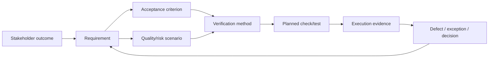
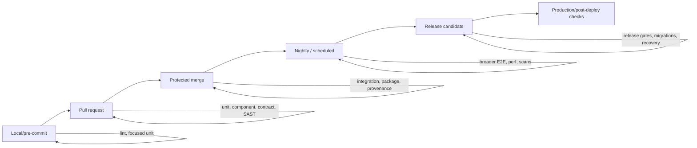
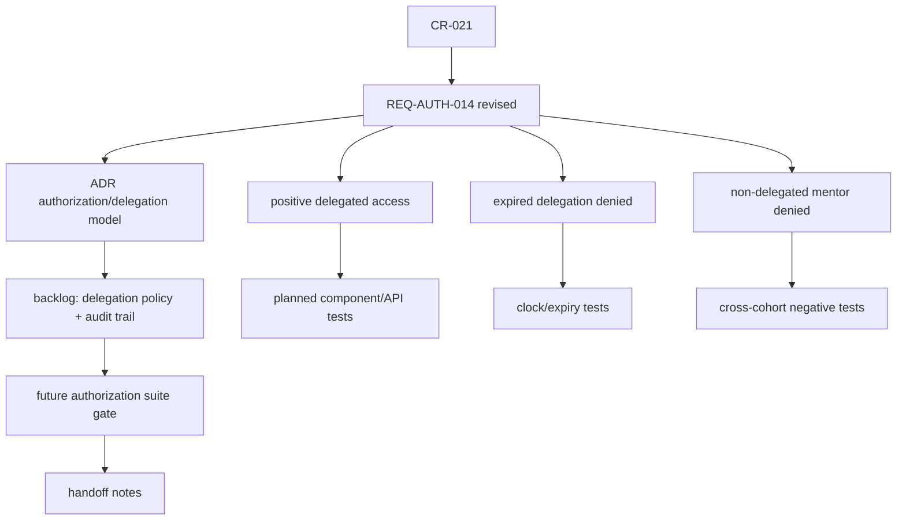

# Research 06 — Verification Strategy, Test Architecture & Delivery Readiness

> **Editorial review — 11 November 2026.** Revised from the original Deep Research report, preserving its research scope and examples. Previously missing inline references were checked and repaired where possible; unsupported empirical assertions were qualified or corrected. Bibliographic links are standalone URLs, not inaccessible session IDs. This is a research reference, not execution evidence. The editorial correction and verification records belong to the historical accompanying archive. The accepted [`PROJECT_CONVENTIONS.md`](https://drive.google.com/file/d/1EMvmx0or0fgv7hqKJarOmdt4e5kGKo_y/view), especially §§4–5 and §§9–10, governs Git handoff, implementation readiness, gameplay-test authorization and human release gates.


## Foundations: what can be verified before implementation

The central design principle for an SDD bootstrap is that **verification planning is not verification evidence**. Before implementation, a bootstrap process can credibly produce testable requirements, acceptance criteria, verification methods, risk models, test inventories, environment assumptions, trace links, review decisions and future quality gates. It cannot truthfully claim that executable tests pass, that coverage has been achieved, that a build is reproducible, that a vulnerability scan is clean or that a release is safe. ISO/IEC/IEEE 29119 explicitly treats test documentation as outputs of test processes, while IEEE 1012 frames verification and validation as activities that may include analysis, review, inspection, assessment and testing. This leaves substantial room for useful pre-implementation verification, but not for inventing execution evidence. ([ISO 29119-1:2022](https://www.iso.org/standard/81291.html); [IEEE 1012-2024](https://standards.ieee.org/ieee/1012/7324/))

A useful terminology baseline is to reserve **verification** for determining whether a work product conforms to its specification and **validation** for determining whether it satisfies stakeholder needs. ISTQB uses essentially those definitions, while acceptance testing is specifically tied to deciding whether an authorized stakeholder can accept a system against agreed criteria. ([ISTQB glossary verification](https://glossary.istqb.org/en_US/term/verification); [ISTQB glossary validation](https://glossary.istqb.org/en_US/term/validation); [ISTQB glossary acceptance testing](https://glossary.istqb.org/en_US/term/acceptance-testing))

For an SDD bootstrap, the following distinctions should therefore be explicit:

| Concept | Question | Bootstrap can produce | Requires implementation/execution |
|---|---|---|---|
| Validation | Are we specifying the right thing? | stakeholder reviews, examples, prototypes, acceptance authority | sometimes user trials |
| Verification | Are specified artifacts internally correct and conformant? | reviews, linting, trace checks, model analysis | many dynamic checks |
| Testing | Does an implementation behave as expected when exercised? | test design and planned cases | **yes** |
| Acceptance | May the authorized party accept this outcome? | criteria and approvers | usually final evidence |
| Assurance | How strong is our justified confidence? | assurance argument structure | depends on evidence gathered |
| Static verification | What can be checked without running the product? | specification review, schema/model analysis, source linting when source exists | some tooling may execute analyzers |
| Dynamic verification | What happens when the system executes? | strategy only | **yes** |

ISO/IEC/IEEE 29148 remains the current published requirements-engineering standard as of November 11, 2026, although ISO lists a third-edition Draft International Standard intended to replace the 2018 edition. ISO/IEC 25010:2023 defines a nine-characteristic product-quality model that can be used when structuring quality requirements. ISO/IEC/IEEE 29119 provides general testing concepts, test processes, documentation and test-design techniques; most full ISO/IEEE standards are paywalled, so a bootstrap Skill should cite public abstracts or licensed organizational copies rather than pretending to reproduce normative text. ([ISO 29148:2018](https://www.iso.org/standard/72089.html); [ISO DIS 29148](https://www.iso.org/standard/94091.html); [ISO 25010:2023](https://www.iso.org/standard/78176.html))

Security verification should likewise distinguish requirements from evidence. NIST SSDF 1.1 is a risk-oriented secure-development framework intended to integrate secure practices into different SDLC models rather than prescribe one development method. OWASP ASVS 5.0.0, released May 30, 2025, provides structured application-security verification requirements, while the OWASP API Security Top 10 2023 is an awareness/risk model rather than a comprehensive verification standard. WCAG 2.2 remains a W3C Recommendation, with W3C encouraging use of the latest WCAG 2 version. ([NIST SSDF 1.1](https://csrc.nist.gov/pubs/sp/800/218/final); [OWASP ASVS 5.0.0](https://asvs.owasp.org/); [OWASP API Top 10 2023](https://owasp.org/API-Security/editions/2023/en/0x00-header/))

### Readiness terminology

The term **delivery readiness** is dangerously overloaded. A bootstrap should avoid it unless qualified. A more precise state model is:

| State | Meaning |
|---|---|
| **Discovery-ready** | enough context exists to continue elicitation |
| **Specification-ready** | requirements are sufficiently coherent for structured review |
| **Implementation-ready** | agreed scope and acceptance criteria, proportionate architecture and verification, a verified authorized Git handoff, and **at least one genuinely unblocked implementation task** permit responsible coding; a research spike alone does not qualify |
| **Test-ready** | implemented components plus fixtures/environments exist so planned tests can actually run |
| **Integration-ready** | component contracts and integration dependencies are available and verified sufficiently for integration |
| **Release-candidate-ready** | a candidate build exists and required release verification can be executed |
| **Release-ready** | authorized evidence satisfies the defined release policy |
| **Production-ready** | operational, security, recovery, observability and organizational conditions are demonstrably satisfied |
| **Operate-ready** | ownership, monitoring, incident response, rollback/recovery and support are established |

For SDD Bootstrap v0.1, the appropriate terminal status should be **Implementation Ready** only when all applicable acceptance conditions in the governing conventions are met, including an unblocked implementation task and verified handoff. Otherwise label the draft **incomplete / not implementation-ready**; never imply “Production Ready.”

A compact evidence-state vocabulary prevents accidental inflation of confidence:

```text
planned       check exists conceptually
drafted       artifact has been written but not approved
runnable      executable check exists and prerequisites are available
executed      check ran and produced evidence, regardless of outcome
passed        executed check satisfied its acceptance rule
failed        executed check violated its acceptance rule
blocked       check could not execute because a prerequisite failed
not_applicable check was reviewed and judged irrelevant
waived        authorized exception permits proceeding without satisfying the check
```

A waiver is therefore not a pass.

## From intent to verifiable evidence

A credible verification architecture begins with traceability rather than a list of tools. The desired chain is:



This chain aligns well with the distinction in IEEE 1012 between conformance to requirements and satisfaction of intended use, and with ISO/IEC/IEEE 29119’s separation of test process, documentation and design technique. ([IEEE 1012-2024](https://standards.ieee.org/ieee/1012/7324/); [ISO 29119-1:2022](https://www.iso.org/standard/81291.html))

A practical trace model should use stable identifiers, but not every sentence needs an ID. A small static site may need a dozen meaningful traces; a multi-tenant platform may need hundreds. The objective is **impact visibility**, not maximal link count.

A portable minimal schema might be:

```yaml
requirement:
  id: REQ-AUTH-004
  statement: >
    A mentor shall not access portfolio items belonging
    to students outside the mentor's assigned cohort.
  source:
    type: stakeholder_decision
    ref: DEC-2026-014
  status: approved
  acceptance:
    - id: AC-AUTH-004-A
      criterion: >
        Given a mentor authenticated for cohort A,
        when the mentor requests a portfolio from cohort B,
        access is denied without exposing portfolio content.
  risks:
    - RISK-SEC-012
  verification:
    - id: VER-AUTH-004
      method: dynamic_authorization_test
      lifecycle_state: planned
      future_evidence_required: true
```

This does not claim that authorization works. It says what must later prove that it works.

### Repairing an untestable requirement

Consider:

> “The application should be fast and intuitive.”

This is unsuitable as an acceptance requirement because neither *fast* nor *intuitive* has a defined observation or authority. ISO/IEC 25010 provides quality categories but does not choose application-specific thresholds for a project. Those thresholds must come from stakeholders, constraints or validated baselines rather than being invented by the bootstrap. ([ISO 25010:2023](https://www.iso.org/standard/78176.html))

A repaired version might become:

> **REQ-UX-007:** First-time students shall be able to publish an existing portfolio draft without mentor assistance.

Acceptance criterion:

> During an approved usability evaluation with the target participant profile, the participant can locate and complete the publish workflow. The acceptable completion rate and time threshold remain **TBD-APPROVAL** until agreed by the product owner and usability reviewer.

The bootstrap can identify that a measurable threshold is missing without fabricating one.

### Structured specifications and executable forms

Different verification representations solve different problems:

| Technique | Best use | Bootstrap value | Main failure mode |
|---|---|---|---|
| Structured natural language / EARS | precise behavioral requirements | very high | apparent precision can hide domain ambiguity |
| Examples + counterexamples | boundary clarification | very high | examples can under-specify general behavior |
| BDD / Given–When–Then | stakeholder-readable scenarios | high | turns into verbose test scripting |
| Decision tables | combinations of rules | high | combinatorial growth |
| State machines | lifecycle/protocol behavior | high | omitted states/transitions |
| Property-based specification | invariant-rich domains | medium/high | weak generators or weak properties |
| Contract/schema specification | service boundaries | very high for APIs/events | schema conformance ≠ behavioral compatibility |
| Model-based testing | stateful/protocol systems | conditional | model construction cost |
| Metamorphic testing | oracle-poor problems | conditional | incorrect metamorphic relations |
| Differential testing | equivalent implementations/models | conditional | correlated implementations |
| Formal models such as TLA+ | concurrency, distributed invariants | selective | expertise and abstraction cost |
| Snapshot/golden tests | stable structured/rendered outputs | selective | normalizes unintended change |

Property-based testing has long been used to formulate properties and generate many inputs, including state-machine approaches for stateful systems. Metamorphic testing is useful where exact expected outputs are difficult to specify by checking relations across transformed inputs instead. Formal methods can be disproportionately valuable for concurrency and distributed-system designs; published AWS experience with TLA+ described finding subtle design defects before implementation, but that experience should not be generalized into a requirement that ordinary CRUD applications use formal methods. ([Newcombe et al. — Use of Formal Methods at AWS (2014)](https://lamport.azurewebsites.net/tla/formal-methods-amazon.pdf); [Hypothesis — Rule-based State Machines](https://hypothesis.readthedocs.io/en/latest/stateful.html))

For a requirement such as:

> “Submitting the same payment-confirmation event multiple times must not create duplicate ledger entries.”

Possible representations are:

```gherkin
Given confirmation event E has already been accepted
When E is received again with the same idempotency key
Then no additional ledger entry is created
And the response indicates the previously accepted outcome
```

Property form:

```text
For every event E and system state S:
apply(E, apply(E, S)) has the same ledger effect as apply(E, S)
```

State invariant:

```text
count(ledger_entries where idempotency_key = K) <= 1
```

Future executable test concept:

```text
generate valid event E
send E N times, including concurrent delivery
assert at most one durable ledger effect exists
```

The bootstrap should capture all four only when each adds useful information. Generating Gherkin, property tests, state models and formal specifications for every requirement would be process theatre.

### Traceability and change impact

A minimum relation vocabulary is enough for most bootstraps:

```text
derived_from
satisfies
constrains
verified_by
risks
depends_on
supersedes
blocks
waived_by
```

Impact analysis should be traversable in both directions. A requirement change should reveal affected acceptance criteria, ADRs, backlog items, planned tests and later evidence; a failed test should reveal the behavior or risk it was meant to verify.

A lightweight lint rule can detect common drift:

```pseudo
for requirement in approved_requirements:
    if requirement.risk != trivial:
        assert requirement.has_acceptance_criterion
        assert requirement.has_verification_method

for planned_check in verification_inventory:
    assert planned_check.traces_to_requirement_or_risk

for evidence in executed_evidence:
    assert evidence.commit_hash
    assert evidence.environment
    assert evidence.run_id
    assert evidence.result in {passed, failed, blocked}
```

## Risk-based test architecture and quality verification

There is no universally correct test pyramid. Unit-heavy pyramids, test trophies, honeycombs and sociable-test strategies are heuristics shaped by architecture, interfaces and failure economics. A bootstrap should decide **where confidence is cheapest and strongest**, not adopt one diagram as doctrine.

A useful decision model is:

\[
Priority \propto Impact \times Plausibility \times Uncertainty \times DetectionValue \div VerificationCost
\]

This is deliberately not a statistically validated probability formula. It is a prioritization heuristic. “Detectability” scores borrowed from FMEA can be useful, but numeric multiplication often creates false precision. For a small project, ordinal classes such as low/medium/high are usually more honest.

A practical selection procedure is:

1. Identify failures that would be unacceptable.
2. Trace them to requirements, boundaries and architecture assumptions.
3. Select the cheapest verification method capable of detecting each failure with adequate confidence.
4. Prefer independent checks where correlated failures are plausible.
5. Add broader/end-to-end checks only for behaviors that cannot be credibly verified below the system boundary.
6. Stop when remaining verification cost exceeds the value of additional confidence, unless regulation or safety requirements mandate more.

### Test portfolio by risk

| Verification type | Typical target | Bootstrap decision |
|---|---|---|
| Unit | local computation and invariants | plan when logic exists |
| Component | deployable/component behavior | useful for service/module boundaries |
| Integration | databases, queues, external systems | plan around high-risk interfaces |
| Contract | compatibility between consumers/providers | strong for API/event boundaries |
| End-to-end | critical whole-system journeys | few, high-value cases |
| Exploratory | unknown/creative/UX risk | explicitly reserve human sessions |
| Accessibility | semantic/UI access | automate + manual review |
| Performance | latency/throughput/resource use | derive only approved thresholds |
| Security | authorization, input handling, configuration | risk-based; align with ASVS/OWASP |
| Privacy | minimization, access, deletion, consent | evidence may require review + dynamic tests |
| Resilience | timeouts, retries, degraded mode | especially distributed systems |
| Recovery | backup/restore/migration/rollback | critical where durable data matters |
| Compatibility | browsers/devices/platforms | choose from supported matrix |
| Hardware-in-loop | firmware/device behavior | only embedded/IoT |
| Playtesting | enjoyment, difficulty, pacing | human creative evaluation |
| AI/ML evaluation | nondeterminism, distributional behavior | statistical/evaluation architecture, not single exact assertions |

OWASP ASVS can provide structured security-verification requirements for web applications and services; the OWASP API Top 10 highlights API risks including broken object-level authorization, broken authentication, resource consumption, SSRF and unsafe consumption of external APIs. These should inform threat-focused test design but not be treated as proof of security merely because a checklist was consulted. ([OWASP ASVS 5.0.0](https://asvs.owasp.org/); [OWASP API Top 10 2023](https://owasp.org/API-Security/editions/2023/en/0x00-header/))

WCAG conformance similarly cannot be reduced to a scanner. Automated checks are valuable for detectable violations, but many accessibility criteria require semantic or human judgment; the bootstrap should therefore define both automated and manual review responsibilities where accessibility matters. WCAG 2.2 is the latest WCAG 2 recommendation and is the version W3C recommends using. ([W3C WCAG 2.2](https://www.w3.org/TR/WCAG22/))

### Quality scenarios

Quality attributes should be specified as scenarios rather than adjectives:

```yaml
id: QS-PERF-003
attribute: performance
stimulus: burst of authenticated read requests
environment: normal production-like dependency latency
response: service remains responsive and returns correct data
measure:
  status: approval_required
  metric: p95 response latency
  threshold: TBD
authority: product_owner + technical_lead
verification:
  method: load_test
  state: planned
```

The important bootstrap behavior is leaving `threshold: TBD` rather than hallucinating “200 ms.”

### Failure-oriented verification

Risk discovery should deliberately search for:

- boundary values and equivalence classes;
- permissions crossed between users, roles or tenants;
- duplicate, late and reordered messages;
- retries after partial completion;
- clock skew and expiration;
- concurrent writes and races;
- timeouts and dependency degradation;
- stale caches;
- corrupt or missing data;
- rollback after partial migration;
- lost connectivity and resynchronization;
- backup restoration failure;
- misleading or privacy-leaking error messages.

Mutation testing can assess whether a test suite detects injected code changes, but its value and execution cost vary with the project, chosen mutations and tooling. It is therefore usually an escalation technique, not a bootstrap default. 

Chaos engineering and fault injection are similarly inappropriate for a brochure website but may become justified for distributed services whose requirements depend on degraded-mode behavior.

### Testability by design

Architecture can make later verification cheap or expensive. Useful testability properties include explicit module boundaries, injectable dependencies, controllable time and randomness, observable state transitions, deterministic fixtures, idempotent setup/teardown, reproducible environments and stable contracts. The bootstrap should recommend such seams only when tied to identified risk; introducing abstraction layers solely “for testability” without a concrete use can create unnecessary complexity.

Mocks and service virtualization are most valuable when they isolate external dependencies or reproduce otherwise expensive failure conditions. They become dangerous when tests merely confirm the behavior encoded into the mock. Contract tests can help reduce that gap. Pact, for example, describes consumer-driven contracts as executable examples of request/response expectations and distinguishes them from schema-only provider conformance. ([Pact official](https://docs.pact.io/))

### Test data, privacy and ethics

A bootstrap should prefer synthetic fixtures when realistic behavior can be represented without personal data. Pseudonymization and anonymization are distinct risk-reduction approaches, not guarantees against re-identification. Sensitive production records should never be embedded into prompts, generated ZIPs, fixtures or general-purpose agent context.

For Hackadō-like educational systems, student data should trigger explicit discovery of age, jurisdiction, guardian/consent requirements, identity model and retention rules rather than assuming either “all students are minors” or “none are minors.” Security and privacy controls should be proportional to actual data classes and legal obligations, not invented regulatory claims.

## Continuous verification, evidence governance and human–AI collaboration

A future CI architecture should optimize **fast feedback first**, while escalating cost and environment fidelity as changes approach release.



At bootstrap, this diagram is a **planned pipeline**. It is not evidence that any stage exists or succeeds.

NIST SSDF recommends secure-development practices integrated with the chosen lifecycle, while SLSA 1.2 defines supply-chain assurance levels and provenance concepts. SLSA defines provenance as verifiable information about where, when and how an artifact was produced; this is directly relevant to later build/test evidence, but a bootstrap ZIP without executed builds should not claim SLSA provenance. ([NIST SSDF 1.1](https://csrc.nist.gov/pubs/sp/800/218/final); [SLSA 1.2](https://slsa.dev/spec/v1.2/))

The SLSA Source track also distinguishes trusted people, trusted automation and untrusted contributors, and explicitly discusses source provenance and attestations such as test-result or vulnerability-scan attestations. This is useful for designing human–agent boundaries: an autonomous coding agent may propose changes or execute bounded checks, while merge approval or security exceptions can remain human-authorized. ([SLSA 1.2](https://slsa.dev/spec/v1.2/))

### Evidence manifest

Later execution evidence should be machine-readable enough to audit and compare:

```yaml
evidence_id: EVD-2026-00341
verification_id: VER-AUTH-004
status: failed
run:
  id: ci-9841
  timestamp: 2026-11-18T10:14:22Z
  commit: 3f2a9b7
  runner: linux-x86_64
  toolchain_lock: sha256:...
command: ./scripts/test authorization
environment:
  profile: integration
  dependency_set: compose-lock-7f91
test_data:
  classification: synthetic
artifacts:
  - report/junit.xml
  - logs/auth-test.log
defects:
  - BUG-174
review:
  human_required: true
```

Evidence records should be append-oriented or otherwise tamper-evident for high-assurance contexts, but ordinary projects need not create an audit ledger. The invariant that matters is that “passed” can be tied to a specific execution, code revision and environment.

### Human–AI review boundaries

LLMs can help produce test candidates, counterexamples and edge cases, but current research does not justify treating self-generated tests as independent proof that self-generated implementation is correct. A 2024 industrial study at Meta found that generated test improvements needed multiple quality filters, while a 2025 study of LLM-generated oracles found promising mutation scores but limitations on complex oracles. ([Molinelli et al. — Do LLMs Generate Useful Test Oracles? (ASE 2025)](https://doi.org/10.1109/ASE63991.2025.00031); [Alshahwan et al. — Automated Unit Test Improvement at Meta (FSE 2024)](https://discovery.ucl.ac.uk/id/eprint/10199775/))

More recent 2026 research specifically reports **error propagation** when the same or coupled LLM workflow generates faulty code and subsequent tests: in that study, tests generated after faulty code detected fewer faults than independently generated tests. The exact numerical results belong to that experiment and should not be universalized, but the underlying independence risk is directly relevant to agentic SDD. ([Konstantinou, Tambon & Papadakis — Coding Before Testing (2026 preprint)](https://arxiv.org/abs/2607.05139))

An industrial Meta study demonstrated that LLM-generated test improvements can be useful under filtering and engineering review, but only a subset of generated tests built, passed reliably or improved coverage. This supports a workflow in which agent-generated tests are candidates subject to execution and review, not authoritative evidence by generation alone. ([Alshahwan et al. — Automated Unit Test Improvement at Meta (FSE 2024)](https://discovery.ucl.ac.uk/id/eprint/10199775/))

A robust collaboration model is therefore:

```text
Agent A may implement.
Agent B may independently derive adversarial tests from the specification.
Automation executes both.
Human or explicitly authorized reviewer resolves:
  - requirement ambiguity,
  - acceptance authority,
  - security/privacy waivers,
  - release exceptions,
  - contested oracle correctness.
```

Independence does not require a different model/provider every time, but the bootstrap should avoid making the implementation itself the only source of truth for its tests.

Prompt injection also matters in software verification: issue text, documentation, test logs and external reports should be treated as untrusted data when consumed by an agent with tool permissions. Agents should not interpret instructions embedded in test fixtures or scanner output as authoritative workflow commands unless the orchestration layer explicitly permits that behavior.

### Tooling landscape as of November 11, 2026

A bootstrap Skill should select **capabilities before products**. The same need may be fulfilled through a library, CLI, API, hosted platform, MCP server or specialized agent skill. MCP availability should be treated only as an integration option; it is neither a quality signal nor an endorsement.

Representative current tools include:

| Need | Representative tool/capability | Current verification |
|---|---|---|
| Browser/E2E | Playwright | v1.65.0 listed as latest; Chromium, Firefox and WebKit projects supported ([Playwright official](https://playwright.dev/docs/intro)) |
| Consumer-driven contracts | Pact | code-first HTTP/message contract testing ([Pact official](https://docs.pact.io/)) |
| Load/performance | k6 | open-source performance/load tooling; GitHub releases showed active 2026 maintenance ([Grafana k6 official](https://grafana.com/docs/k6/latest/)) |
| Web DAST | OWASP ZAP | automation framework supports YAML-driven automation; current core metadata listed 2.17.0 in November 2026 ([OWASP ZAP official](https://www.zaproxy.org/)) |
| Dependency/container/IaC scanning | Trivy | v0.76.2 released November 5, 2026 with security fixes ([Trivy official](https://trivy.dev/latest/)) |
| Supply-chain assessment | OpenSSF Scorecard | automated checks for open-source-project security practices ([OpenSSF Scorecard](https://openssf.org/scorecard/)) |
| Supply-chain provenance | SLSA/in-toto-compatible attestations | SLSA specification 1.2 approved ([SLSA 1.2](https://slsa.dev/spec/v1.2/)) |

Tool choice should consider language fit, maintenance activity, license, offline/hosted requirements, reproducible installation, output formats, CI portability, secret requirements, security model and how easily another agent/provider can reproduce the check. Tool discovery should not result in installation, account creation or credential retrieval during bootstrap.

### Mandatory game/gamification gameplay-test exception (accepted v0.1)

Under [Project Conventions §5.2](https://drive.google.com/file/d/1EMvmx0or0fgv7hqKJarOmdt4e5kGKo_y/view), human playtesting campaigns and costly automated gameplay-oriented suites (full-run simulations, extensive physics traversal, balancing, playability and game-feel evaluation) **MUST run only on an identified, coherent, stable checkpoint of `dev` AND only after explicit human authorization for that campaign**. Do not launch them on unfinished topic branches or automatically after every feature. Narrow unit, static, component and build checks that are **not** gameplay testing may run at the appropriate feature gate. If a proposed check could be gameplay testing and its classification is uncertain, treat it as gameplay testing and ask for explicit human authorization. A CI trigger, completed feature, successful merge into `dev`, or generic approval of a test plan does **not** authorize a specific gameplay campaign.

Several completed features may accumulate on `dev` before a combined authorized gameplay campaign. If a human requests promotion from `dev` to `main` without gameplay verification, warn of unvalidated gameplay and release-regression risk **before** the merge, offer the option to test, and proceed only after the human explicitly accepts that risk and authorizes promotion. Record omitted checks, available evidence, stable source commit, human decision and release identifier in `docs/verification/` or `docs/UPDATES.md`. A waiver is never a passed test; automated tests do not prove subjective playability.
## Worked contrasting cases

### Solo static portfolio

**Known:** one owner, static public content, no privileged backend assumed.

**Unknown:** hosting provider, browser support matrix, analytics choice, accessibility target.

**Primary risks:** broken navigation, inaccessible markup, responsive-layout failures, accidental publication of private content, stale/broken links.

Representative requirement:

```text
REQ-NAV-002
Every portfolio project reachable from the home page shall
have a working return path to the primary navigation.
```

Verification design:

| Risk | Minimal check | Expanded only if needed |
|---|---|---|
| broken links | static link validation + browser smoke | scheduled external link checks |
| accessibility | semantic review + selected automated checks | manual screen-reader/keyboard pass |
| responsive layout | smoke at approved viewport classes | browser/device matrix |
| content integrity | owner review | snapshot comparison |
| regressions | minimal page/navigation E2E | visual regression if design is stable |

WCAG 2.2 can structure accessibility criteria, but a portfolio does not require enterprise-scale test management merely because accessibility is important. ([W3C WCAG 2.2](https://www.w3.org/TR/WCAG22/))

At bootstrap the repository may contain acceptance criteria and a planned smoke-test inventory. It must say:

```yaml
verification_status: planned
executed_tests: 0
release_status: not_assessed
```

A 200-test unit suite, mutation testing and formal modeling would be disproportionate unless the site evolves into a complex application.

### Hackadō multi-user portfolio platform

**Assumed scenario:** students publish portfolios; mentors review assigned cohorts; administrators manage organization-level configuration.

Critical unknowns include age profile, institutional tenancy, jurisdiction, content moderation, identity provider and whether mentors may access data across cohorts.

Representative security requirement:

```text
REQ-AUTH-014
A mentor shall access private student portfolio data only
for students within assignments explicitly authorized by the platform.
```

The risk is not merely “authentication”; it is broken object-level authorization and cross-tenant/cohort exposure, directly related to the class of risks highlighted by OWASP’s API Security Top 10. ([OWASP API Top 10 2023](https://owasp.org/API-Security/editions/2023/en/0x00-header/))

Minimal architecture:

| Layer | Planned verification |
|---|---|
| domain/unit | role/assignment policy logic |
| component/API | authorized and unauthorized object access |
| integration | identity + persistence boundaries |
| E2E | student publish / mentor review / denied cross-cohort path |
| accessibility | core student and mentor workflows |
| privacy | data inventory, retention/deletion criteria |
| human acceptance | student/mentor usability review |

High-risk escalation should include authorization matrix testing, adversarial identifier substitution, role transition tests, audit-log verification and tenant-boundary negative cases.

Acceptance authority should be split: product owner accepts user workflow; security owner accepts authorization controls; privacy/legal authority confirms applicable data rules; educators validate learning workflow. One stakeholder should not silently approve all dimensions.

### API-first integration service

Assume a service receives external events, transforms them and calls a third-party API.

Representative requirement:

```text
REQ-IDEM-006
Reprocessing an accepted source event with the same stable
event identifier shall not create more than one external side effect.
```

Architecture-level verification should include:

- schema/contract validation;
- idempotency properties;
- retry and timeout behavior;
- partial-failure simulation;
- authentication and secret handling;
- rate-limit behavior;
- provider error mapping;
- correlation IDs and observability;
- deterministic replay.

Contract testing is especially valuable at this boundary. Pact’s documentation distinguishes executable consumer/provider contracts from schemas alone, while OWASP specifically lists unsafe consumption of APIs as a 2023 API risk category. ([Pact official](https://docs.pact.io/))

Bootstrap artifacts might define:

```yaml
planned_checks:
  - id: VER-CONTRACT-01
    type: provider_contract
    status: planned
  - id: VER-IDEM-02
    type: property_based
    property: duplicate input => at-most-one side effect
    status: planned
  - id: VER-FAIL-03
    type: integration_fault_injection
    condition: provider_timeout_after_request_received
    status: planned
```

No external API credentials belong in the bootstrap ZIP.

### Offline-first mobile / creative / embedded system

Assume an offline-capable application stores local edits and synchronizes when connectivity returns.

Representative requirement:

```text
REQ-SYNC-011
Edits created while offline shall remain locally available
until synchronization completes or the user explicitly discards them.
```

This creates a stateful verification problem involving offline transitions, reordered updates, concurrent edits, duplicate delivery and conflict resolution. State-machine or property-based testing is more justified here than on the portfolio site. QuickCheck-style approaches demonstrate the applicability of state-machine property testing to stateful systems. ([Hypothesis — Rule-based State Machines](https://hypothesis.readthedocs.io/en/latest/stateful.html))

Test portfolio:

| Risk | Verification |
|---|---|
| lost offline edit | local persistence component test |
| conflicting edits | model/state-machine scenarios |
| repeated sync | idempotency property |
| network flapping | fault-injection integration test |
| device/platform difference | platform matrix |
| hardware dependency | hardware-in-loop where applicable |
| creative quality | exploratory/playtesting by humans |
| migration | upgrade fixture + rollback/recovery checks |

For a game or creative product, “fun,” pacing or aesthetic coherence cannot be replaced by automated correctness tests. The bootstrap should explicitly reserve human playtesting/creative review rather than forcing subjective goals into bogus numeric metrics.

### Change-request propagation example

Suppose Hackadō receives:

> **CR-021:** mentors may temporarily review students outside their cohort when explicitly delegated by an administrator for a defined period.

Impact propagation:



New risks include stale delegation, clock boundary errors, unauthorized delegation creation and missing audit evidence. A well-traced verification architecture reveals these consequences without requiring implementation to exist.

## Reusable assets, governance and evaluation

A bootstrap should create only artifacts that carry information. `docs/TEST_PLAN.md` is justified when enough verification decisions exist that burying them in `docs/PRD.md` or `docs/BACKLOG.md` would reduce clarity. Tiny projects may keep a five-line verification section in the README or specification instead.

### Minimal `docs/TEST_PLAN.md`

```markdown
# Verification Strategy

## Scope
What must be verified and what is explicitly excluded.

## Critical Risks
- RISK-...

## Planned Verification
| ID | Requirement/Risk | Method | Level | Owner | State |
|----|------------------|--------|-------|-------|-------|

## Acceptance Authority
Who may approve which outcomes.

## Environments and Data
Required future environments, fixtures and prohibited data.

## Evidence Policy
Required metadata for executed checks.

## Bootstrap Status
No dynamic verification has been executed unless evidence records are linked here.
```

### Acceptance-criterion template

```yaml
id: AC-...
requirement: REQ-...
given:
when:
then:
negative_cases: []
authority:
verification_method:
threshold_source:
status: draft
```

### Planned test record

```yaml
id: TEST-...
traces_to: [REQ-..., RISK-...]
purpose:
level:
type:
preconditions:
inputs:
oracle:
negative_cases:
data_classification: synthetic
environment:
automation_candidate: true
state: planned
```

### Quality-gate policy

```yaml
gates:
  topic_to_dev:
    required_when_applicable:
      - static_checks
      - relevant_unit_tests
      - relevant_contract_tests
    advisory:
      - expensive_non_gameplay_quality_analysis
    gameplay_campaigns: prohibited_without_stable_dev_and_human_authorization

  stable_dev_gameplay_campaign:
    prerequisites:
      - identified_coherent_stable_dev_commit
      - explicit_human_authorization_for_this_campaign
    planned_when_approved:
      - human_playtesting_or_costly_gameplay_suite

  dev_to_main:
    explicit_human_promotion_authorization: true
    if_gameplay_unverified: warn_offer_testing_and_record_accepted_risk
    required_when_applicable:
      - critical_e2e
      - security_verification
      - accessibility_review
      - migration_check
      - recovery_check
      - approved_performance_thresholds

policy:
  planned_is_never_equivalent_to_passed: true
  waiver_requires_authority: true
  blocked_is_never_equivalent_to_passed: true
  tests_passing_do_not_authorize_release: true
```
### CI pseudo-YAML

```yaml
pipeline:
  pull_request:
    - restore_pinned_toolchain
    - lint
    - unit
    - component_or_contract
    - security_static_checks_if_applicable

  protected_merge:
    - package
    - integration
    - record_evidence

  scheduled:
    - broader_e2e
    - dependency_security_review
    - selected_performance_checks

  release_candidate:
    - verify_release_policy
    - verify_migration_if_applicable
    - verify_recovery_if_applicable
    - produce_provenance_if_configured
```

Again, this is a future architecture, not a report of a successful pipeline. Scheduled or pull-request CI must **not** trigger gameplay campaigns outside the authorized stable-`dev` checkpoint rule; `release_candidate` checks do not themselves authorize promotion to `main`.

### Readiness record

The following record is **fictional illustrative data**; its `approved: true` flags, counts and dates do not describe any actual generated project or verified Git handoff. A real bootstrap must include the selected ZIP/personal-GitHub channel, truthful commit/branch evidence and an approved, unblocked implementation task.

```yaml
bootstrap_readiness:
  state: implementation_ready
  reviewed_at: 2026-11-11
  requirements:
    approved: true
    unresolved:
      - REQ-PERF-008 threshold awaiting stakeholder approval
  architecture:
    consequential_decisions_reviewed: true
  verification:
    strategy_reviewed: true
    planned_checks_count: 31
    executed_checks_count: 0
  risks:
    open_high:
      - RISK-AUTH-004
  implementation:
    started: false
  release:
    assessed: false
```

This type of record makes truthful handoff much stronger than a vague “ready” badge.

### Pilot evaluation and falsification

The v0.1 Skill should be evaluated by trying to prove its verification process **wrong**, not merely checking whether users like the generated documentation. Proposed metrics are hypotheses, not empirical results.

Useful measurements include:

| Metric | What it tests |
|---|---|
| requirements with meaningful acceptance criteria | specification testability |
| ambiguous requirement detection | elicitation quality |
| negative cases discovered | failure orientation |
| planned checks later judged useful | planning precision |
| tests later deleted as pointless | test-plan bloat |
| false “passed/ready” statements | evidence honesty |
| requirements with orphaned tests | trace quality |
| tests with no requirement/risk rationale | unnecessary verification |
| cross-agent handoff accuracy | portability |
| independent reviewer disagreement | hidden ambiguity |
| environment reproduction success | reproducibility |
| human correction time | practical workload |
| token/time cost | economic proportionality |
| later defects mapped to missed risks | blind-spot discovery |

Failure-injection experiments should include intentionally ambiguous requirements, missing acceptance authority, conflicting stakeholder criteria, planted cross-tenant security risks, unreachable performance targets, fake “all tests passed” text in an issue, stale trace links, an outdated test plan, malicious instructions embedded in test logs and a requirement change whose affected tests are deliberately left unchanged.

A strong bootstrap should detect or surface those conditions rather than produce a cosmetically complete package.

Research on LLM testing suggests both potential and significant limitations: generated tests can be useful, industrial deployments can produce accepted improvements, but correctness problems, weak path coverage and correlated implementation/test errors remain empirically documented concerns. ([Molinelli et al. — Do LLMs Generate Useful Test Oracles? (ASE 2025)](https://doi.org/10.1109/ASE63991.2025.00031); [Alshahwan et al. — Automated Unit Test Improvement at Meta (FSE 2024)](https://discovery.ucl.ac.uk/id/eprint/10199775/); [Konstantinou, Tambon & Papadakis — Coding Before Testing (2026 preprint)](https://arxiv.org/abs/2607.05139))

### Annotated source guide and freshness protocol

The strongest long-lived reference set is:

- **ISO/IEC/IEEE 29148** for requirements engineering; note that the 2018 edition remains current while the third edition is in DIS stage as of November 2026. ([ISO 29148:2018](https://www.iso.org/standard/72089.html); [ISO DIS 29148](https://www.iso.org/standard/94091.html))
- **ISO/IEC/IEEE 29119** for software-testing concepts, processes, documentation and test techniques. ([ISO 29119-1:2022](https://www.iso.org/standard/81291.html))
- **IEEE 1012-2024** for verification and validation across system/software/hardware life cycles. ([IEEE 1012-2024](https://standards.ieee.org/ieee/1012/7324/))
- **ISO/IEC 25010:2023** for product-quality characteristics. ([ISO 25010:2023](https://www.iso.org/standard/78176.html))
- **NIST SSDF 1.1** for risk-based secure-development practices. ([NIST SSDF 1.1](https://csrc.nist.gov/pubs/sp/800/218/final))
- **OWASP ASVS 5.0.0** for application-security verification requirements and **OWASP API Security Top 10 2023** for API risk awareness. ([OWASP ASVS 5.0.0](https://asvs.owasp.org/); [OWASP API Top 10 2023](https://owasp.org/API-Security/editions/2023/en/0x00-header/))
- **WCAG 2.2** for web accessibility requirements. ([W3C WCAG 2.2](https://www.w3.org/TR/WCAG22/))
- **SLSA 1.2** for software-supply-chain provenance and assurance terminology. ([SLSA 1.2](https://slsa.dev/spec/v1.2/))
- Empirical software-testing research for property-based testing, metamorphic testing, mutation testing, formal methods and LLM-generated tests. ([SLSA specification (contextual source)](https://slsa.dev/spec/v1.2/))

Tool documentation and security guidance are volatile. The Skill should therefore record `verified_at`, source URL/reference, version where available, and a freshness class. Security scanners, CI providers, browser tooling and agent integrations should be rechecked at bootstrap execution time rather than frozen into the Skill’s knowledge indefinitely. The 2026 release metadata for Playwright, ZAP and Trivy illustrates how quickly concrete versions change. ([Playwright official](https://playwright.dev/docs/intro); [OWASP ZAP official](https://www.zaproxy.org/); [Trivy official](https://trivy.dev/latest/))

## Implications for SDD Bootstrap Skill v0.1

The Skill should adopt a **minimal verification protocol** consisting of: identify consequential risks; make requirements testable; assign acceptance authority; derive at least one meaningful verification method for every non-trivial requirement or risk; record negative cases; classify planned checks by lifecycle stage; define required future evidence; and end bootstrap with an explicit statement that dynamic verification has not occurred unless evidence actually exists.

Its completed output should be **Implementation Ready**, never “Production Ready.” “Implementation Ready” requires coherent approved requirements, explicit unresolved assumptions, architecture decisions sufficient to implement, a traceable `docs/BACKLOG.md`, proportionate verification, testable acceptance criteria, ownership, an honest risk register, an authorized and verified Git baseline (`main`/`dev`, truthful initial commit), and **at least one sufficiently specified, genuinely unblocked implementation task**. A research spike alone does not satisfy this gate; otherwise the result is an incomplete draft. It should not require fabricated test files, fake CI badges or empty governance documents.

Escalation should be conditional. A static portfolio may need accessibility, navigation, responsive and content-integrity checks. Multi-user systems add authorization and privacy verification. External integrations add contract, retry, idempotency and dependency-failure checks. Durable-data systems add migration, backup and restore verification. Distributed or concurrent systems may justify state modeling, fault injection or formal methods. Safety-, financial- or legally sensitive systems should escalate further according to applicable standards and professional review.

Every verification object should carry a state such as `planned`, `drafted`, `runnable`, `executed`, `passed`, `failed`, `blocked`, `not_applicable` or `waived`. The Skill should enforce the invariant:

```text
planned ≠ runnable
runnable ≠ executed
executed ≠ passed
waived ≠ passed
absence of evidence ≠ success
```

Human review gates should remain mandatory for consequential requirement changes, acceptance authority, security/privacy exceptions, disputed test oracles, waivers and claims of release or production readiness. Agents can draft tests, design adversarial cases, inspect traceability and execute authorized checks, but self-generated implementation plus self-generated tests must not be treated as independent assurance. Current empirical evidence supports using LLMs as test-generation collaborators while maintaining execution, independent review and provenance controls. ([Molinelli et al. — Do LLMs Generate Useful Test Oracles? (ASE 2025)](https://doi.org/10.1109/ASE63991.2025.00031); [Konstantinou, Tambon & Papadakis — Coding Before Testing (2026 preprint)](https://arxiv.org/abs/2607.05139))

The smallest useful reusable asset set is therefore not a fixed folder tree but a set of information concepts: **acceptance criteria, verification inventory, risk-to-check mapping, evidence-state semantics, acceptance authority, test-data policy, future quality gates and handoff status**. These may live inside existing documents for small projects and become dedicated `TEST_PLAN`, verification manifests or evidence directories only when scale justifies them.

The most important v0.1 pilot hypotheses are that explicit evidence states reduce false-green claims; risk-derived tests produce less bloat than generic test pyramids; independent agent review finds more negative cases than same-agent self-review; stable requirement/check IDs reduce change-impact omissions; and smaller projects benefit when the Skill actively chooses **not** to generate unnecessary testing infrastructure. These are proposed hypotheses and require empirical pilot evaluation.

The major open questions are how much independence between implementation and verification agents is economically worthwhile; which traceability granularity yields the best signal-to-maintenance ratio; when a dedicated `TEST_PLAN.md` becomes preferable to embedded verification sections; which readiness gates should become machine-lintable; how to preserve evidence portability across CI providers; and how much verification architecture can be specified before implementation without causing premature design lock-in.

The governing rule for SDD Bootstrap v0.1 should therefore be:

> **Bootstrap designs the argument for future confidence; implementation and execution must later supply the evidence.**

## Source provenance and limitations

**Final editorial pass (11 November 2026).** Legacy Deep Research result identifiers have been removed because they cannot be resolved from a standalone Markdown export. Where possible, affected assertions now cite independently located, relevant primary publications or official specifications. If a specific empirical claim could not be supported, it was rewritten or qualified rather than assigning a different study as though it were the missing original. Broad design guidance may be an editorial synthesis rather than a direct quotation from a standard.

This review includes source checks for the assertions repaired here, consistency fixes, static formatting inspection and parsing of extractable YAML/JSON examples. It is **not** a claim that all historical citations have been exhaustively rechecked, that all linked pages will remain reachable, or that any described software, CI, API, migration, security control or deployment was implemented and tested. Publication and product versions are an as-of snapshot and should be refreshed before decisions that depend on them.

For the change log and exact validation scope, consult the adjacent `CORRECTIONS.md` and `VERIFICATION_REPORT.md` in this research bundle.